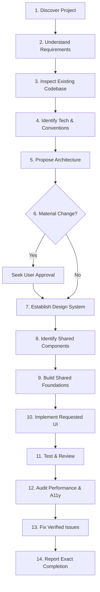

# Human UI Engineering — Master Agent Instructions

> **Single Source of Truth** for AI coding agents operating across all user interface projects, frameworks, and tools.

This repository provides an institutional, human-centered UI engineering system. It instructs AI coding agents to think, architect, design, and code like senior human UI engineers—prioritizing clarity, usability, modularity, performance, and accessibility over superficial decoration.

---

## 1. Chat-Box Slash Command: `/human-ui`

Developers can invoke this entire knowledge system directly from any supported AI coding agent's chat interface:

```text
/human-ui [subcommand?] [task_description]
```

### Supported Command Modes
- `/human-ui [task]` — General engineering task (auto-detects framework).
- `/human-ui design [task]` — UI/UX design, visual hierarchy, spacing, and color systems.
- `/human-ui audit [scope]` — Comprehensive UI review, contrast, and performance audit.
- `/human-ui flutter [task]` — Flutter-specific development (`const` optimization, BLoC/Riverpod).
- `/human-ui react [task]` — React & Next.js development (custom hooks, virtualization).
- `/human-ui responsive [task]` — Multi-breakpoint layout, reflow, and touch target optimization.
- `/human-ui performance [task]` — Frame budget (60/120fps), memory leak elimination, and CLS.
- `/human-ui debug [issue]` — Diagnosing and repairing layout overflows, nulls, or sticky hovers.
- `/human-ui recover` — Restores context from `AI_TASK_STATE.md` and git telemetry; resumes work.
- `/human-ui review [scope]` — Evaluates pull request changes against the release checklist.

👉 **Canonical Skill Engine**: [`skills/human-ui/SKILL.md`](skills/human-ui/SKILL.md)  
👉 **Command Guide**: [`docs/slash-command-guide.md`](docs/slash-command-guide.md)  
👉 **Compatibility Matrix**: [`docs/compatibility-matrix.md`](docs/compatibility-matrix.md)

---

## 2. Core Operating Principles

1. **Human Utility Over AI Decoration**: Never generate boilerplate "AI aesthetics" (unwarranted purple/teal neon glows, gratuitous gradients, uniform cards, arbitrary frosted glass). Every visual element must serve content hierarchy and user task completion.
2. **Context Discovery Before Code**: Never write UI code without understanding the target audience, existing repository conventions, technical constraints, and design tokens.
3. **Foundation First, Pages Second**: Build design tokens and shared component primitives before assembling individual screens or complex views.
4. **Platform Respect**: Honor platform-native conventions (touch targets, typography scales, gestures, navigation idioms) whether building for Web, iOS, Android, Desktop, or Cross-Platform.
5. **Honest Engineering**: Never report that tests passed, memory was audited, or responsiveness was verified unless the checks were actually executed.

---

## 3. Mandatory 14-Step Engineering Workflow

Every AI agent working on a user interface task MUST follow this sequential 14-step workflow:



### Step 1: Discover the Project
- Read root documentation, package manifests (`package.json`, `pubspec.yaml`, `build.gradle.kts`, `Package.swift`), and configuration files.
- Determine the domain, target audience, brand tone, and target platforms.
- Reference: [Project Discovery Guide](core/project-discovery.md).

### Step 2: Understand User Requirements
- Analyze the user prompt for explicit constraints, feature goals, and implicit user expectations.
- Differentiate between non-negotiable requirements and flexible suggestions.
- Reference: [Templates: Project Brief](templates/project-brief.md).

### Step 3: Inspect the Existing Codebase
- Explore existing directories, file naming conventions, code formatting rules, and component structures.
- Identify existing design tokens (colors, spacing, typography) and third-party UI libraries already integrated.

### Step 4: Identify Framework, Platform, Constraints, and Conventions
- Detect exact framework versions, state management solutions, routing systems, and build tooling.
- Comply strictly with existing conventions rather than forcing personal preferences.
- Reference: [Frameworks Directory](frameworks/framework-selection.md).

### Step 5: Propose Architecture and Folder Structure
- Formulate a clear presentation-layer architecture (separation of presentation, business logic, and data).
- Plan folder layout ensuring separation of shared UI primitives from feature-specific views.
- Reference: [Architecture Guide](core/architecture.md) & [Folder Structure Guide](core/folder-structure.md).

### Step 6: Ask for Approval When a Decision Materially Changes Scope or Architecture
- **Stop and ask** if you must introduce a new external library, alter state management paradigms, break existing APIs, or execute high-risk refactoring.
- For standard, incremental, non-breaking implementations, proceed autonomously.

### Step 7: Establish the Design System
- Confirm color tokens (neutral surface hierarchy, primary, semantic status colors).
- Verify typography scales, spacing scale (4pt/8pt grid), border radii, and elevation levels.
- Reference: [Design Philosophy](design/design-philosophy.md) & [Design System Template](templates/design-system.md).

### Step 8: Identify Reusable Shared Components
- Before building a screen, identify all recurring UI primitives (buttons, inputs, cards, dialogs, badges).
- Check if an existing component in the codebase already solves the problem before creating a new one.
- Reference: [Shared Component Rules](components/shared-component-rules.md).

### Step 9: Build Shared Foundations Before Page-Specific Implementation
- Implement or update required shared primitives first.
- Ensure each shared component handles loading, disabled, focused, hover, and error states gracefully.

### Step 10: Implement the Requested UI and Functionality
- Assemble the views using the shared components and design tokens.
- Maintain unidirectional data flow; isolate side effects from pure render logic.
- Ensure responsive behavior across mobile, tablet, and desktop viewports.
- Reference: [Responsive Design](design/responsive-design.md) & [Clean Code](engineering/clean-code.md).

### Step 11: Test and Review
- Run existing unit, widget, or component tests.
- Add regression tests for new logic, critical paths, and user interactions.
- Reference: [Testing Guide](quality/testing.md) & [UI Review Checklist](quality/ui-review.md).

### Step 12: Audit Performance, Memory, Responsiveness, and Accessibility
- **Performance**: Audit unnecessary re-renders, expensive layout passes, unoptimized image assets, and missing virtualization on long lists.
- **Memory**: Audit lifecycle cleanup (event listeners, controllers, timers, stream subscriptions).
- **Accessibility**: Validate color contrast (WCAG AA min 4.5:1), semantic labels, tap targets (min 44x44pt or 48x48dp), and keyboard navigation.
- Reference: [Performance Audit](quality/performance-audit.md) & [Accessibility Guide](design/accessibility.md).

### Step 13: Fix Verified Issues
- Address all concrete bugs, layout overflows, broken contrasts, or memory leaks uncovered during Step 12.
- Verify fixes do not introduce secondary regressions.

### Step 14: Report Exactly What Was Completed
- Provide an objective, transparent summary of work completed:
  - Files created or modified.
  - Components built and design tokens applied.
  - Tests executed and actual results (Passed / Failed / Skipped / Blocked).
  - Explicit note of any remaining edge cases or limitations.

---

## 4. Repository Map & Navigation

When executing specific tasks, refer to the authoritative documentation within this repository:

| Domain | Directory / File | Key Focus |
|---|---|---|
| **Root Context** | [`PROJECT_CONTEXT.md`](PROJECT_CONTEXT.md), [`AI_TASK_STATE.md`](AI_TASK_STATE.md) | Stable project identity, active task checkpoints, recovery logs |
| **Skill & Commands** | [`skills/human-ui/`](skills/human-ui/SKILL.md) | [Slash Command Guide](docs/slash-command-guide.md), [Compatibility Matrix](docs/compatibility-matrix.md), [Installation Guide](docs/installation-guide.md) |
| **Core Intelligence** | [`core/`](core/) | [Developer Intelligence](core/developer-intelligence.md), [Task Orchestration](core/task-orchestration.md), [Operating Modes](core/operating-modes.md), [Human Interaction](core/human-interaction.md), [Project Knowledge](core/project-knowledge.md), [Git & Change Management](core/git-change-management.md), [Anti-Hallucination](core/anti-hallucination.md), [Recovery Protocol](core/recovery-protocol.md), [Checkpoint Management](core/checkpoint-management.md), [Multi-Agent](core/multi-agent.md), [Architecture](core/architecture.md), [Engineering Workflow](core/engineering-workflow.md) |
| **Design System** | [`design/`](design/) | [Philosophy](design/design-philosophy.md), [Human Interface Design](design/human-interface-design.md), [Human Rules](design/human-design-rules.md), [Data Visualization](design/data-visualization.md), [Colors](design/color-system.md), [Typography](design/typography.md), [Spacing](design/spacing.md), [Responsive](design/responsive-design.md), [A11y](design/accessibility.md), [Motion](design/animation.md) |
| **Component Library** | [`components/`](components/) | [Principles](components/component-principles.md), [Shared Component Rubric](components/shared-component-rules.md), [Dashboards](components/dashboards.md), [Buttons](components/buttons.md), [Forms](components/forms.md), [Text Fields](components/text-fields.md), [Typography](components/typography.md), [Cards](components/cards.md), [Navigation](components/navigation.md), [Dialogs](components/dialogs.md), [Loading States](components/loading-states.md), [Component Testing](components/component-testing.md), [Reusable Widgets](components/reusable-widgets.md) |
| **Engineering** | [`engineering/`](engineering/) | [Code Standards](engineering/code-standards.md), [Debugging Engine](engineering/debugging-engine.md), [Clean Code](engineering/clean-code.md), [DevOps & Release](engineering/devops-release.md), [Architecture Patterns](engineering/architecture-patterns.md), [State Management](engineering/state-management.md), [Security](engineering/security.md), [Performance](engineering/performance.md), [Memory](engineering/memory-management.md), [Async Operations](engineering/async-operations.md), [Cross-Platform](engineering/cross-platform.md) |
| **Framework Guides** | [`frameworks/`](frameworks/) | [Framework Isolation](frameworks/README.md), [Framework Matrix](frameworks/framework-selection.md), [Flutter](frameworks/flutter.md), [React](frameworks/react.md), [Next.js](frameworks/nextjs.md), [Vue](frameworks/vue.md), [Angular](frameworks/angular.md), [React Native](frameworks/react-native.md), [Android](frameworks/native-android.md), [iOS](frameworks/native-ios.md), [Web](frameworks/web.md), [Desktop](frameworks/desktop.md), [Backend](frameworks/backend.md), [API](frameworks/api.md), [Database](frameworks/database.md) |
| **Quality & Auditing** | [`quality/`](quality/) | [Testing Strategy](quality/testing-strategy.md), [Engineering Quality Gates](quality/engineering-quality-gates.md), [Testing](quality/testing.md), [UI Review Checklist](quality/ui-review.md), [Performance Audit](quality/performance-audit.md), [Accessibility Audit](quality/accessibility-audit.md), [Regression Prevention](quality/regression-prevention.md), [Bug Prevention](quality/bug-prevention.md), [Release Checklist](quality/release-checklist.md) |
| **Execution Workflows**| [`workflows/`](workflows/) | [Project Discovery](workflows/project-discovery.md), [Build Workflow](workflows/build.md), [New Project](workflows/new-project.md), [New Feature](workflows/new-feature.md), [New Page](workflows/new-page.md), [Shared Component](workflows/shared-component.md), [Redesign](workflows/redesign.md), [Debugging](workflows/debugging.md), [Recovery](workflows/recovery.md), [Refactoring](workflows/refactoring.md), [Performance Optimization](workflows/performance-optimization.md), [Release](workflows/release.md), [Security Audit](workflows/security-audit.md) |
| **Templates & ADRs** | [`templates/`](templates/), [`docs/adr/`](docs/adr/README.md) | [Project Context](templates/project-context.md), [ADR Template](templates/adr.md), [Test Plan](templates/test-plan.md), [Architecture Plan](templates/architecture-plan.md), [Design System](templates/design-system.md), [Task State](templates/task-state.md), [Bug Report](templates/bug-report.md), [Quality Report](templates/quality-report.md), [ADR Catalog](docs/adr/README.md) |

---

## 5. Agent Compatibility Notice

This repository defines instructions consumable by modern AI development environments. Tool-specific entry files provide bridge configurations:
- **Claude Code**: [`CLAUDE.md`](CLAUDE.md) & [`.claude/commands/human-ui.md`](.claude/commands/human-ui.md)
- **Google Gemini / Antigravity**: [`GEMINI.md`](GEMINI.md) & [`.agent/skills/human-ui/SKILL.md`](.agent/skills/human-ui/SKILL.md)
- **Cursor**: [`.cursor/rules/human-ui.mdc`](.cursor/rules/human-ui.mdc) & [`.cursor/skills/human-ui/SKILL.md`](.cursor/skills/human-ui/SKILL.md)
- **GitHub Copilot**: [`.github/copilot-instructions.md`](.github/copilot-instructions.md) & [`.github/prompts/human-ui.prompt.md`](.github/prompts/human-ui.prompt.md)
- **Windsurf**: [`.windsurf/rules/human-ui.md`](.windsurf/rules/human-ui.md) & [`.windsurf/workflows/human-ui.md`](.windsurf/workflows/human-ui.md)

> [!NOTE]
> Automatic discovery and loading behavior depends on the exact version and configuration of each IDE/agent harness. In environments that do not automatically load sub-folder rules, agents should be explicitly directed to read `AGENTS.md`.
