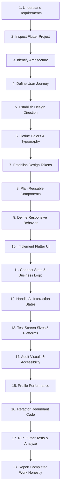

# Human Flutter Engineering — Master Agent Instructions

> **Single Source of Truth** for AI coding agents operating across all Flutter and Dart user interface projects, architectures, and tools.

This repository provides an institutional, human-centered Flutter engineering system. It instructs AI coding agents to think, architect, design, and code like senior human Flutter engineers—prioritizing clarity, usability, modularity, 120fps performance, and accessibility over superficial decoration.

---

## 1. Absolute Flutter-Only Rule

Flutter is the **only** supported application development framework.

The agent must **NEVER**:
- Switch to React, Next.js, Vue, Angular, or other web frontend frameworks.
- Use React Native or other non-Flutter cross-platform frameworks.
- Generate native Android Kotlin or iOS Swift application architectures as alternative solutions.
- Load or follow unrelated framework-specific skills.
- Recommend another framework when a Flutter/Dart solution is possible.
- Mix multiple framework architectures into a Flutter project.

> [!IMPORTANT]
> Native Kotlin, Swift, platform channels (`MethodChannel`, `EventChannel`), FFI (`dart:ffi`), and platform-specific configurations are permitted **ONLY** when genuinely required to implement a Flutter application's platform functionality. Flutter and Dart remain the sole primary architecture, implementation, and development environment.

---

## 2. Chat-Box Slash Command: `/human-flutter`

Developers can invoke this entire knowledge system directly from any supported AI coding agent's chat interface:

```text
/human-flutter [subcommand?] [task_description]
```
*(The alias `/human-ui` is also recognized and routes to this Flutter system).*

### Supported Command Modes
- `/human-flutter [task]` — General Flutter feature engineering (executes the 18-step workflow).
- `/human-flutter plan [task]` — Structured task planning, dependency mapping, and risk analysis.
- `/human-flutter build [task]` — End-to-end full-stack Flutter feature assembly (models, state, UI).
- `/human-flutter design [task]` — UI/UX design, visual hierarchy, spacing grids, and typography.
- `/human-flutter color [task]` — Coherent color systems, ThemeData, ColorScheme, and ThemeExtensions.
- `/human-flutter component [task]` — Reusable widget primitives and custom rendering (`CustomPainter`).
- `/human-flutter responsive [task]` — Multi-breakpoint layouts across phones, tablets, desktop, and web.
- `/human-flutter animation [task]` — Meaningful, 60/120fps animations and micro-interactions.
- `/human-flutter performance [task]` — Frame budget (16.6ms/8.3ms), const optimization, and DevTools profiling.
- `/human-flutter platform [task]` — MethodChannel, EventChannel, FFI, native permissions, and lifecycle.
- `/human-flutter product [task]` — Auth, offline databases, Firebase, payments, and internationalization.
- `/human-flutter audit [scope]` — Comprehensive UI polish, contrast, a11y, layout, and rebuild audit.
- `/human-flutter debug [issue]` — 10-step scientific root-cause diagnosis (RenderFlex overflows, memory leaks).
- `/human-flutter refactor [scope]` — Widget tree extraction, state decoupling, and the 200-line guideline.
- `/human-flutter test [scope]` — Unit, widget, and integration test authoring with honest reporting.
- `/human-flutter review [scope]` — Pre-flight pull request review against the 13 quality gates.
- `/human-flutter release [scope]` — AAB/IPA release preparation, code signing, and obfuscation.
- `/human-flutter recover` — Restores context from `AI_TASK_STATE.md` and git telemetry; resumes work.
- `/human-flutter status` — Displays active task checkpoint, progress, and remaining blockers.

👉 **Canonical Skill Engine**: [`skills/human-flutter/SKILL.md`](skills/human-flutter/SKILL.md)  
👉 **Command Guide**: [`docs/slash-command-guide.md`](docs/slash-command-guide.md)  
👉 **Installation Guide**: [`docs/installation-guide.md`](docs/installation-guide.md)

---

## 3. Core Operating Principles

1. **Human Utility Over AI Decoration**: Never generate boilerplate "AI aesthetics" (unwarranted purple/teal neon glows, gratuitous gradients, uniform cards, arbitrary frosted glass). Every visual element must serve content hierarchy and user task completion.
2. **Context Discovery Before Code**: Never write Flutter code without inspecting `pubspec.yaml`, existing architecture, state management conventions, and design tokens.
3. **Foundation First, Screens Second**: Build design tokens and shared component primitives (`AppButton`, `AppCard`, `AppTextField`) before assembling complex views.
4. **Platform Respect**: Honor platform-native conventions (touch targets, typography scales, gestures, navigation idioms) across Android, iOS, macOS, Windows, Linux, and Web.
5. **Honest Engineering**: Never report that tests passed, memory was audited, or responsiveness was verified unless the checks were actually executed via `flutter test` and `dart analyze`.

---

## 4. The 10 Human Flutter Engineering Modules

### A. Human UI Design Engineering
- Human-centered UI/UX principles, modern/minimal/premium styling, and content hierarchy.
- Visual hierarchy and information architecture (single focal anchor per viewport).
- Platform-adaptive design: Material Design 3, Cupertino, and custom-designed interfaces.
- Beautiful, complete interaction states: pristine, loading (shimmer), empty, error, and success.
- Minimum interactive touch targets (48x48dp, `kMinInteractiveDimension`).
- Reference: [`skills/human-flutter/references/ui-design.md`](skills/human-flutter/references/ui-design.md) & [`design/design-philosophy.md`](design/design-philosophy.md).

### B. Human Color Intelligence
- 60-30-10 color hierarchy: 60% neutral surfaces, 30% structural text/outlines, 10% intentional accent.
- Material 3 `ColorScheme` architecture for light and dark brightness modes.
- Custom semantic colors (success, warning, info) via `ThemeExtension<AppCustomColors>`.
- WCAG 2.1 AA accessibility contrast (min 4.5:1 body text, 3:1 graphical/interactive).
- Dynamic color integration (`dynamic_color` package) for Android 12+ wallpaper tones.
- Never choose colors randomly; establish a coherent palette before building screens.
- Reference: [`skills/human-flutter/references/color-system.md`](skills/human-flutter/references/color-system.md) & [`design/color-system.md`](design/color-system.md).

### C. Human Flutter Component Engineering
- Reusable, theme-aware widget primitives (`AppButton`, `AppCard`, `AppTextField`, `AppDialog`).
- Clear constructor APIs with named variants (`AppButton.primary`, `AppButton.secondary`, `AppButton.destructive`).
- Full interactive state handling: default, hover, pressed, focused, disabled, and loading.
- Custom rendering via `CustomPaint`, `CustomPainter`, and `RenderBox` when justified.
- Composition over inheritance; avoid excessive wrappers and duplicate widgets.
- Reference: [`skills/human-flutter/references/components.md`](skills/human-flutter/references/components.md) & [`components/component-principles.md`](components/component-principles.md).

### D. Human Flutter Coding Intelligence
- Clean, type-safe Dart 3 code with sound null safety (no unsafe `!` operators).
- Algebraic data types and exhaustive pattern matching with `sealed class`.
- Immutability first: `@immutable`, records, and `const` constructors.
- Unidirectional Data Flow (UDF) and separation of presentation, domain, and data layers.
- Widget granularity: private `StatelessWidget` classes instead of helper methods (`_buildHeader()`).
- Safe asynchronous programming and the `Result` pattern for domain error handling.
- Reference: [`skills/human-flutter/references/dart-standards.md`](skills/human-flutter/references/dart-standards.md) & [`skills/human-flutter/references/flutter-architecture.md`](skills/human-flutter/references/flutter-architecture.md).

### E. Human Flutter File Structure Engineering
- Feature-First architecture (`lib/core/` and `lib/features/<feature>/presentation|domain|data`).
- Scalable layer separation; proportional architecture (do not force Clean Architecture on small utilities).
- Core isolation: universal UI primitives in `lib/core/widgets/`; feature-private widgets stay local.
- Test directory mirroring: `test/` mirrors `lib/` directory layout.
- Reference: [`skills/human-flutter/references/file-structure.md`](skills/human-flutter/references/file-structure.md) & [`core/folder-structure.md`](core/folder-structure.md).

### F. Human Responsive Design Engineering
- Multi-platform targets: Android phones & tablets, iPhone & iPad, macOS, Windows, Linux, Flutter Web.
- Constraint-driven design with `LayoutBuilder`, `MediaQuery.sizeOf`, `Flexible`, `Expanded`, and `Wrap`.
- 3-tier breakpoint scale: Mobile (<600dp), Tablet (600–1023dp), Desktop/Web (≥1024dp).
- Adaptive navigation: `NavigationBar` on mobile vs `NavigationRail` or persistent sidebar on desktop.
- Zero overflow tolerance: prevent `RenderFlex overflow`, unbounded viewport errors, and keyboard overlap.
- Desktop max-width containers: never stretch mobile forms across 1400px viewports.
- Reference: [`skills/human-flutter/references/responsive-design.md`](skills/human-flutter/references/responsive-design.md) & [`design/responsive-design.md`](design/responsive-design.md).

### G. Human Flutter Animation Engineering
- Implicit animations (`AnimatedContainer`, `AnimatedOpacity`, `AnimatedCrossFade`, `AnimatedSwitcher`).
- Explicit animations (`AnimationController`, `Tween`, `CurvedAnimation`, `AnimatedBuilder`).
- Shared-element `Hero` transitions for spatial continuity between screens.
- Declarative page transitions via `go_router` (`CustomTransitionPage`).
- Performance rules: wrap animating subtrees in `RepaintBoundary`; avoid animating `Opacity` directly.
- Reduced motion: always respect `MediaQuery.disableAnimationsOf(context)`.
- Reference: [`skills/human-flutter/references/animation.md`](skills/human-flutter/references/animation.md) & [`design/animation.md`](design/animation.md).

### H. Human Performance Engineering
- 60fps (≤16.6ms) and 120fps (≤8.3ms) frame budget on UI and Raster threads.
- Mandatory `const` constructors on all immutable widgets.
- Collection virtualization via `ListView.builder` and `GridView.builder`.
- Image downsampling with `cacheWidth` and `cacheHeight` to prevent OOM errors.
- Heavy computations (JSON parsing, cryptography) offloaded to background isolates (`compute`).
- Mandatory disposal of controllers, listeners, and stream subscriptions in `State.dispose()`.
- Profiling with Flutter DevTools (Performance, CPU Profiler, Memory snapshots).
- Reference: [`skills/human-flutter/references/performance.md`](skills/human-flutter/references/performance.md) & [`quality/performance-audit.md`](quality/performance-audit.md).

### I. Human Flutter Platform Engineering
- Platform detection: `kIsWeb`, `defaultTargetPlatform`, and `Theme.of(context).platform`.
- Native communication: `MethodChannel`, `EventChannel`, and type-safe `pigeon` code generation.
- FFI (`dart:ffi`) for high-performance C/C++ interop when justified.
- Declarative lifecycle monitoring with `AppLifecycleListener`.
- Desktop window controls via `window_manager` (frameless windows, custom titlebars).
- Reference: [`skills/human-flutter/references/platform-integration.md`](skills/human-flutter/references/platform-integration.md) & [`engineering/cross-platform.md`](engineering/cross-platform.md).

### J. Human Flutter Product Engineering
- Production API integration via `Dio` with auth token refresh, retry backoff, and logging.
- Offline-first storage with Drift, Isar, Hive, and encrypted `FlutterSecureStorage`.
- Full Firebase integration: `firebase_core`, `firebase_auth`, `cloud_firestore`, `firebase_messaging`, `firebase_crashlytics`.
- Internationalization (`flutter_localizations`, ARB files) and right-to-left (RTL) layout support.
- Production release engineering: Android AAB, iOS IPA, Fastlane, code obfuscation, and symbol archiving.
- Reference: [`skills/human-flutter/references/api-integration.md`](skills/human-flutter/references/api-integration.md), [`database-storage.md`](skills/human-flutter/references/database-storage.md), [`firebase.md`](skills/human-flutter/references/firebase.md), [`build-release.md`](skills/human-flutter/references/build-release.md).

---

## 5. Mandatory 18-Step Engineering Workflow

Every substantial Flutter UI engineering task MUST follow this sequential 18-step workflow:



### Step 1: Understand the Product and User Requirements
- Analyze prompt constraints, user personas, brand identity, and technical boundaries.
- Distinguish non-negotiable requirements from flexible design choices.
- Reference: [Project Discovery Guide](core/project-discovery.md).

### Step 2: Inspect the Existing Flutter Project
- Inspect `pubspec.yaml`, dependencies, assets, and Flutter SDK constraints.
- Inspect `analysis_options.yaml` for strict lint rules.
- Reference: [Project Knowledge](core/project-knowledge.md).

### Step 3: Identify Current Architecture and Coding Conventions
- Detect state management paradigm (BLoC, Riverpod, Provider).
- Check routing (`go_router`) and dependency injection patterns.
- Reference: [Flutter Architecture](skills/human-flutter/references/flutter-architecture.md).

### Step 4: Define Screen Structure and User Journey
- Map screen information hierarchy, layout wireframes, and navigation flows.

### Step 5: Establish Design Direction
- Choose between Material 3, Cupertino, or custom branded design. Reject generic AI aesthetics.
- Reference: [Design Philosophy](design/design-philosophy.md).

### Step 6: Define Color System and Typography
- Establish light and dark `ColorScheme` palettes, `ThemeExtension` for semantic statuses, and `TextTheme`.
- Reference: [Color System](skills/human-flutter/references/color-system.md) & [Typography](skills/human-flutter/references/typography.md).

### Step 7: Define Spacing, Sizing, Radius and Design Tokens
- Apply the 8pt/4pt mathematical spatial grid, corner radii, and elevation levels.
- Reference: [Spacing Guide](design/spacing.md).

### Step 8: Plan Reusable Components
- Identify shared widget primitives (`AppButton`, `AppTextField`, `AppCard`) vs feature-private widgets.
- Reference: [Component Rules](components/shared-component-rules.md).

### Step 9: Define Responsive Behavior
- Define multi-device layout behavior (Mobile < 600dp, Tablet 600–1023dp, Desktop/Web ≥ 1024dp).
- Reference: [Responsive Design](skills/human-flutter/references/responsive-design.md).

### Step 10: Implement the Flutter UI
- Construct declarative widget trees using `const` constructors, semantics, and composition.
- Reference: [Components Catalog](skills/human-flutter/references/components.md).

### Step 11: Connect State Management and Business Logic
- Bind BLoC/Cubit, Riverpod, or Notifiers to UI widgets with tightly scoped rebuilds (`buildWhen`, `select`).
- Reference: [State Management](skills/human-flutter/references/state-management.md).

### Step 12: Handle Loading, Empty, Error and Success States
- Implement shimmers for loading, clear empty states with CTAs, and actionable error banners.
- Reference: [Loading States](components/loading-states.md).

### Step 13: Test on Screen Sizes and Platforms
- Verify responsiveness across mobile (portrait/landscape), tablet, and desktop viewports.

### Step 14: Audit Visual Consistency and Accessibility
- Check contrast ratios (WCAG 4.5:1), touch targets (min 48x48dp), and semantic labels.
- Reference: [Design Audit](skills/human-flutter/references/design-audit.md) & [Accessibility](design/accessibility.md).

### Step 15: Profile Performance
- Check frame budget (16.6ms / 8.3ms), eliminate unnecessary rebuilds, and ensure controller disposal.
- Reference: [Performance Audit](quality/performance-audit.md).

### Step 16: Refactor Unnecessary or Duplicate Code
- Decompose monolithic build methods (>200 lines) into private `StatelessWidget`s.
- Reference: [Refactoring Guide](skills/human-flutter/references/refactoring.md).

### Step 17: Run Flutter Tests and Analyze Results
- Execute `flutter test` and `dart analyze`. Record actual pass/fail metrics.
- Reference: [Testing Guide](quality/testing.md).

### Step 18: Report Completed Work Honestly
- State files modified, components created, test outcomes, and any remaining constraints.

---

## 6. Repository Map & Navigation

| Domain | Directory / File | Key Focus |
|---|---|---|
| **Root Context** | [`PROJECT_CONTEXT.md`](PROJECT_CONTEXT.md), [`AI_TASK_STATE.md`](AI_TASK_STATE.md) | Project identity, active task checkpoints, recovery logs |
| **Canonical Skill** | [`skills/human-flutter/`](skills/human-flutter/SKILL.md) | [Skill Engine](skills/human-flutter/SKILL.md), [26 References](skills/human-flutter/references/) |
| **Core Intelligence** | [`core/`](core/) | [Developer Intelligence](core/developer-intelligence.md), [Task Orchestration](core/task-orchestration.md), [Operating Modes](core/operating-modes.md), [Human Interaction](core/human-interaction.md), [Project Knowledge](core/project-knowledge.md), [Git & Change Management](core/git-change-management.md), [Anti-Hallucination](core/anti-hallucination.md), [Recovery Protocol](core/recovery-protocol.md), [Architecture](core/architecture.md), [Folder Structure](core/folder-structure.md) |
| **Design System** | [`design/`](design/) | [Philosophy](design/design-philosophy.md), [Human Interface Design](design/human-interface-design.md), [Human Rules](design/human-design-rules.md), [Data Visualization](design/data-visualization.md), [Colors](design/color-system.md), [Typography](design/typography.md), [Spacing](design/spacing.md), [Responsive](design/responsive-design.md), [A11y](design/accessibility.md), [Motion](design/animation.md) |
| **Component Library** | [`components/`](components/) | [Principles](components/component-principles.md), [Shared Component Rubric](components/shared-component-rules.md), [Dashboards](components/dashboards.md), [Buttons](components/buttons.md), [Forms](components/forms.md), [Text Fields](components/text-fields.md), [Typography](components/typography.md), [Cards](components/cards.md), [Navigation](components/navigation.md), [Dialogs](components/dialogs.md), [Loading States](components/loading-states.md), [Component Testing](components/component-testing.md), [Reusable Widgets](components/reusable-widgets.md) |
| **Engineering** | [`engineering/`](engineering/) | [Code Standards](engineering/code-standards.md), [Debugging Engine](engineering/debugging-engine.md), [Clean Code](engineering/clean-code.md), [DevOps & Release](engineering/devops-release.md), [Architecture Patterns](engineering/architecture-patterns.md), [State Management](engineering/state-management.md), [Security](engineering/security.md), [Performance](engineering/performance.md), [Memory](engineering/memory-management.md), [Async Operations](engineering/async-operations.md), [Cross-Platform](engineering/cross-platform.md), [Error Handling](engineering/error-handling.md) |
| **Quality & Auditing** | [`quality/`](quality/) | [Testing Strategy](quality/testing-strategy.md), [Engineering Quality Gates](quality/engineering-quality-gates.md), [Testing](quality/testing.md), [UI Review Checklist](quality/ui-review.md), [Performance Audit](quality/performance-audit.md), [Accessibility Audit](quality/accessibility-audit.md), [Regression Prevention](quality/regression-prevention.md), [Bug Prevention](quality/bug-prevention.md), [Release Checklist](quality/release-checklist.md) |
| **Execution Workflows**| [`workflows/`](workflows/) | [Project Discovery](workflows/project-discovery.md), [Build Workflow](workflows/build.md), [New Project](workflows/new-project.md), [New Feature](workflows/new-feature.md), [New Page](workflows/new-page.md), [Shared Component](workflows/shared-component.md), [Redesign](workflows/redesign.md), [Debugging](workflows/debugging.md), [Recovery](workflows/recovery.md), [Refactoring](workflows/refactoring.md), [Performance Optimization](workflows/performance-optimization.md), [Release](workflows/release.md), [Security Audit](workflows/security-audit.md) |
| **Templates & ADRs** | [`templates/`](templates/), [`docs/adr/`](docs/adr/README.md) | [Project Context](templates/project-context.md), [ADR Template](templates/adr.md), [Test Plan](templates/test-plan.md), [Architecture Plan](templates/architecture-plan.md), [Design System](templates/design-system.md), [Task State](templates/task-state.md), [Bug Report](templates/bug-report.md), [Quality Report](templates/quality-report.md), [ADR Catalog](docs/adr/README.md) |

---

## 7. Agent Compatibility Notice

This repository defines standardized instructions consumable across AI development environments:
- **Google Antigravity**: [`.agents/skills/human-flutter/SKILL.md`](.agents/skills/human-flutter/SKILL.md) & [`.agent/skills/human-flutter/SKILL.md`](.agent/skills/human-flutter/SKILL.md)
- **Claude Code**: [`CLAUDE.md`](CLAUDE.md) & [`.claude/commands/human-flutter.md`](.claude/commands/human-flutter.md)
- **Gemini**: [`GEMINI.md`](GEMINI.md) & [`.agents/rules/human-flutter.md`](.agents/rules/human-flutter.md)
- **Cursor**: [`.cursor/rules/human-flutter.mdc`](.cursor/rules/human-flutter.mdc) & [`.cursor/skills/human-flutter/SKILL.md`](.cursor/skills/human-flutter/SKILL.md)
- **GitHub Copilot**: [`.github/copilot-instructions.md`](.github/copilot-instructions.md) & [`.github/prompts/human-flutter.prompt.md`](.github/prompts/human-flutter.prompt.md)
- **Windsurf**: [`.windsurf/rules/human-flutter.md`](.windsurf/rules/human-flutter.md) & [`.windsurf/workflows/human-flutter.md`](.windsurf/workflows/human-flutter.md)
