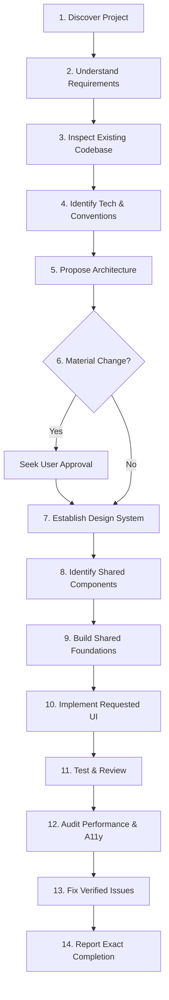

# Human UI Engineering

> **Universal AI Agent Context & Instruction System for Production UI Engineering**

[](LICENSE)
[](frameworks/framework-selection.md)
[](design/accessibility.md)
[](docs/slash-command-guide.md)
[](CONTRIBUTING.md)

---

## 1. What is Human UI Engineering?

**Human UI Engineering** is an open, framework-neutral knowledge and instruction system that teaches AI coding agents to think, architect, design, and code like senior human UI engineers.

Rather than generating generic "AI aesthetics" (unwarranted purple/teal glows, repetitive card grids, arbitrary glassmorphism, and unmaintainable 800-line monolithic files), this repository instills rigorous engineering standards:
- **Human Utility Over AI Decoration**: Prioritizes content hierarchy, readability, and task completion.
- **Foundation-First Architecture**: Establishes design tokens and shared component primitives before building screens.
- **Platform Authenticity**: Respects native idioms across Web, iOS, Android, and Desktop.
- **Deterministic Quality**: Enforces strict verification of performance, accessibility, memory disposal, and responsiveness.

The single source of truth for all agent operations is [`AGENTS.md`](AGENTS.md).

---

## 2. Direct Chat Slash Command: `/human-ui`

Developers can invoke Human UI Engineering directly from their AI agent's chat input:

```text
/human-ui [subcommand?] [task_description]
```

### Example Invocations
```text
# General feature implementation (auto-detects framework)
/human-ui Create a modern, accessible customer profile screen.

# UI/UX design and design tokens
/human-ui design Establish an 8pt spatial grid and semantic status colors.

# Full UI & performance audit
/human-ui audit src/features/checkout

# Flutter-specific clean architecture & const optimization
/human-ui flutter Build an adaptive dashboard with BLoC state management.

# React & Next.js virtualization
/human-ui react Implement a virtualized data table with debounced search.

# Responsive mobile adaptation
/human-ui responsive Refactor navigation to collapse gracefully on 375px mobile screens.

# Performance optimization & frame drops
/human-ui performance Eliminate jank and memory leaks during infinite list scrolling.

# Debugging layout and state issues
/human-ui debug The mobile keyboard is obscuring our form submit button.

# Recovery Mode: resume interrupted work without restarting
/human-ui recover

# Code review against pre-flight release checklist
/human-ui review Audit our recent PR changes.
```

👉 Read the full [Chat Slash Command Guide](docs/slash-command-guide.md) and [Compatibility Matrix](docs/compatibility-matrix.md).

---

## 3. Supported AI Coding Agents

This repository provides standardized, lightweight entry points for all major AI coding environments:

| Agent / Tool | Entry File | Chat Invocation Syntax | Autocomplete | Auto-Activation | Notes |
|---|---|---|---|---|---|
| **Google Antigravity** | [`.agent/skills/human-ui/`](.agent/skills/human-ui/SKILL.md) | `/human-ui [task]` | **YES** | **YES** | Native skill integration |
| **Claude Code** | [`.claude/commands/human-ui.md`](.claude/commands/human-ui.md) | `/human-ui [task]` | **YES** | **YES** | CLI slash command |
| **VS Code GitHub Copilot** | [`.github/prompts/human-ui.prompt.md`](.github/prompts/human-ui.prompt.md) | `/human-ui [task]` | **YES** | **YES** | Reusable prompt file |
| **Cursor** | [`.cursor/rules/human-ui.mdc`](.cursor/rules/human-ui.mdc) | `/human-ui [task]` or `@human-ui` | **YES** | **YES** | Rules & symbol picker |
| **Windsurf** | [`.windsurf/workflows/human-ui.md`](.windsurf/workflows/human-ui.md) | `/human-ui [task]` | **YES** | **YES** | Cascade workflow |
| **Gemini CLI** | [`skills/human-ui/SKILL.md`](skills/human-ui/SKILL.md) | `/human-ui [task]` | **YES** | **YES** | Agent Skills standard |
| **Android Studio Gemini** | [`.agent/rules/human-ui.md`](.agent/rules/human-ui.md) | `/human-ui [task]` | Limited | **YES** | Workspace context |
| **Codex / Assistants** | Prompt injection | `/human-ui [task]` | N/A | Manual | System prompt instructions |

👉 Read the complete [Compatibility Matrix](docs/compatibility-matrix.md) and [Installation Guide](docs/installation-guide.md).

---

## 4. Supported Frameworks

Universal principles apply across all technologies, with specialized, strictly isolated implementation guides in [`frameworks/`](frameworks/README.md):

- **[Flutter](frameworks/flutter.md)**: Clean architecture, widget granularity, `const` optimization, BLoC/Riverpod, semantics.
- **[React](frameworks/react.md)**: Functional composition, custom hooks, strategic memoization, virtualized lists.
- **[Next.js](frameworks/nextjs.md)**: App Router, React Server Components (RSC) vs Client boundaries, Streaming, Core Web Vitals.
- **[Vue](frameworks/vue.md)**: Vue 3 Composition API, `<script setup lang="ts">`, Pinia state management, Nuxt 3.
- **[Angular](frameworks/angular.md)**: Angular 17+ Standalone Components, Signals, modern control flow (`@if`/`@for`).
- **[Native Android](frameworks/native-android.md)**: Jetpack Compose, ViewModel, Material 3, Coroutines, WindowSizeClass.
- **[Native iOS](frameworks/native-ios.md)**: SwiftUI, Swift 6, Observation macro, SF Symbols, Apple HIG.
- **[Modern Web](frameworks/web.md)**: Semantic HTML5, CSS Container Queries, native `<dialog>` and Popovers, Web Components.
- **[React Native](frameworks/react-native.md)**: Expo, New Architecture (Fabric/TurboModules), FlashList, Safe Areas.
- **[Desktop Development](frameworks/desktop.md)**: Electron, Tauri, Flutter Desktop, Frameless window dragging, system shortcuts, secure IPC.
- **[Framework Selection Matrix](frameworks/framework-selection.md)**: Objective criteria and decision heuristics for choosing the right stack.
- **[Framework Isolation Standards](frameworks/README.md)**: Boundaries ensuring framework rules never cross-contaminate.

---

## 5. Repository Architecture

```text
human-ui-engineering/
├── README.md               # Overview, slash commands, and setup guide
├── AGENTS.md               # Master instructions (Single Source of Truth)
├── CLAUDE.md               # Claude Code entry point
├── GEMINI.md               # Gemini agent entry point
├── CONTRIBUTING.md         # Contribution standards
├── LICENSE                 # MIT License
├── CHANGELOG.md            # Version release milestones & roadmap
├── AI_TASK_STATE.md        # Active task checkpoint & recovery tracker
│
├── skills/human-ui/        # Canonical Agent Skill Engine
│   ├── SKILL.md            # Main skill with YAML frontmatter
│   └── references/         # Progressive disclosure references (flutter, react, recovery, etc.)
│
├── docs/                   # User guides & matrices
│   ├── compatibility-matrix.md # Verified agent support matrix
│   ├── slash-command-guide.md  # Detailed /human-ui command manual
│   └── installation-guide.md   # Step-by-step installation instructions
│
├── .github/                # GitHub-specific instructions
│   ├── copilot-instructions.md
│   ├── prompts/human-ui.prompt.md # Reusable Copilot prompt
│   └── workflows/validate.yml  # GitHub Actions CI validator
│
├── .cursor/                # Cursor IDE configuration
│   ├── rules/human-ui.mdc  # Cursor rules
│   └── skills/human-ui/    # Cursor skill adapter
│
├── .agent/                 # Google Antigravity & Agent configuration
│   ├── rules/human-ui.md   # Agent workspace rules
│   └── skills/human-ui/    # Agent skill adapter
│
├── .claude/commands/       # Claude Code slash commands
│   └── human-ui.md         # /human-ui command definition
│
├── .windsurf/              # Windsurf Cascade configuration
│   ├── rules/human-ui.md   # Cascade rules
│   └── workflows/human-ui.md# Cascade workflow
│
├── core/                   # Universal engineering core (framework-agnostic)
│   ├── agent-behavior.md   # Eliminating AI tropes; human engineer mindset
│   ├── project-discovery.md# Evidence-based pre-flight codebase discovery
│   ├── architecture.md     # 3-tier presentation architecture & UDF
│   ├── folder-structure.md # Feature-First directory conventions
│   ├── engineering-workflow.md # 6-stage universal engineering lifecycle
│   ├── development-workflow.md # Task execution cycle & step transitions
│   ├── anti-hallucination.md # 5-tier evidence classification & pre-action verification
│   ├── recovery-protocol.md # 6-step autonomous recovery sequence & blocker reporting
│   ├── checkpoint-management.md # Checkpoint rules, state tracking & hygiene
│   └── change-control.md   # Blast radius assessment & backward-compatible changes
│
├── design/                 # Human-centered UI design system
│   ├── design-philosophy.md# Purpose of UI, content-first design
│   ├── human-design-rules.md# Strict visual Do's and Don'ts
│   ├── human-interface-design.md # Information architecture, cognitive laws & visual rhythm
│   ├── color-system.md     # 60-30-10 rule, functional tokens, dark mode
│   ├── typography.md       # Typographic scale, measure, line-heights
│   ├── spacing.md          # 8pt/4pt mathematical spatial grid
│   ├── responsive-design.md# 5-tier breakpoint system & touch targets
│   ├── accessibility.md    # WCAG 2.1 AA, keyboard focus, screen readers
│   └── animation.md        # Functional motion tokens, reduced motion
│
├── components/             # Reusable shared component engineering
│   ├── shared-component-rules.md # 6-question qualification rubric
│   ├── component-principles.md # Component boundaries, composition & 7 interactive states
│   ├── buttons.md          # Hierarchy, sizes, 6 interactive states
│   ├── text-fields.md      # Labels, error states, mobile keyboards
│   ├── forms.md            # Form control catalog, validation heuristics & multi-step wizards
│   ├── typography.md       # Polymorphic text primitives, line clamping
│   ├── cards.md            # Compound card patterns; anti-card fatigue
│   ├── navigation.md       # Headers, sidebars, bottom bars, tabs
│   ├── dialogs.md          # Focus trapping, escape dismissal, sheets
│   ├── loading-states.md   # Skeletons, shimmers, spinners, optimistic UI
│   ├── reusable-widgets.md # Badges, avatars, tooltips, list tiles
│   └── component-testing.md# 5-stage component test suite & resilient role selectors
│
├── engineering/            # Production engineering standards
│   ├── clean-code.md       # Modularity, naming rules, 200-line guideline
│   ├── architecture-patterns.md # MVVM, MVI/Redux, BLoC, Custom Hooks
│   ├── state-management.md # 4 state tiers, placement heuristics
│   ├── error-handling.md   # Error boundaries, actionable user messages
│   ├── async-operations.md # Async lifecycle safety, AbortController & debouncing
│   ├── performance.md      # 16.6ms frame budget, virtualization, CLS
│   ├── memory-management.md# Disposing listeners, timers, controllers
│   ├── security.md         # UI security, XSS defenses, token hygiene & native IPC
│   └── cross-platform.md   # Platform idioms, safe areas, RTL/i18n
│
├── quality/                # Quality assurance & pre-flight gates
│   ├── testing.md          # Testing pyramid, resilient selectors, honesty
│   ├── ui-review.md        # Visual polish & spacing checklist
│   ├── accessibility-audit.md # Exhaustive WCAG 2.1 AA audit checklist across all modalities
│   ├── performance-audit.md# Profiling frames, memory leaks, assets
│   ├── bug-prevention.md   # Top 10 recurring UI bugs & defenses
│   ├── regression-prevention.md # 4-dimension regression prevention protocol & gates
│   └── release-checklist.md# 8-point pre-flight release gate
│
├── frameworks/             # Independent, strictly isolated framework modules
│   ├── README.md           # Framework isolation rules & monorepo boundaries
│   ├── framework-selection.md # 10-framework decision tree & heuristics
│   ├── flutter.md          # Flutter / Dart: Widget hierarchy, const, BLoC/Riverpod
│   ├── react.md            # React: Hooks, memoization, virtualization, clean state
│   ├── nextjs.md           # Next.js: RSC, App Router, Suspense, streaming
│   ├── vue.md              # Vue 3: Script setup, Composition API, Pinia, Nuxt 3
│   ├── angular.md          # Angular 17+: Signals, Standalone Components, control flow
│   ├── native-android.md   # Android: Jetpack Compose, ViewModel, Coroutines
│   ├── native-ios.md       # iOS: SwiftUI, Swift 6, Observation, HIG
│   ├── web.md              # Modern Web: Semantic HTML5, CSS Container Queries
│   ├── react-native.md     # React Native: Expo, Fabric/TurboModules, FlashList
│   └── desktop.md          # Desktop: Electron, Tauri, Flutter Desktop, native IPC
│
├── workflows/              # Actionable step-by-step execution guides
│   ├── project-discovery.md# Codebase mapping & monorepo package isolation
│   ├── new-project.md      # Bootstrapping from scratch
│   ├── new-feature.md      # End-to-end multi-screen feature implementation
│   ├── new-page.md         # Building a verified screen
│   ├── shared-component.md # Extracting reusable primitives
│   ├── redesign.md         # Safe modernization without regressions
│   ├── refactoring.md      # Safe refactoring sequence & extraction checkpoints
│   ├── debugging.md        # Scientific 6-stage defect isolation & repair loop
│   ├── performance-optimization.md # Profiling, bottleneck isolation & metrics
│   ├── performance-fix.md  # Quick repair of visual jank and frame drops
│   └── recovery.md         # Autonomous recovery from interrupted tasks
│
├── templates/              # Standardized fillable markdown templates
│   ├── project-brief.md    # Discovery summary
│   ├── architecture-plan.md# Technical proposal
│   ├── design-system.md    # Design token spec
│   ├── task-state.md       # Fillable checkpoint state for AI_TASK_STATE.md
│   ├── bug-report.md       # Fillable UI bug report & root-cause analysis template
│   └── quality-report.md   # QA & verification audit
│
└── scripts/                # Automated repository validation suite
    ├── validate-docs       # Checks required architecture files exist & populated
    ├── validate-links      # Validates all internal relative markdown links
    ├── validate-structure  # Validates agent entry points & 10 framework modules
    └── validate.py         # Master runner coordinating all validators
```

---

## 6. How to Install & Use in Your Projects

### Method A: Git Submodule (Recommended for Teams)
```bash
git submodule add https://github.com/juwelzan/human-ui-engineering.git .human-ui
```
Then copy adapters from `.human-ui` to your agent directories. See [Installation Guide](docs/installation-guide.md).

### Method B: Global Installation (All Projects)
Clone into `~/.gemini/skills/` or `.claude/commands/` for machine-wide availability.

---

## 7. The Mandatory 14-Step Workflow

Every AI agent operating under this framework executes this sequential loop:



See [`AGENTS.md`](AGENTS.md) for full phase details.

---

## 8. Automated Validation

Validate repository integrity and verify that all relative internal links resolve cleanly:

```bash
python3 scripts/validate.py
```

---

## 9. Contributing & License

Contributions that expand framework coverage, refine accessibility guidelines, or enhance quality checklists are warmly welcomed. Please read [CONTRIBUTING.md](CONTRIBUTING.md) before submitting a pull request.

Distributed under the **MIT License**. See [`LICENSE`](LICENSE) for details.
