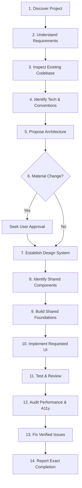

# Human UI Engineering

> **Universal AI Agent Context & Instruction System for Production UI Engineering**

[](LICENSE)
[](frameworks/framework-selection.md)
[](design/accessibility.md)
[](CONTRIBUTING.md)

---

## 1. What is Human UI Engineering?

**Human UI Engineering** is an open, framework-neutral knowledge and instruction system that teaches AI coding agents to think, architect, design, and code like senior human UI engineers.

Rather than generating generic "AI aesthetics" (unwarranted purple/teal glows, repetitive card grids, arbitrary glassmorphism, and unmaintainable 800-line monolithic files), this repository instills rigorous engineering standards:
- **Human Utility Over AI Decoration**: Prioritizes content hierarchy, readability, and task completion.
- **Foundation-First Architecture**: Establishes design tokens and shared component primitives before building screens.
- **Platform Authenticity**: Respects native idioms across Web, iOS, Android, and Desktop.
- **Deterministic Quality**: Enforces strict verification of performance, accessibility, memory disposal, and responsiveness.

The single source of truth for all agent operations is [`AGENTS.md`](AGENTS.md).

---

## 2. Why It Exists

Modern AI coding agents (Claude Code, Google Antigravity, Cursor, Gemini, Copilot, Windsurf) are exceptionally capable at generating code syntax, but frequently stumble on user interface engineering:

1. **The Synthetic AI Cliché**: Defaulting to dark-mode cyber themes, gratuitous gradients, and card wrappers around every single element.
2. **Architectural Amnesia**: Forgetting existing design tokens, ignoring pre-installed UI libraries, and creating duplicate components.
3. **The State & Lifecycle Blindspot**: Forgetting to clean up event listeners, unregister timers, dispose of controllers, or virtualize long lists.
4. **False Quality Reporting**: Hallucinating that "All tests passed and performance is optimal" without executing a single command.

This repository eliminates these failure modes through systematic, machine-readable instructions, rubrics, and checklists.

---

## 3. Supported AI Coding Agents

This repository provides standardized, lightweight entry points for all major AI coding environments:

| Agent / Tool | Entry File | Loading Mechanism | Notes |
|---|---|---|---|
| **Google Antigravity** | [`.agent/rules/human-ui.md`](.agent/rules/human-ui.md) | Automatic via `.agent/rules/` | References [`AGENTS.md`](AGENTS.md) |
| **Cursor** | [`.cursor/rules/human-ui.mdc`](.cursor/rules/human-ui.mdc) | Automatic via `.cursor/rules/` | Global glob matching |
| **Claude Code** | [`CLAUDE.md`](CLAUDE.md) | Automatic at workspace root | Direct context reference |
| **Gemini Coding Agents** | [`GEMINI.md`](GEMINI.md) | Context prompt / workspace | Authoritative guidelines |
| **GitHub Copilot** | [`.github/copilot-instructions.md`](.github/copilot-instructions.md) | Automatic via `.github/` | Repository-wide instructions |
| **Windsurf** | [`.windsurf/rules/human-ui.md`](.windsurf/rules/human-ui.md) | Automatic via `.windsurf/rules/` | Cascade context |

> [!NOTE]
> Tool-specific configuration support varies by version and environment. In any environment where auto-discovery is unsupported, explicitly point the agent to [`AGENTS.md`](AGENTS.md).

---

## 4. Supported Frameworks

Universal principles apply across all technologies, with specialized implementation guides in [`frameworks/`](frameworks/):

- **[Flutter](frameworks/flutter.md)**: Clean architecture, widget granularity, `const` optimization, BLoC/Riverpod, semantics.
- **[React](frameworks/react.md)**: Functional composition, custom hooks, strategic memoization, virtualized lists.
- **[Next.js](frameworks/nextjs.md)**: App Router, React Server Components (RSC) vs Client boundaries, Streaming, Core Web Vitals.
- **[Native Android](frameworks/native-android.md)**: Jetpack Compose, ViewModel, Material 3, Coroutines, WindowSizeClass.
- **[Native iOS](frameworks/native-ios.md)**: SwiftUI, Swift 6, Observation macro, SF Symbols, Apple HIG.
- **[Modern Web](frameworks/web.md)**: Semantic HTML5, CSS Container Queries, native `<dialog>` and Popovers, Web Components.
- **[Framework Selection Matrix](frameworks/framework-selection.md)**: Objective criteria for choosing the right stack.

---

## 5. Repository Architecture

```text
human-ui-engineering/
├── README.md               # Overview and setup guide
├── AGENTS.md               # Master instructions (Single Source of Truth)
├── CLAUDE.md               # Claude Code entry point
├── GEMINI.md               # Gemini agent entry point
├── CONTRIBUTING.md         # Contribution standards
├── LICENSE                 # MIT License
│
├── .github/                # GitHub Copilot instructions
│   └── copilot-instructions.md
├── .cursor/rules/          # Cursor IDE rules
│   └── human-ui.mdc
├── .agent/rules/           # Google Antigravity & Agent rules
│   └── human-ui.md
├── .windsurf/rules/        # Windsurf Cascade rules
│   └── human-ui.md
│
├── core/                   # Foundational engineering mindset & architecture
│   ├── agent-behavior.md   # Eliminating AI tropes; human engineer mindset
│   ├── project-discovery.md# Pre-flight discovery methodology
│   ├── architecture.md     # 3-tier presentation architecture & UDF
│   ├── folder-structure.md # Feature-First directory conventions
│   └── development-workflow.md # 5-stage task execution cycle
│
├── design/                 # Human-centered UI design system
│   ├── design-philosophy.md# Purpose of UI, content-first design
│   ├── human-design-rules.md# Strict visual Do's and Don'ts
│   ├── color-system.md     # 60-30-10 rule, functional tokens, dark mode
│   ├── typography.md       # Typographic scale, measure, line-heights
│   ├── spacing.md          # 8pt/4pt mathematical spatial grid
│   ├── responsive-design.md# 5-tier breakpoint system & touch targets
│   ├── accessibility.md    # WCAG 2.1 AA, keyboard focus, screen readers
│   └── animation.md        # Functional motion tokens, reduced motion
│
├── components/             # Reusable shared component engineering
│   ├── shared-component-rules.md # 6-question qualification rubric
│   ├── buttons.md          # Hierarchy, sizes, 6 interactive states
│   ├── text-fields.md      # Labels, error states, mobile keyboards
│   ├── typography.md       # Polymorphic text primitives, line clamping
│   ├── cards.md            # Compound card patterns; anti-card fatigue
│   ├── navigation.md       # Headers, sidebars, bottom bars, tabs
│   ├── dialogs.md          # Focus trapping, escape dismissal, sheets
│   ├── loading-states.md   # Skeletons, shimmers, spinners, optimistic UI
│   └── reusable-widgets.md # Badges, avatars, tooltips, list tiles
│
├── engineering/            # Production engineering standards
│   ├── clean-code.md       # Modularity, naming rules, 200-line guideline
│   ├── architecture-patterns.md # MVVM, MVI/Redux, BLoC, Custom Hooks
│   ├── state-management.md # 4 state tiers, placement heuristics
│   ├── error-handling.md   # Error boundaries, actionable user messages
│   ├── performance.md      # 16.6ms frame budget, virtualization, CLS
│   ├── memory-management.md# Disposing listeners, timers, controllers
│   └── cross-platform.md   # Platform idioms, safe areas, RTL/i18n
│
├── quality/                # Quality assurance & pre-flight gates
│   ├── testing.md          # Testing pyramid, resilient selectors, honesty
│   ├── ui-review.md        # Visual polish & spacing checklist
│   ├── performance-audit.md# Profiling frames, memory leaks, assets
│   ├── bug-prevention.md   # Top 10 recurring UI bugs & defenses
│   └── release-checklist.md# 8-point pre-flight release gate
│
├── frameworks/             # Framework-specific engineering guides
│   ├── framework-selection.md # Objective selection matrix
│   ├── flutter.md
│   ├── react.md
│   ├── nextjs.md
│   ├── native-android.md
│   ├── native-ios.md
│   └── web.md
│
├── workflows/              # Actionable step-by-step execution guides
│   ├── new-project.md      # Bootstrapping from scratch
│   ├── new-page.md         # Building a verified screen
│   ├── shared-component.md # Extracting reusable primitives
│   ├── redesign.md         # Safe modernization without regressions
│   └── performance-fix.md  # Profiling, isolating, and fixing jank
│
└── templates/              # Standardized fillable markdown templates
    ├── project-brief.md    # Discovery summary
    ├── architecture-plan.md# Technical proposal
    ├── design-system.md    # Design token spec
    └── quality-report.md   # QA & verification audit
```

---

## 6. How to Use in Your Projects

You can incorporate Human UI Engineering into any existing or new project using one of three methods:

### Method A: Git Submodule (Recommended for Multi-Project Teams)
Add this repository as a submodule in your project root:
```bash
git submodule add https://github.com/juwelzan/human-ui-engineering.git .human-ui
```
Configure your agent rules to reference `.human-ui/AGENTS.md`.

### Method B: Direct Rule Copy
Copy the appropriate agent rule into your project:
- For **Cursor**: Copy `.cursor/rules/human-ui.mdc`
- For **Antigravity / Agent**: Copy `.agent/rules/human-ui.md`
- For **Claude Code**: Copy `CLAUDE.md`
- For **GitHub Copilot**: Copy `.github/copilot-instructions.md`

### Method C: Prompt / Context Injection
In any AI chat interface, provide the link to [`AGENTS.md`](https://github.com/juwelzan/human-ui-engineering/blob/main/AGENTS.md) or paste the [Mandatory 14-Step Workflow](AGENTS.md#2-mandatory-14-step-engineering-workflow) into your initial project prompt:

```text
Follow the Human UI Engineering standards defined in AGENTS.md.
Execute Phase 1 Discovery before proposing code. Build shared primitives first.
```

---

## 7. The Mandatory 14-Step Workflow

Every AI agent operating under this framework executes this sequential loop:



See [`AGENTS.md`](AGENTS.md) for full phase details.

---

## 8. Limitations & Compatibility Notes

1. **Agent Tool Variability**: Automatic file loading depends on your specific IDE or agent version. When in doubt, explicitly reference `AGENTS.md`.
2. **Framework Freedom**: This repository does not force a specific styling tool (Tailwind, CSS Modules, Styled Components, ThemeData) or state library (Redux, Zustand, Riverpod, BLoC). It provides structural discipline while adapting to what your codebase already uses.
3. **No Executable Code**: This repository contains pure, battle-tested markdown architectural standards, design specs, checklists, and templates. It does not introduce runtime npm or pub dependencies.

---

## 9. Contributing & License

Contributions that expand framework coverage, refine accessibility guidelines, or enhance quality checklists are warmly welcomed. Please read [CONTRIBUTING.md](CONTRIBUTING.md) before submitting a pull request.

Distributed under the **MIT License**. See [`LICENSE`](LICENSE) for details.
