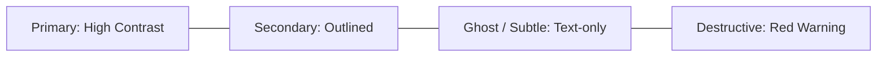

# Button Component Engineering

> Specifications, hierarchy, interactive states, and accessibility rules for button primitives.

---

## 1. Purpose

Buttons are the primary interactive triggers for user actions. Inconsistent styling, missing interactive states, or confusing visual hierarchies frustrate users and induce decision paralysis. 

This guide defines the engineering standard for button primitives.

---

## 2. Visual Hierarchy & Variants

Every application must support four distinct button variants:

| Variant | Purpose | Visual Style | Rule of Use |
|---|---|---|---|
| **Primary** | The single most important action on screen | Solid brand color background with high-contrast text | **Maximum 1 per viewport**; do not let multiple primary buttons compete |
| **Secondary** | Supporting or alternate actions (e.g. "Save Draft", "Cancel") | Clear border outline, transparent/surface background | Used alongside primary buttons or standalone for routine actions |
| **Ghost / Tertiary** | Low-emphasis actions (e.g. "Learn more", toolbar actions) | Borderless, transparent background; tints only on hover | Used in headers, table rows, and dense card layouts |
| **Destructive** | Permanent, destructive actions (e.g. "Delete Project") | Semantic red (solid for high-risk, ghost/outline for low-risk) | Always triggers confirmation dialog for high-risk actions |

---

## 3. Size Scale & Target Dimensions

Buttons must balance typographic proportion with accessible touch targets:

| Size | Height | Horizontal Padding | Font Size | Min Tap Target Enforcement |
|---|---|---|---|---|
| **Small (`sm`)** | 32px | 12px | 13px–14px | On touch devices, expand invisible touch area to 44px via hit slop / padding |
| **Medium (`md`)** | 40px – 44px | 16px | 14px–15px | Standard default size for web and mobile actions |
| **Large (`lg`)** | 48px – 52px | 24px | 16px | Primary mobile bottom actions, hero landing CTAs |

---

## 4. Interactive States

A production button component must handle all 6 states seamlessly:

1. **Rest**: Standard elevation, color, and border.
2. **Hover**: 5%–10% brightness change; cursor shifts to `pointer`.
3. **Active / Pressed**: Subtle scale down (`transform: scale(0.98)`) or deeper shade.
4. **Focused**: High-contrast outline ring with offset (`ring-2 ring-primary ring-offset-2`) for keyboard tabbing.
5. **Loading**:
   - Replaces the icon or label with an inline spinner.
   - **Crucial**: The button width must NOT jump or collapse when entering the loading state. Preserve the original dimensions.
   - Prevents duplicate clicks (`disabled={isLoading}`).
6. **Disabled**:
   - Reduces opacity to 40%–50%.
   - Sets `cursor: not-allowed` or removes pointer events.
   - Sets `aria-disabled="true"`.

---

## 5. Icon Placement & Icon-Only Buttons

- **Icon + Label**: Maintain a strict 8px gap between icon and text label. Ensure icon size matches text line-height (e.g. 16px icon with 14px text).
- **Icon-Only Buttons** (e.g. Close `✕`, Trash `🗑`, More `⋯`):
  - **MANDATORY**: Must include an accessible label (`aria-label="Delete item"`, `Semantics(label: "Close")`).
  - Must provide a tooltip on desktop hover.
  - Square aspect ratio (1:1).

---

## 6. Button Anti-Patterns

1. **The Twin Primary Anti-Pattern**: Rendering two bright, high-contrast primary buttons next to each other (e.g. "Save" and "Cancel" both solid blue). Make "Cancel" secondary or ghost.
2. **Width Jitter on Loading**: Showing a loading spinner that is wider or narrower than the original label, causing surrounding layout elements to shake.
3. **Overriding Focus Visibility**: Stripping default browser focus outlines without providing a custom visible focus ring.

---

## 7. Related Documentation

- Master Instructions: [../AGENTS.md](../AGENTS.md)
- Shared Component Rules: [shared-component-rules.md](shared-component-rules.md)
- Color System: [../design/color-system.md](../design/color-system.md)
- Accessibility: [../design/accessibility.md](../design/accessibility.md)
- Loading States: [loading-states.md](loading-states.md)
