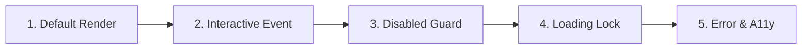

# Component Testing Standards

> Methodologies for testing UI components in isolation: state coverage, event assertions, accessibility checks, and resilient queries.

---

## 1. Purpose

Component testing validates that UI primitives and composite widgets render correctly, respond to user inputs, handle edge-case states, and preserve accessibility invariants. Testing implementation details (e.g. asserting internal CSS class names or private state variables) produces brittle tests that break on simple refactors.

This guide defines the engineering standard for component test suites.

---

## 2. The 5-Stage Component Test Battery

Every production shared component should pass these five test scenarios:



### 1. Default Rendering
- Asserts that text labels, icons, and child elements render with correct hierarchy.
- Queries by **accessible role** (`getByRole('button', { name: /save/i })`, `find.bySemanticsLabel('Save')`).

### 2. Interactive Events
- Simulates user clicks or taps using user-event dispatchers.
- Asserts that the corresponding `onClick` or `onPressed` callback fired with expected arguments.

### 3. Disabled Guard
- Sets `disabled = true`.
- Verifies that clicking does **NOT** fire the callback.
- Verifies that `aria-disabled="true"` or platform disabled semantics are present.

### 4. Loading Lock
- Sets `isLoading = true`.
- Asserts that the progress spinner is displayed.
- Asserts that duplicate clicks are blocked.
- Asserts that the button does not collapse or jitter in width.

### 5. Error & Accessibility Conformance
- Sets `hasError = true` and `errorMessage = "Invalid email"`.
- Asserts that the error text is visible.
- Asserts that the input has `aria-invalid="true"` and `aria-describedby` matching the error ID.

---

## 3. Flutter Widget Test Implementation (`testWidgets`)

```dart
import 'package:flutter/material.dart';
import 'package:flutter_test/flutter_test.dart';
import 'package:your_app/core/widgets/app_button.dart';

void main() {
  group('AppButton Widget Tests', () {
    testWidgets('fires onPressed callback on user tap', (tester) async {
      bool tapped = false;
      await tester.pumpWidget(
        MaterialApp(
          home: Scaffold(
            body: AppButton(
              label: 'Submit',
              onPressed: () => tapped = true,
            ),
          ),
        ),
      );

      expect(find.text('Submit'), findsOneWidget);
      await tester.tap(find.byType(AppButton));
      await tester.pumpAndSettle();

      expect(tapped, isTrue);
    });

    testWidgets('prevents tap events when disabled', (tester) async {
      await tester.pumpWidget(
        const MaterialApp(
          home: Scaffold(
            body: AppButton(
              label: 'Submit',
              onPressed: null, // Disabled
            ),
          ),
        ),
      );

      await tester.tap(find.byType(AppButton));
      await tester.pumpAndSettle();

      final button = tester.widget<FilledButton>(find.byType(FilledButton));
      expect(button.onPressed, isNull);
    });

    testWidgets('displays spinner and blocks taps when loading', (tester) async {
      bool tapped = false;
      await tester.pumpWidget(
        MaterialApp(
          home: Scaffold(
            body: AppButton(
              label: 'Submit',
              isLoading: true,
              onPressed: () => tapped = true,
            ),
          ),
        ),
      );

      expect(find.byType(CircularProgressIndicator), findsOneWidget);
      await tester.tap(find.byType(AppButton));
      await tester.pumpAndSettle();

      expect(tapped, isFalse);
    });
  });
}
```

---

## 4. Testing Anti-Patterns to Avoid

1. **Testing Internal State Instead of User Behavior**: Avoid asserting private widget fields. Assert what the user actually experiences via `find.text`, `find.byType`, and `tester.tap`.
2. **Missing `pumpAndSettle()`**: Forgetting to pump the frame after an animation or tap causes false test failures.
3. **Flaky Hardcoded Delays**: Never use `Future.delayed()` in widget tests. Use `tester.pump()` or `tester.pumpAndSettle()`.
2. **Missing Wrapper Providers**: Testing components that require ThemeContext or NavigationContext without wrapping them in a test harness, resulting in false test crashes.
3. **Flaky Timers**: Using real `setTimeout` in tests instead of fake timers (`vi.useFakeTimers()` / `tester.pump(duration)`).

---

## 5. Related Documentation

- Master Instructions: [../AGENTS.md](../AGENTS.md)
- Testing Standards: [../quality/testing.md](../quality/testing.md)
- Component Principles: [component-principles.md](component-principles.md)
- Buttons: [buttons.md](buttons.md)
- Forms Architecture: [forms.md](forms.md)

