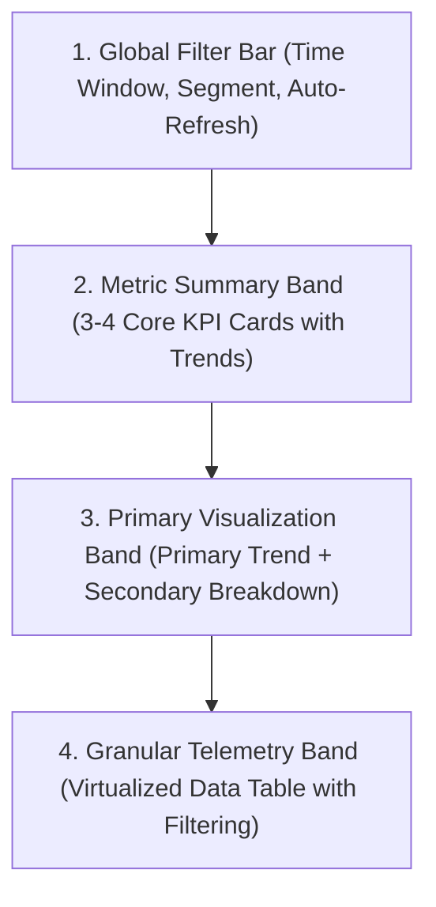

# Complex Dashboard Architecture & Engineering

> **KPI Metric Cards, Visual Grids, Telemetry Streaming & Anti-Card Fatigue**

Dashboards are the operational cockpit of modern software products. Amateur AI dashboards suffer from "card fatigue" (25 identical cards floating aimlessly on a screen) and brittle layouts. Professional engineering organizes data hierarchically, handles real-time streams gracefully, and maintains responsive rhythm.

---

## 1. Information Architecture of a Dashboard

Every production dashboard follows an inverted pyramid of detail:



---

## 2. Preventing "Card Fatigue"

> [!CAUTION]
> **Anti-Pattern: The Endless Card Grid**:
> Never wrap every metric, label, and button in its own isolated white box with drop shadows. When everything is in a card, nothing has visual priority.

### Professional Hierarchy Rules
1. **Combine Related Metrics**: Place 3-4 related metrics into a single unified summary panel with clean divider rules rather than 4 separate cards.
2. **Use Negative Space Over Borders**: Separate sections using 24px–32px vertical whitespace instead of heavy borders and shadows.
3. **Elevation Contrast**: Reserve elevated cards with subtle borders (`1px solid var(--color-border)`) for actionable widgets or interactive charts.

---

## 3. High-Fidelity Metric (KPI) Card Blueprint

A KPI card must display clear context in minimal space:

```text
+-------------------------------------------------------+
| Active Monthly Subscriptions              [Info Icon] |
| $142,850.00                                           |
| [Up Arrow] +8.4% vs previous month         [Sparkline]|
+-------------------------------------------------------+
```

### Anatomical Rules
- **Label**: 13px–14px muted text (`color-text-secondary`), unambiguous title.
- **Value**: 24px–30px bold typography (`font-weight: 600` or `700`) with localized currency/number formatting.
- **Delta Indicator**: Explicit direction (`+` or `-`), semantic color (green for positive growth, red for negative churn), and comparison baseline (`vs last 30 days`).
- **Sparkline**: Micro-chart (40px height) providing historical trend context at a glance without axes or grid lines.

---

## 4. Responsive Grid Layout Blueprint

Use a flexible 12-column CSS Grid or responsive flexbox layout:

```text
DESKTOP (>= 1200px):
[ KPI 1 (3 col) ] [ KPI 2 (3 col) ] [ KPI 3 (3 col) ] [ KPI 4 (3 col) ]
[        Primary Line Chart (8 col)        ] [ Secondary Donut (4 col) ]
[                   Granular Virtualized Table (12 col)                 ]

TABLET (768px - 1199px):
[        KPI 1 (6 col)        ] [        KPI 2 (6 col)        ]
[        KPI 3 (6 col)        ] [        KPI 4 (6 col)        ]
[                     Primary Line Chart (12 col)             ]
[                     Secondary Donut (12 col)                ]
[                   Granular Virtualized Table (12 col)       ]

MOBILE (< 768px):
All sections stack vertically into a single column (100% width).
Horizontal scroll for dense table rows or convert to card-list items.
```

---

## 5. Telemetry Streaming & Error Recovery

1. **Optimistic Loading**: When changing filters, show an unobtrusive inline loading bar or faint opacity overlay (0.7) rather than destroying the chart and flashing a full-screen spinner.
2. **Connection Status Indicators**: In streaming dashboards (WebSockets / SSE), provide a small status pill (`Connected`, `Reconnecting...`, `Offline`) in the header.
3. **Graceful Degraded State**: If a secondary widget fails to load, isolate the error inside that widget's boundary with a "Retry" button; never crash the entire dashboard page.
