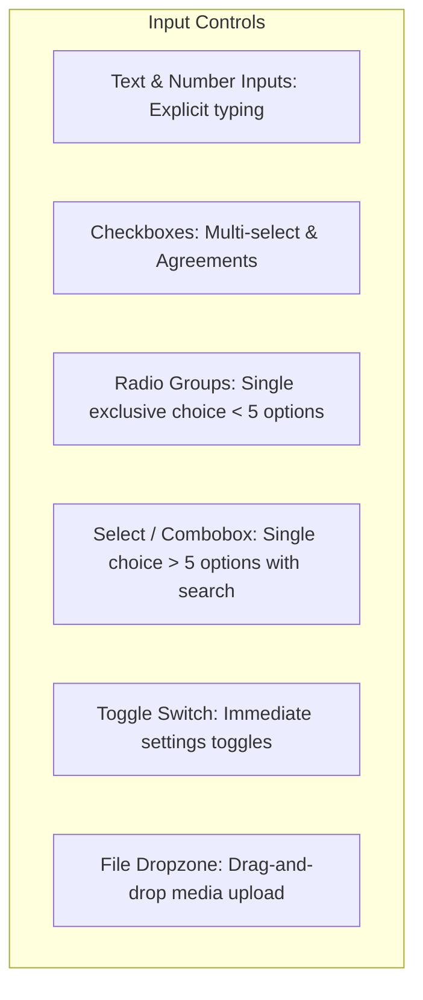

# Form Architecture & Input Controls

> Comprehensive engineering standards for form controls, schema validation, keyboard optimization, and accessible error handling.

---

## 1. Purpose

Forms represent the primary interactive bridge where users exchange data with software. Confusing layouts, disappearing labels, premature validation errors, and broken mobile keyboards lead to high abandonment rates and user frustration.

This guide defines the engineering requirements for production-grade form systems.

---

## 2. Form Control Catalog & Roles



| Control Type | Ideal Usage | Key Architectural Rule |
|---|---|---|
| **Text Field** | Single-line strings, emails, numbers | Top persistent label; never rely on placeholder alone. |
| **Text Area** | Multi-line descriptions, messages | Dynamic vertical expansion with character counter. |
| **Checkbox** | Independent options, terms agreement, table rows | Supports checked, unchecked, and **indeterminate** (`-`) states. |
| **Radio Group** | Mutually exclusive choices (2 to 5 options) | Full options visible upfront; arrow key navigation. |
| **Select / Combobox** | Large choice sets (> 5 items) | Virtualized dropdown; typeahead search filtering. |
| **Toggle Switch** | Immediate state mutations (e.g. "Dark Mode") | Takes effect immediately; do NOT require a "Save" button. |

---

## 3. Form Validation Timing Heuristics

Validation timing dramatically affects user sentiment:

```text
┌────────────────────────┬──────────────────────────────────────────────┐
│ Validation Trigger     │ Appropriate Use Case                         │
├────────────────────────┼──────────────────────────────────────────────┤
│ 1. On Blur (Focus Exit)│ Default for standard fields (email, phone).  │
│                        │ Validates after user finishes typing field.  │
├────────────────────────┼──────────────────────────────────────────────┤
│ 2. Debounced (300ms)   │ Username availability, password strength.    │
│                        │ Provides live feedback without jumping.      │
├────────────────────────┼──────────────────────────────────────────────┤
│ 3. On Submit           │ Entire form schema check. Scrolls viewport   │
│                        │ to first invalid input with summary banner.  │
├────────────────────────┼──────────────────────────────────────────────┤
│ 4. NEVER on Keystroke 1│ NEVER show red error before the user types   │
│                        │ their 3rd character. Induces anxiety.        │
└────────────────────────┴──────────────────────────────────────────────┘
```

---

## 4. Anatomy of a Production Form Field

```text
┌────────────────────────────────────────────────────────┐
│ Label Text *                     (Optional Indicator)  │  ◄── Persistent Top Label
├────────────────────────────────────────────────────────┤
│ [Prefix Icon]  Input Value Text       [Suffix Action]  │  ◄── 44px–48px Touch Box
├────────────────────────────────────────────────────────┤
│ ⚠ This field is required and must be a valid email.    │  ◄── Semantic Error Notice
└────────────────────────────────────────────────────────┘
```

### Essential Attributes:
- **`id` and `htmlFor`**: Programmatic binding between label and input.
- **`aria-invalid="true"`**: Announces validation failure to screen readers.
- **`aria-describedby="field-error-id"`**: Automatically reads the error message upon focus.
- **Mobile `inputmode` and `autocomplete`**: Configured to match data type (`email`, `tel`, `numeric`).

---

## 5. Multi-Step Form Wizards

For complex processes (onboarding, checkout, mortgage applications):
1. **Progress Indicator**: Render a clear numbered step tracker (e.g. `Step 2 of 4: Billing Address`).
2. **Step-by-Step Validation**: Validate Step 1 completely before permitting transition to Step 2.
3. **Preserve Draft State**: Persist partially filled data to local storage or state stores so accidental refreshes do not wipe progress.
4. **Allow Back Navigation**: Users must be able to return to Step 1 to edit previous entries without clearing forward progress.

---

## 6. Related Documentation

- Master Instructions: [../AGENTS.md](../AGENTS.md)
- Text Fields: [text-fields.md](text-fields.md)
- Buttons: [buttons.md](buttons.md)
- Component Principles: [component-principles.md](component-principles.md)
- Accessibility: [../design/accessibility.md](../design/accessibility.md)
