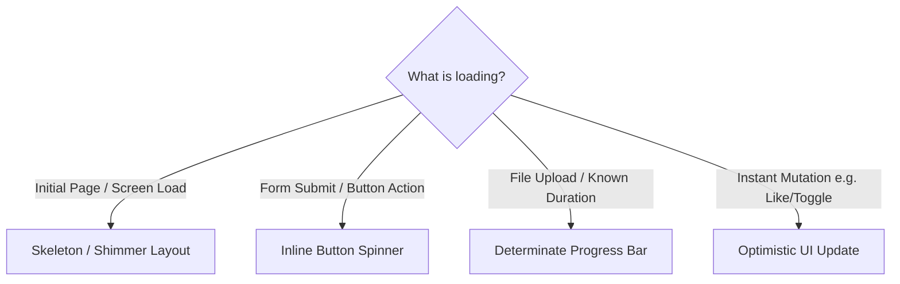

# Loading States, Skeletons & Feedback

> Engineering rules for visual feedback, perceived performance, skeleton loaders, and optimistic UI.

---

## 1. Purpose

Waiting for asynchronous data is unavoidable in network-connected software. However, poor loading feedback—such as blank white screens, jarring layout shifts (CLS), or uninformative blocking spinners—makes applications feel broken and slow. 

This guide defines the engineering standard for loading and feedback primitives.

---

## 2. Choosing the Right Loading Indicator

| Pattern | Best Used For | UX Advantage |
|---|---|---|
| **Skeleton / Shimmer** | Initial screen load, table population, feed cards | Reduces perceived wait time; eliminates layout shift (CLS) |
| **Inline Button Spinner** | Form submissions, saving settings, async actions | Keeps user in place; prevents double-taps |
| **Determinate Progress Bar** | File uploads, export generation, downloads | Gives user transparency into actual percentage remaining |
| **Optimistic UI** | Likes, bookmarks, toggles, instant reordering | Zero perceived latency; immediate tactile satisfaction |

---

## 3. Skeleton Screen Engineering Rules

Skeletons must be faithful blueprints of the content they precede:

1. **Exact Dimension Matching**:
   - The skeleton avatar must be the exact size of the final avatar (e.g. 40px circle).
   - The skeleton title must match the typography line-height and approximate width (e.g. `h-5 w-48`).
   - If the skeleton dimensions differ from the loaded data, the page will visibly jump when content arrives, ruining the Cumulative Layout Shift (CLS) score.
2. **Subtle Shimmer Motion**:
   - Use a soft linear gradient wave (`#E2E8F0` to `#F1F5F9` in light mode; `#1E293B` to `#334155` in dark mode).
   - Duration: 1.5s to 2s cycle.
   - **Reduced Motion Support**: If `prefers-reduced-motion` is enabled, freeze the wave animation and display a static, low-opacity gray block.
3. **Compound Skeleton Components**:
   - Create skeleton counterparts for shared components: `<CardSkeleton>`, `<TableRowSkeleton>`, `<UserProfileSkeleton>`.

---

## 4. Spinners & Perceived Latency

- **The 200ms Delay Threshold**: If an API call typically returns in under 200ms, displaying a spinner immediately causes an annoying visual flash. Delay the spinner visibility by 150ms–200ms:
  - If data arrives within 150ms: Show content immediately with zero spinner flicker.
  - If data takes longer: Fade in the spinner smoothly.
- **Minimum Visibility Window**: Once a spinner or skeleton is displayed, keep it visible for a minimum of 300ms to avoid jarring sub-second flashes.

---

## 5. Optimistic UI Updates

For non-destructive user actions (e.g. liking a post, toggling a favorite, archiving an email):

1. **Instant State Transition**: Update the local UI state immediately upon user tap.
2. **Background Dispatch**: Fire the asynchronous API request in the background.
3. **Rollback with User Notice**: If the network request fails:
   - Revert local state back to its previous snapshot.
   - Display a non-blocking toast alert: *"Could not save favorite. Click to retry."*

---

## 6. Loading State Anti-Patterns

1. **The Blank White Void**: Showing a blank white or black container while fetching data without an indicator, leading users to believe the app crashed.
2. **Full-Page Blocking Spinners**: Locking the entire screen with an intrusive overlay spinner when only a minor sub-panel is fetching data.
3. **The Infinite Zombie Spinner**: A spinner that loops forever because an unhandled network error caught in a try/catch block failed to update the `isLoading` flag to false. Always reset loading state in a `finally` block.

---

## 7. Related Documentation

- Master Instructions: [../AGENTS.md](../AGENTS.md)
- Buttons: [buttons.md](buttons.md)
- Animation: [../design/animation.md](../design/animation.md)
- Error Handling: [../engineering/error-handling.md](../engineering/error-handling.md)
- Performance Audit: [../quality/performance-audit.md](../quality/performance-audit.md)

