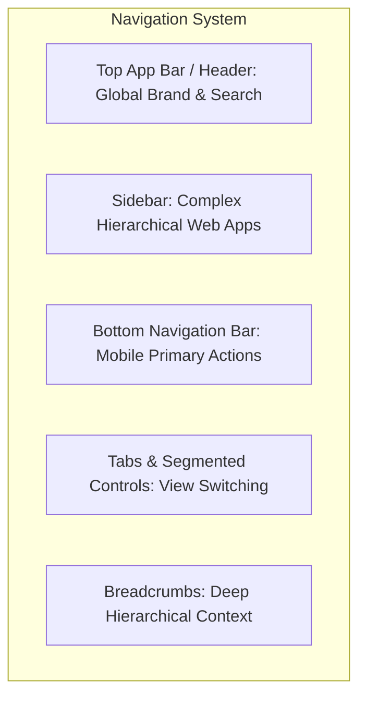

# Navigation Components & Architecture

> Patterns, responsive transitions, active states, and accessibility for navigation primitives.

---

## 1. Purpose

Navigation defines the mental map of an application. Poor navigation causes users to get lost, fail to discover features, or abandon tasks. 

This guide defines the engineering requirements for top bars, sidebars, bottom navigation, tabs, and breadcrumbs.

---

## 2. Navigation Primitives & Form Factors

### 1. Top App Bar / Header
- **Context**: Present across web desktops and mobile apps.
- **Components**: Brand logo/title, global search trigger, notification bell, user profile avatar.
- **Rule**: On mobile, keep height fixed between 48px–56px with minimal clutter.

### 2. Sidebar Navigation
- **Context**: Complex SaaS web dashboards and tablet split-views.
- **Behavior**:
  - Persistent on desktop (≥ 1024px) with widths between 240px–280px.
  - Collapsible into compact icon-only mode (64px) for data-heavy workflows.
  - Transforms into an off-canvas slide-out drawer on tablet and mobile viewports.

### 3. Bottom Navigation Bar
- **Context**: Mobile applications (< 768px).
- **Rules**:
  - **Limit to 3–5 destinations**: Fewer than 3 destinations should use tabs; more than 5 causes visual overcrowding and missed tap targets.
  - **Always label icons**: Never rely on ambiguous icons alone ("Mystery Meat Navigation"). Include a 10px–12px text label beneath every icon.
  - **Safe Area Insets**: Always incorporate bottom safe-area padding (`env(safe-area-inset-bottom)` or `SafeArea` widget) to clear mobile home indicator bars.

### 4. Tabs & Segmented Controls
- **Context**: Switching between parallel views within the same page context.
- **Styles**:
  - **Underline Tabs**: Active tab marked by high-contrast bottom border highlight.
  - **Pill / Segmented Control**: Inset rounded container with an active sliding pill background.
- **Rule**: Tabs must not trigger full-page page refreshes; they should swap views immediately in-place.

### 5. Breadcrumbs
- **Context**: Deeply nested hierarchical structures (e.g. `Projects > Frontend > Settings > Billing`).
- **Rule**: Every intermediate item is clickable; the current (final) item is static and marked with `aria-current="page"`.

---

## 3. Active State Indication

The active navigation item must be unambiguous:
- **Color**: Uses primary brand token.
- **Weight**: Shifts from regular to medium/semibold.
- **Visual Marker**: Accompanied by a 3px active bar indicator, filled icon variant, or subtle tinted background pill.
- **Accessibility**: Must include `aria-current="page"` (web) or equivalent platform accessibility trait.

---

## 4. Accessibility & Semantics

- Wrap primary navigation regions in semantic `<nav aria-label="Main Navigation">`.
- Provide a hidden-until-focused **"Skip to main content"** link at the very top of the DOM.
- Support arrow key navigation (`ArrowLeft` / `ArrowRight` or `ArrowUp` / `ArrowDown`) inside tabs and segmented controls.

---

## 5. Navigation Anti-Patterns

1. **Unlabeled Icon-Only Bottom Bars**: Displaying 5 mysterious abstract icons with no labels, forcing users to guess which screen is which.
2. **Hidden Critical Actions in Hamburger Menus on Desktop**: Hiding main navigation destinations inside a hamburger drawer when there is 1200px of empty header space available.
3. **Double Navigation Stacks**: Combining a top tab bar, a sub-navigation bar, and a bottom tab bar simultaneously on a small mobile screen, leaving 30% of the viewport for content.

---

## 6. Related Documentation

- Master Instructions: [../AGENTS.md](../AGENTS.md)
- Responsive Design: [../design/responsive-design.md](../design/responsive-design.md)
- Shared Component Rules: [shared-component-rules.md](shared-component-rules.md)
- Buttons: [buttons.md](buttons.md)

