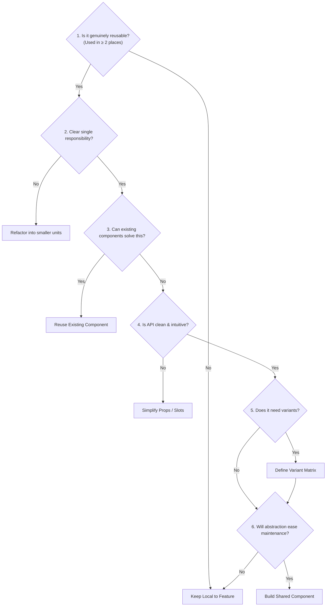

# Shared Component Engineering Rules

> Rubric, patterns, and architectural rules for designing, abstracting, and maintaining reusable UI components.

---

## 1. Purpose

Shared components are the building blocks of an application. Poorly designed components lead to prop explosion, leaky abstractions, duplication, and maintenance nightmares. 

This guide defines the qualification rubric and API design standards for all reusable UI components.

---

## 2. The 6-Question Qualification Rubric

Before extracting or creating a shared component, every AI agent must answer these six questions:



1. **Is it genuinely reusable?** Does this pattern appear in at least two distinct screens or workflows? If it only exists on one screen, keep it co-located in that screen's folder.
2. **Does it have a single clear responsibility?** Does it do one thing well (e.g. render a button, display an avatar), or does it attempt to be an avatar, badge, dropdown, and tooltip all at once?
3. **Can existing project components already solve this?** Check the repository's `components/` or `ui/` directory before building from scratch.
4. **Is the API understandable?** Can an engineer read the props/parameters and immediately grasp how to use it without reading 200 lines of implementation code?
5. **Does it need variants or configuration?** Are variants modeled cleanly via enumerated types (e.g. `variant="primary" | "secondary" | "destructive"`)?
6. **Will abstraction make maintenance easier?** Will updating this shared component improve consistency, or will it create fragile conditional branches (`if (isHeader) ... else if (isModal) ...`)?

---

## 3. Component API Design Guidelines

### 1. Sensible Defaults
Components must work out-of-the-box with minimal required parameters:
```dart
// Good: Sensible defaults, only label and action required
AppButton(
  label: 'Save Changes',
  onPressed: handleSave,
);

// Bad: Requiring excessive boilerplate for standard behavior
AppButton(
  label: 'Save Changes',
  onPressed: handleSave,
  variant: AppButtonVariant.primary,
  size: AppButtonSize.medium,
  isFullWidth: false,
  isDisabled: false,
  isLoading: false,
);
```

### 2. Avoid Parameter Explosion (The 25-Parameter Megawidget)
When a widget accumulates 15+ constructor parameters, it is doing too much. Break it down using **Widget Composition**:

```dart
// Anti-Pattern: Megawidget (parameter creep for a rigid layout)
AppProfileCard(
  title: "Profile", 
  titleColor: Colors.blue, 
  subtitle: "Manage account", 
  avatarUrl: "/pic.jpg", 
  hasBadge: true, 
  badgeText: "Active", 
  actionButtonText: "Edit", 
  onActionClick: handleEdit, 
);

// Idiomatic: Flutter Widget Composition
AppCard(
  child: Column(
    crossAxisAlignment: CrossAxisAlignment.start,
    children: [
      Row(
        children: [
          const CircleAvatar(backgroundImage: AssetImage('assets/pic.jpg')),
          const SizedBox(width: 12),
          Expanded(
            child: Column(
              crossAxisAlignment: CrossAxisAlignment.start,
              children: [
                Text('Profile', style: theme.textTheme.titleMedium),
                Text('Manage account', style: theme.textTheme.bodySmall),
              ],
            ),
          ),
          const AppBadge.success(label: 'Active'),
        ],
      ),
      const SizedBox(height: 16),
      AppButton.secondary(label: 'Edit', onPressed: handleEdit),
    ],
  ),
);
```

### 3. Support the 5 Mandatory States
Every interactive component must explicitly handle and test:
1. **Default / Rest**: Standard resting appearance.
2. **Hover / Focus**: Visual feedback on cursor hover or keyboard focus ring.
3. **Active / Pressed**: Tactile feedback on click/tap.
4. **Disabled**: Visual attenuation (e.g. 50% opacity, `cursor: not-allowed`) and suppression of all click events.
5. **Loading**: Indication of ongoing action while preventing duplicate submissions.

---

## 4. Component Evolution Path

```text
Feature-Specific View ──► Feature-Shared Component ──► Global Design System Primitive
     (Screen-only)              (Inside feature/)            (Inside core/components/)
```

1. **Stage 1 (Feature-Specific)**: Implement the UI directly inside the feature page while requirements are fluid.
2. **Stage 2 (Feature-Shared)**: When 2–3 views inside the same feature need the pattern, move it to `features/<feature>/components/`.
3. **Stage 3 (Global Shared)**: When multiple independent features require the pattern, generalize its API, document its props, add unit tests, and promote it to `components/ui/` or `core/components/`.

---

## 5. Related Documentation

- Master Instructions: [../AGENTS.md](../AGENTS.md)
- Buttons: [buttons.md](buttons.md)
- Text Fields: [text-fields.md](text-fields.md)
- Cards: [cards.md](cards.md)
- Shared Component Workflow: [../workflows/shared-component.md](../workflows/shared-component.md)

