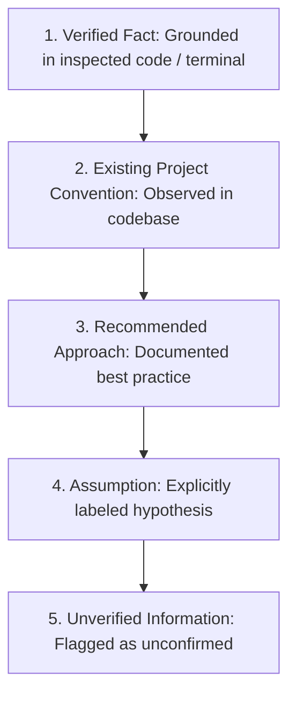
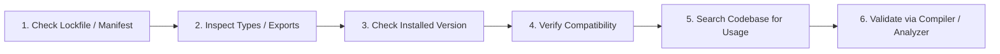

# Anti-Hallucination & Evidence-Based Engineering

> Mandatory standards preventing AI coding agents from fabricating APIs, dependencies, configurations, file paths, and test results.

---

## 1. Purpose & The Critical Imperative

One of the most destructive behaviors of AI coding assistants is **hallucination**: inventing non-existent package dependencies, generating plausible-sounding but fictitious API methods, citing fabricated configuration options, or falsely asserting that tests passed without executing them.

In production engineering, a hallucinated dependency breaks builds; a fabricated API method introduces subtle runtime crashes; an unverified test report erodes trust. 

This guide defines the non-negotiable **Evidence-Based Engineering** protocol that all AI agents must follow.

---

## 2. What AI Agents Must NEVER Invent

Under no circumstances may an AI agent fabricate or assume the existence of:

1. **Package & Library Names**: Recommending third-party packages without verifying that they exist in the official package registry (`npm`, `pub.dev`, `Maven`, `crates.io`, `PyPI`).
2. **API Methods & Parameters**: Invoking methods, flags, or parameters on external or internal classes without verifying their signatures in source code or installed type definitions.
3. **Dependency Versions**: Hardcoding arbitrary version numbers (e.g. `^4.18.2`) without inspecting existing lockfiles (`package-lock.json`, `pubspec.lock`, `yarn.lock`).
4. **Configuration Options**: Inventing compiler flags, linter rules, or framework config properties in `tsconfig.json`, `next.config.js`, `build.gradle.kts`, or `vite.config.ts`.
5. **File Paths & Directory Structures**: Assuming that files live at specific paths (e.g. `/src/utils/api.ts`) without running discovery tools or reading directory trees.
6. **Test & Build Results**: Claiming that tests passed, compilation succeeded, or benchmarks achieved 60fps without terminal execution evidence.
7. **Platform Capabilities**: Assuming a web API is universally available on native mobile, or vice versa, without verifying platform support.

---

## 3. The 5-Tier Truth Classification

Every technical statement, architectural proposal, or implementation choice must adhere to this classification:

| Tier | Definition | Example Statement |
|---|---|---|
| **1. Verified Fact** | Confirmed by inspecting project files or running commands | *"Checked `package.json`: Project is using Next.js version 15.0.3 and React 19."* |
| **2. Existing Project Convention** | Established pattern observed in current repository code | *"Existing screens in `src/features/` encapsulate state in custom hooks."* |
| **3. Recommended Approach** | Official community pattern supported by framework documentation | *"In Next.js 15, route handlers should handle mutation via Server Actions."* |
| **4. Assumption** | Plausible premise that has not yet been verified against code | *"Assumption: The backend API returns timestamps in ISO 8601 UTC format. Needs verification."* |
| **5. Unverified Information** | Uncertain claim where documentation or tests are unavailable | *"Unverified: Whether this specific third-party calendar widget supports RTL layout without custom CSS overrides."* |

> [!CAUTION]
> If an agent is uncertain about an API, dependency, or version, it MUST classify it as an **Assumption** or **Unverified Information** rather than presenting it as a confirmed fact.

---

## 4. The 6-Step Verification Protocol

Before writing code that consumes an unfamiliar internal module or external dependency:

1. **Check Lockfile & Manifest**: Confirm the exact installed package and version in `package.json`, `pubspec.yaml`, `build.gradle.kts`, or lockfiles.
2. **Inspect Types & Signatures**: Read the `.d.ts` declaration file, Dart doc comments, or Kotlin/Swift interface to confirm the exact parameter names and types.
3. **Search for Existing Usage**: Search the repository (e.g. using grep or file search) to see how the team already invokes this module.
4. **Verify Runtime Compatibility**: Confirm that the API works in the target runtime (Node.js version, browser baseline, Dart SDK constraint, iOS deployment target).
5. **Prefer Local Verified Patterns**: Mimic patterns already proven to work in the project rather than introducing unvetted patterns from training weights.
6. **Validate via Compiler**: Run static type-checking (`tsc --noEmit`, `dart analyze`, `./gradlew compileDebugSources`) immediately after writing code.

---

## 5. Absolute Truth in Execution Reporting

AI agents must report execution outcomes with strict, unimpeachable honesty:

- **PASSED**: The command was executed in the workspace shell and returned exit code 0 with matching assertions.
- **FAILED**: The command was executed and failed with a specific non-zero exit code or error output.
- **SKIPPED**: The test was intentionally omitted (with an explicit technical reason).
- **BLOCKED**: The check could not run due to missing environment tooling, dependencies, or permissions.
- **NOT APPLICABLE**: The check does not apply to this specific task (e.g. Android tests on a React web task).

> [!IMPORTANT]
> Never say "All 24 tests passed" if you did not execute the test runner. Fabricating test output is a severe violation of engineering ethics.

---

## 6. Related Documentation

- Master Instructions: [../AGENTS.md](../AGENTS.md)
- Recovery Protocol: [recovery-protocol.md](recovery-protocol.md)
- Checkpoint Management: [checkpoint-management.md](checkpoint-management.md)
- Project Discovery: [project-discovery.md](project-discovery.md)
- Quality & Testing: [../quality/testing.md](../quality/testing.md)
