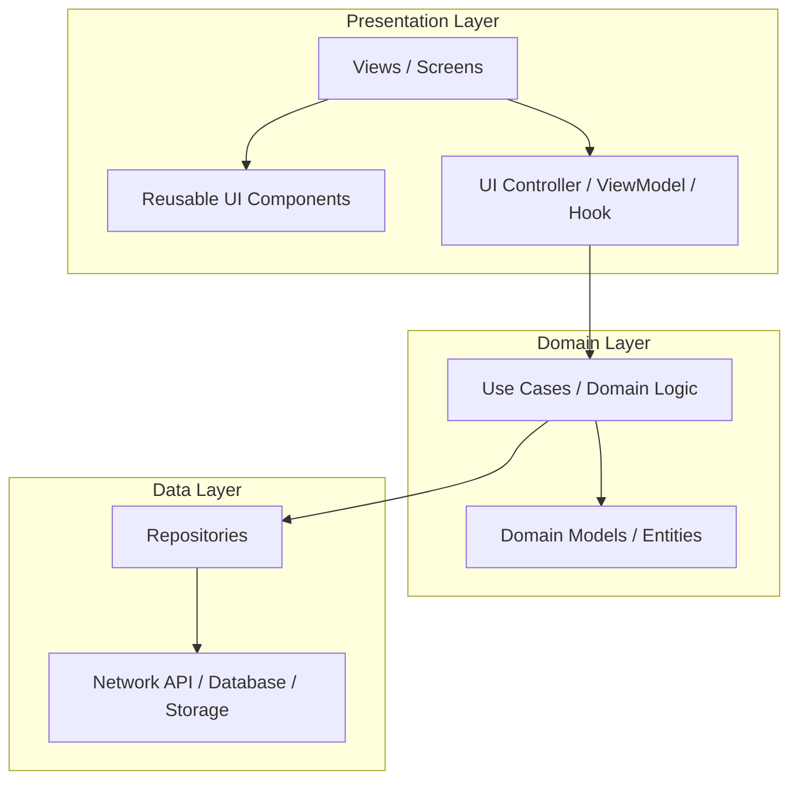
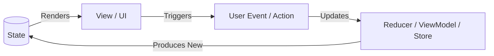

# UI Architecture & Separation of Concerns

> Universal principles for structuring maintainable, scalable, and testable user interface applications.

---

## 1. Purpose

Fragile UI codebases typically suffer from one underlying defect: mixing presentation rendering, business logic, asynchronous networking, and state mutation in a single component. 

This guide defines the universal presentation architecture that keeps UI layers clean, modular, and resilient across any framework.

---

## 2. The 3-Tier Layered Architecture

Regardless of framework (React, Flutter, Android, iOS, or Web), code should separate into three distinct layers:

### 1. Presentation Layer
- **Responsibility**: Rendering visual hierarchy, reacting to user inputs (clicks, gestures, typing), and reflecting state.
- **Rules**:
  - Components should be declarative functions of state.
  - Never initiate raw HTTP calls or database queries directly within a render method or template.
  - Delegate event handling to controllers, hooks, or ViewModels.

### 2. Domain / Logic Layer
- **Responsibility**: Pure business rules, data transformations, input validation, and user workflow orchestration.
- **Rules**:
  - Independent of UI rendering libraries.
  - Easily unit testable without mocking UI frames or DOM trees.

### 3. Data Layer
- **Responsibility**: Fetching, caching, mapping raw JSON to strongly-typed models, and managing network or persistence clients.
- **Rules**:
  - Encapsulated behind repository interfaces or query client abstractions.

---

## 3. Presentational (Dumb) vs. Container (Smart) Components

To ensure high reusability and clean testability, divide UI elements into two categories:

### Presentational Components (Dumb)
- **Role**: Render visual elements based strictly on passed-in properties/props.
- **Characteristics**:
  - Contain no side effects or API calls.
  - Rely exclusively on explicit parameters (data inputs) and callbacks (event outputs).
  - Highly reusable across different screens and features (e.g., buttons, input fields, badges, cards).

### Container Components / Views (Smart)
- **Role**: Bind domain state to presentational components and handle navigation or side effects.
- **Characteristics**:
  - Connected to state stores, ViewModels, or data-fetching hooks.
  - Handle screen lifecycle (mount, focus, unmount).
  - Orchestrate transitions between views.

---

## 4. Unidirectional Data Flow (UDF)

All production UI architectures must enforce unidirectional data flow:

1. **State Flows Down**: Views receive immutable state snapshots.
2. **Events Flow Up**: User interactions trigger explicit callbacks or dispatched events.
3. **No Backdoor Mutation**: Never mutate shared state objects directly in-place; state transitions must be explicit and deterministic.

---

## 5. Architectural Anti-Patterns

1. **The "God View"**: A single screen file exceeding 800+ lines that fetches data, manages 15 local states, contains 20 inline sub-widgets, and performs complex regex validation.
2. **Prop Drilling / Parameter Pass-Through**: Routing dependencies through 8 intermediate layers of presentation components that do not need them. Use context, composition, or state injectors.
3. **Leaky Network Abstractions**: UI widgets parsing raw JSON response maps or checking HTTP status codes (e.g. `if (response.statusCode == 200)` inside a button handler).
4. **Side Effects in Pure Render Loops**: Calling analytics triggers, navigation pushes, or state updates directly inside a widget build or component render block.

---

## 6. Adapting to Existing Codebases

Do not forcefully re-architect a working codebase. 
- If the project uses **Redux**, use Redux Toolkit idiomatic patterns.
- If it uses **BLoC** or **Riverpod** in Flutter, structure code according to established community best practices.
- If it uses **Jetpack Compose + ViewModel** or **SwiftUI + Observation**, align with platform-idiomatic reactive state patterns.

---

## 7. Related Documentation

- Master Instructions: [AGENTS.md](../AGENTS.md)
- Folder Structure Standards: [folder-structure.md](folder-structure.md)
- State Management: [../engineering/state-management.md](../engineering/state-management.md)
- Architecture Patterns: [../engineering/architecture-patterns.md](../engineering/architecture-patterns.md)
- Architecture Plan Template: [../templates/architecture-plan.md](../templates/architecture-plan.md)

