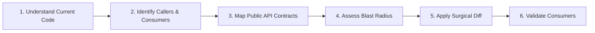

# Safe Refactoring & Change Control

> Strict engineering constraints for modifying existing UI code without introducing regressions, breaking public APIs, or altering unrelated files.

---

## 1. Purpose

Careless refactoring is a primary source of regressions in production codebases. AI agents frequently fall into the trap of rewriting entire 400-line files to change a single button style, renaming component props without updating existing callers, or silently dropping edge-case validation logic.

This guide defines strict **Change Control Standards** to guarantee safe, reversible, and predictable modifications.

---

## 2. The 6-Step Pre-Modification Discipline

Before altering any existing file, the agent must execute this sequence:



1. **Understand Current Implementation**: Read the entire file and its comments. Understand why existing branches or guards exist before deleting them.
2. **Identify Dependencies & Consumers**: Search the repository for all imports/callers of this component or function.
3. **Map Public API Contracts**: Note all exported interfaces, prop names, and default values.
4. **Assess Blast Radius**: Determine if the proposed edit is localized (private internal logic) or global (shared UI component used in 15 screens).
5. **Apply Surgical Diffs**: Modify only the minimal necessary lines. Preserve unrelated comments, docstrings, and formatting.
6. **Validate Consumers**: Ensure that existing callers continue to compile and render properly.

---

## 3. The "Never Do" List for Refactoring

Under no circumstances should an agent:

1. **NEVER Rewrite Entire Files Unnecessarily**: If modifying 5 lines inside a function or widget, make a localized edit. Do not overwrite the entire file with newly generated boilerplate.
2. **NEVER Replace Architecture for Fashion**: Never rewrite an existing Provider app into Riverpod, or a BLoC app into Cubit, without first explaining the decision in Bengali and obtaining explicit user permission.
3. **NEVER Add Dependencies Without Justification**: Do not add a third-party pub package to `pubspec.yaml` without a genuine technical need and explicit user approval in Bengali.
4. **NEVER Alter UI During a Logic-Only Refactor**: When assigned to optimize performance or refactor state logic, the visual appearance of the UI must remain identical.
5. **NEVER Silently Remove Existing Functionality**: If an existing component handles an obscure error state or keyboard shortcut, preserve it.
6. **NEVER Suppress Errors Instead of Fixing Them**: Never add `// ignore: ...` or empty catch blocks (`catch (e) {}`) to mask Flutter compilation or runtime failures.

---

## 4. Preserving Backward Compatibility

When evolving shared component APIs:

```typescript
// Anti-Pattern: Breaking existing callers by removing or renaming props
// Before: <Button variant="primary" label="Save" />
// Breaking Change:
interface ButtonProps {
  buttonStyle: 'solid'; // Renamed from 'variant', broke 40 callers!
  children: ReactNode;  // Required instead of label, broke all callers!
}

// Best Practice: Backward-compatible evolution
interface ButtonProps {
  /** @deprecated Use variant instead */
  buttonStyle?: 'solid' | 'outline';
  variant?: 'primary' | 'secondary' | 'ghost';
  label?: string;
  children?: ReactNode;
}
```

Provide fallback support and deprecation notices so that existing callers continue to work seamlessly.

---

## 5. Incremental Checkpoint Strategy for Risky Refactors

For major structural refactorings (e.g. decomposing an 800-line monolithic screen):
1. **Checkpoint 1**: Extract shared presentational sub-widgets without altering state. Run tests to confirm zero regression.
2. **Checkpoint 2**: Extract business logic into a dedicated hook or ViewModel. Confirm behavior is unchanged.
3. **Checkpoint 3**: Clean up the main view to act as a pure coordinator.
4. Run full test suite and audit responsive layout across viewports.

---

## 6. Related Documentation

- Master Instructions: [../AGENTS.md](../AGENTS.md)
- Clean Code Standards: [../engineering/clean-code.md](../engineering/clean-code.md)
- Refactoring Workflow: [../workflows/refactoring.md](../workflows/refactoring.md)
- Recovery Protocol: [recovery-protocol.md](recovery-protocol.md)
- Checkpoint Management: [checkpoint-management.md](checkpoint-management.md)

