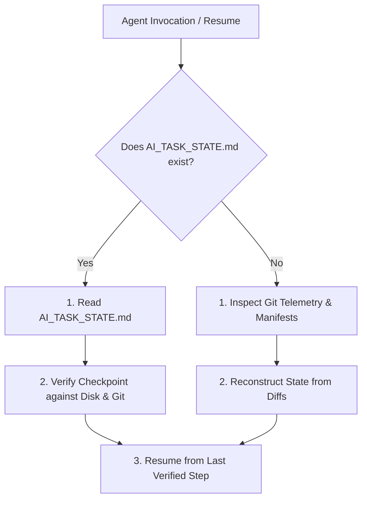

# Checkpoint & Task Progress Management

> Standards for recording progress, maintaining execution checkpoints, and resuming multi-turn tasks via `AI_TASK_STATE.md`.

---

## 1. Purpose

AI coding sessions frequently span multiple interactions, tool executions, or subagent tasks. When an execution is paused, hits a context limit, or encounters an unexpected disconnect, the agent must be able to reconstruct exact progress without re-running completed work or asking the user to repeat instructions.

This guide defines the standardized **Checkpoint Management Protocol** using `AI_TASK_STATE.md`.

---

## 2. When to Create and Maintain Checkpoints

- **CREATE Checkpoints For**:
  - Complex screen implementations or multi-file features.
  - Large-scale UI refactorings or design system migrations.
  - Performance optimization loops.
  - Multi-step bug debugging workflows.
- **DO NOT Create Checkpoints For**:
  - Trivial one-line edits (e.g. fixing a typo, updating a single color token).
  - Quick, single-turn query answers.

---

## 3. Standard `AI_TASK_STATE.md` Schema

When tracking substantial tasks, maintain an `AI_TASK_STATE.md` file in the project root:

```markdown
# AI Task State

- **Task Title**: [Concise task description, e.g. "Implement Responsive Billing Dashboard"]
- **Target Framework**: [e.g. Next.js 15 App Router / Tailwind CSS]
- **Current Phase**: [Phase 1 to 5 / 14-Step Workflow Stage]
- **Status**: [IN PROGRESS / BLOCKED / VERIFIED]

---

## Completed Milestones
- [x] Phase 1: Project Discovery & Token Inventory
- [x] Phase 2: Shared Primitives (`MetricCard`, `BillingBadge`) implemented & tested
- [x] Phase 3: Layout scaffolding with mobile-responsive stack

---

## Active Checkpoint & Execution State
- **Active Step**: Wiring `InvoiceTable` to the `useInvoices` server query.
- **Modified Files**:
  - `src/components/ui/MetricCard.tsx` (Verified & Passing)
  - `src/features/billing/components/InvoiceTable.tsx` (Partially written)
- **Last Verified Checkpoint**: Commit `a1b2c3d` / Tests passing on `MetricCard`.
- **Known Errors / Roadblocks**: None.
- **Next Safe Action**: Complete invoice status cell rendering and write component tests.
```

---

## 4. The 4 Golden Rules of Checkpoint Management

1. **Update at Meaningful Milestones**: Update `AI_TASK_STATE.md` after completing a coherent sub-task (e.g. building a component, passing a test suite, resolving a layout bug), not after every keystroke.
2. **Ground Checkpoints in Reality**: The state file is an index, NOT a substitute for reality. Before resuming from a checkpoint, the agent must verify that files on disk actually match the recorded state (`git status`, file inspection).
3. **Clean Up or Archive Upon Completion**: Once a feature is fully implemented, verified, and committed, delete `AI_TASK_STATE.md` or archive its summary in the PR description to prevent stale state from confusing future sessions.
4. **Preserve Checkpoint Integrity**: If a checkpoint is found to be invalid (e.g. someone manually edited files), update the state file immediately to reflect current reality before making further changes.

---

## 5. Resuming Interrupted Work Protocol

When an agent begins a session or is invoked with `/human-ui recover`:



1. **Read `AI_TASK_STATE.md`**: Note the recorded objective, completed milestones, and active step.
2. **Verify Against Disk**: Run `git status` and inspect the modified files to ensure the checkpoint is intact.
3. **Resume Without Repeating**: Pick up directly from the "Next Safe Action". Never regenerate components that are already complete and functional.

---

## 6. Related Documentation

- Master Instructions: [../AGENTS.md](../AGENTS.md)
- Recovery Protocol: [recovery-protocol.md](recovery-protocol.md)
- Anti-Hallucination: [anti-hallucination.md](anti-hallucination.md)
- Task State Template: [../templates/task-state.md](../templates/task-state.md)
- Recovery Workflow: [../workflows/recovery.md](../workflows/recovery.md)
