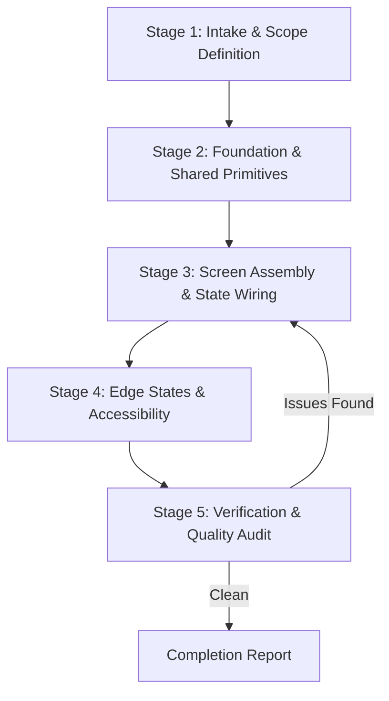

# UI Development Workflow

> Operational procedure for executing UI engineering tasks cleanly, safely, and predictably.

---

## 1. Purpose

Chaotic task execution leads to regressions, broken layouts, incomplete states, and missed requirements. 

This guide outlines the standard operating cycle for implementing UI features, refactoring existing views, or fixing visual defects.

---

## 2. The 5-Stage Engineering Loop

### Stage 1: Intake & Scope Definition
1. Review the requirement, wireframe, or bug report.
2. Check existing components and tokens.
3. Formulate the execution plan:
   - What shared primitives are needed?
   - What state is required (local vs global vs server cache)?
   - What API endpoints or mock models are involved?
4. If the task changes existing architecture or adds a heavy dependency, request approval before proceeding.

### Stage 2: Foundation & Shared Primitives
1. Create or update design tokens in the design system if new colors, spacings, or font sizes are introduced.
2. Construct needed reusable components (e.g. specialized buttons, badges, custom inputs).
3. Ensure each primitive supports all states:
   - Default
   - Hover / Pressed / Focused
   - Loading
   - Disabled
   - Error

### Stage 3: Screen Assembly & State Wiring
1. Structure layout using responsive containers (flex, grid, column, row).
2. Assemble views using the shared primitives created in Stage 2.
3. Bind UI components to state management (ViewModels, controllers, hooks, stores).
4. Isolate business logic outside the rendering tree.

### Stage 4: Edge States & Polish
A feature is never complete until all four UI states are implemented:
1. **Loading State**: Skeleton, shimmer, or focused spinner (never an empty white screen).
2. **Empty State**: Meaningful illustration/icon, descriptive copy, and a primary call-to-action.
3. **Error State**: Informative error message and a retry mechanism.
4. **Success / Populated State**: The primary happy path layout.

### Stage 5: Verification & Quality Audit
1. **Visual & Responsive Verification**: Test viewports (mobile: 375px/390px, tablet: 768px/834px, desktop: 1280px/1440px). Ensure no overflow errors or truncated critical copy.
2. **Accessibility (A11y)**: Test keyboard navigation, focus indicators, screen reader labels (`aria-label`, `Semantics`, `contentDescription`), and minimum touch targets (44x44pt / 48x48dp).
3. **Performance & Memory**: Verify no unbounded list rendering; ensure controllers, subscriptions, and listeners are properly disposed of.
4. **Automated Tests**: Execute existing unit and widget tests; write new regression tests covering the implemented behavior.

---

## 3. Safe Refactoring Guidelines

When modifying existing UI code:
- **Never delete working features silently**: Ensure all existing user flows remain intact.
- **Maintain backward compatibility of component APIs**: If adding a new parameter to a shared component, provide a sensible default value so existing callers do not break.
- **Isolate edits**: Avoid unnecessary formatting changes in unrelated files to keep diffs legible.

---

## 4. Related Documentation

- Master Instructions: [AGENTS.md](../AGENTS.md)
- Agent Behavior: [agent-behavior.md](agent-behavior.md)
- Shared Component Rules: [../components/shared-component-rules.md](../components/shared-component-rules.md)
- UI Review Checklist: [../quality/ui-review.md](../quality/ui-review.md)
- Release Checklist: [../quality/release-checklist.md](../quality/release-checklist.md)
