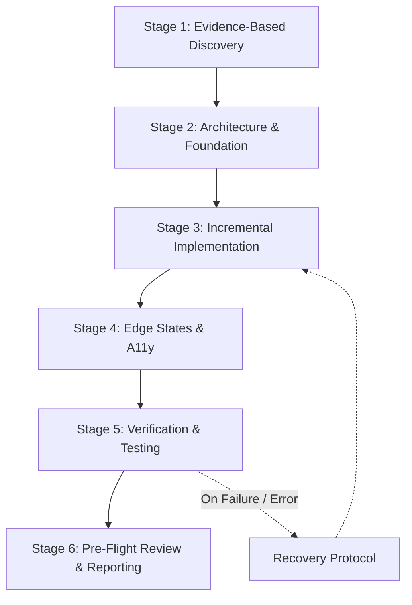

# Universal Engineering Workflow

> The end-to-end operational execution workflow for AI coding agents operating across any programming language, framework, or platform.

---

## 1. Purpose

High-reliability engineering requires a consistent, repeatable operational loop. Regardless of whether an agent is building a new screen in Flutter, refactoring a React Native module, or fixing a memory leak in Next.js, this universal workflow governs every stage of the lifecycle.

---

## 2. The 6-Stage Universal Engineering Lifecycle

---

### Stage 1: Evidence-Based Discovery & Intake
- **Inspect Root & Manifests**: Read `package.json`, `pubspec.yaml`, `build.gradle.kts`, `Package.swift`, `angular.json` to identify active frameworks, versions, and build tooling.
- **Monorepo Detection**: If working in a monorepository (Nx, Turborepo, Melos, Gradle multi-project), identify package boundaries and isolate the specific subproject.
- **Token & Primitive Inventory**: Locate existing design tokens (colors, typography, spacing) and reusable components before writing any code.
- Reference: [Project Discovery](project-discovery.md) & [Anti-Hallucination](anti-hallucination.md).

---

### Stage 2: Architecture & Foundation Precedence
- **Presentation Architecture**: Enforce strict separation between visual rendering and business logic (ViewModels, Controllers, Hooks, BLoC).
- **Material Change Approval**: Stop and seek explicit developer approval before introducing new dependencies, changing state paradigms, or altering database contracts.
- **Foundation First**: Build or update shared primitives and design tokens before assembling feature views.
- Reference: [Architecture](architecture.md) & [Folder Structure](folder-structure.md).

---

### Stage 3: Incremental Implementation & Scope Preservation
- **Unidirectional Data Flow**: Maintain immutable state downward; emit explicit event callbacks upward.
- **Change Control**: Refactor surgically. Never rewrite entire files unnecessarily or touch unrelated code.
- **Checkpoint Tracking**: On multi-file or complex tasks, record ongoing progress in `AI_TASK_STATE.md`.
- Reference: [Change Control](change-control.md) & [Checkpoint Management](checkpoint-management.md).

---

### Stage 4: Four Mandatory States & Accessibility
Every interactive feature must explicitly handle:
1. **Loading State**: Skeletons or spinners matching the loaded content proportions.
2. **Empty State**: Descriptive message, visual icon, and primary call-to-action.
3. **Error State**: Actionable human-readable error message and retry button.
4. **Success State**: Populated happy-path layout.
- **Accessibility Conformance**: Ensure WCAG 2.1 AA contrast (≥ 4.5:1), visible keyboard focus rings, semantic markup, and minimum touch target sizes (≥ 44x44pt / 48x48dp).
- Reference: [Accessibility](../design/accessibility.md) & [Loading States](../components/loading-states.md).

---

### Stage 5: Verification & Automated Testing
- **Test Pyramids**: Run existing unit, component/widget, and integration test suites.
- **Honest Telemetry Reporting**: Classify test outcomes accurately as **PASSED**, **FAILED**, **SKIPPED**, or **BLOCKED**. Never fabricate test passes.
- **Autonomous Recovery**: If tests or builds fail, trigger the [Recovery Protocol](recovery-protocol.md) to diagnose root causes without discarding progress.
- Reference: [Testing Standards](../quality/testing.md) & [Recovery Protocol](recovery-protocol.md).

---

### Stage 6: Pre-Flight Review & Reporting
- Execute the [8-Point Release Checklist](../quality/release-checklist.md).
- Verify responsive layout across mobile (375px), tablet (768px), and desktop (1280px+).
- Clean up intermediate task artifacts.
- Provide a concise completion summary listing modified files, verified outcomes, and remaining limitations.

---

## 3. Related Documentation

- Master Instructions: [../AGENTS.md](../AGENTS.md)
- Development Workflow: [development-workflow.md](development-workflow.md)
- Recovery Protocol: [recovery-protocol.md](recovery-protocol.md)
- Checkpoint Management: [checkpoint-management.md](checkpoint-management.md)
- Release Checklist: [../quality/release-checklist.md](../quality/release-checklist.md)
