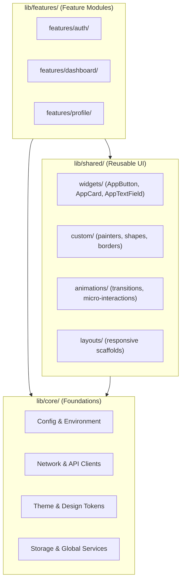

# Flutter Project & Folder Structure Conventions

> **Mandatory Standard Directory Architecture** for production Flutter applications: `lib/core/`, `lib/shared/`, and `lib/features/`.

Chaotic folder layouts lead to lost widgets, duplicated state logic, circular imports, and unmaintainable codebases. In the Human Flutter Engineering system, all Flutter projects enforce a strict 3-tier architecture:

```text
lib/
├── core/       # Global foundational infrastructure and configuration
├── shared/     # Cross-feature reusable widgets, custom painters, and animations
└── features/   # Independent, feature-first functional modules
```

---

## 1. Top-Level Architectural Boundaries



- **`features/`** can consume `core/` and `shared/`.
- **`shared/`** can consume `core/`, but **never** imports `features/`.
- **`core/`** has zero knowledge of `shared/` or `features/`.

---

## 2. `lib/core/` — Foundational Infrastructure

The `core/` folder hosts application-wide, non-feature foundational infrastructure:

```text
lib/core/
├── config/             # Environment configs (Env, AppConfig)
├── constants/          # App constants, API endpoints, asset keys
├── errors/             # Failure definitions (ServerFailure, CacheFailure)
├── exceptions/         # System exceptions (NetworkException, ParseException)
├── extensions/         # Dart extensions on BuildContext, String, DateTime
├── helpers/            # Reusable helper functions and formatters
├── initializers/       # Async initialization routines (Firebase, local storage)
├── network/            # HTTP clients, Dio interceptors, SSL pinning
├── routing/            # Router configuration (GoRouter, AppRoutes, Guards)
├── services/           # Global services (Connectivity, Analytics, Permissions)
├── storage/            # Local storage clients (SecureStorage, SharedPreferences)
├── theme/              # Centralized Design Tokens
│   ├── app_colors.dart       # Color tokens, ColorScheme, ThemeExtensions
│   ├── app_theme.dart        # Light and Dark ThemeData constructors
│   ├── app_typography.dart   # TextTheme configurations
│   ├── app_spacing.dart      # 4pt/8pt spatial grid constants
│   ├── app_radius.dart       # Corner radius constants
│   └── app_elevation.dart    # Surface elevation and shadow tokens
├── utils/              # Pure algorithmic utilities and loggers
└── core.dart           # Barrel export
```

---

## 3. `lib/shared/` — Reusable UI & Supporting Components

Contains UI widget primitives, custom graphics, animations, and adaptive layouts used across multiple features:

```text
lib/shared/
├── widgets/            # Reusable UI primitives
│   ├── buttons/        # AppButton, AppIconButton
│   ├── cards/          # AppCard, AppElevatedCard
│   ├── containers/     # ResponsiveContainer, GlassCard
│   ├── dialogs/        # ConfirmDialog, InfoDialog
│   ├── inputs/         # AppTextField, DropdownField
│   ├── indicators/     # StatusBadge, StepIndicator
│   ├── loaders/        # ShimmerBox, SkeletonLoader
│   ├── navigation/     # AppNavigationBar, AdaptiveNavRail
│   ├── app_bars/       # CustomAppBar, CollapsibleAppBar
│   ├── avatars/        # UserAvatar, GroupAvatar
│   ├── badges/         # CountBadge, DotBadge
│   ├── dividers/       # SectionDivider, LabeledDivider
│   ├── menus/          # ContextMenu, DropdownMenu
│   ├── sheets/         # ModalBottomSheet, DragHandleSheet
│   └── widgets.dart
│
├── custom/             # Custom rendering and drawing
│   ├── painters/       # CustomPainter implementations
│   ├── shapes/         # CustomShapeBorder, ClipPaths
│   ├── borders/        # DashedBorder, GradientBorder
│   └── effects/        # ShadowDecorations, GlassMorphism
│
├── animations/         # Reusable animations
│   ├── transitions/    # SharedAxisTransition, PageTransitions
│   ├── implicit/       # AnimatedPressScale, AnimatedVisibility
│   └── explicit/       # ShimmerAnimation, PulseAnimation
│
├── layouts/            # Adaptive structural scaffolds
│   ├── responsive/     # ResponsiveLayoutBuilder, AdaptiveGrid
│   └── adaptive/       # AdaptivePlatformScaffold
│
└── shared.dart         # Universal shared barrel export
```

---

## 4. `lib/features/` — Feature-First Modules

All application features live inside `lib/features/`. Each feature manages its own data, domain, and presentation:

```text
lib/features/
├── authentication/
│   ├── data/                   # Data Access Layer
│   │   ├── datasources/        # Remote API endpoints, local cache
│   │   ├── models/             # DTOs, JSON serialization
│   │   └── repositories/       # Repository implementations
│   │
│   ├── domain/                 # Core Business Logic Layer
│   │   ├── entities/           # Pure Dart business models (@immutable)
│   │   ├── repositories/       # Abstract repository interfaces
│   │   └── usecases/           # Single-responsibility use cases
│   │
│   ├── presentation/           # Presentation Layer
│   │   ├── screens/            # Full-screen views (or pages/)
│   │   ├── pages/              # Composite multi-tab pages
│   │   ├── widgets/            # Feature-private reusable widgets
│   │   ├── components/         # Micro-components scoped to this feature
│   │   └── state/              # State management (BLoC, Cubit, Notifier)
│   │
│   ├── authentication.dart     # Public feature interface
│   └── README.md
│
├── dashboard/
├── settings/
└── profile/
```

---

## 5. Directory Anti-Patterns

1. **Junk Drawer `utils/`**: Never dump dozens of random helper functions into a single file. Group by concern (`formatting/`, `validation/`, `date/`).
2. **Infinite Nesting**: Avoid nesting directories deeper than 4 levels within a feature.
3. **Cross-Feature Widget Leaks**: Never import private widgets from `features/other_feature/presentation/widgets/`. Promote shared widgets to `lib/shared/widgets/`.
4. **Scattered Hardcoded Tokens**: Never define colors, paddings, or font sizes inline inside widgets. Always reference `Theme.of(context)` and `core/theme/`.

---

## 6. Related Documentation

- Master Instructions: [AGENTS.md](../AGENTS.md)
- Project Structure Reference: [../skills/human-flutter/references/project-structure.md](../skills/human-flutter/references/project-structure.md)
- Shared Components Reference: [../skills/human-flutter/references/shared-components.md](../skills/human-flutter/references/shared-components.md)
- Feature Engineering Reference: [../skills/human-flutter/references/feature-engineering.md](../skills/human-flutter/references/feature-engineering.md)
