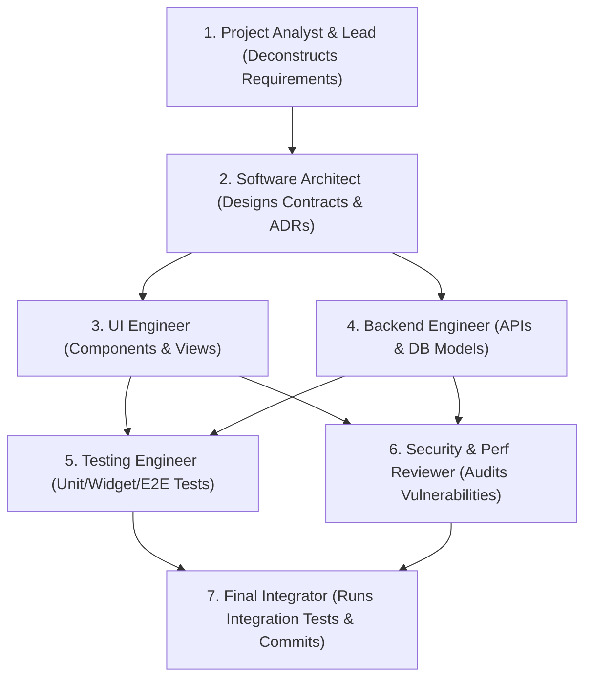

# Multi-Agent Collaboration Workflow

> **Specialist Agent Roles, Task Boundaries, Conflict Resolution & Single-Agent Compatibility**

When the host platform supports multi-agent execution or parallel subagents (e.g., Google Antigravity, Claude multi-agent sessions, specialized swarm harnesses), dividing responsibilities accelerates delivery. However, the system must remain 100% functional with a single autonomous agent.

---

## 1. Specialist Agent Role Definitions

| Specialist Role | Primary Responsibility | Input Artifacts | Output Deliverables |
|---|---|---|---|
| **Project Analyst** | Requirement scoping, user stories, acceptance criteria, discovery | User request, existing codebase | Scoped task brief, dependency list |
| **Software Architect** | API contracts, schema design, ADR formulation, boundary isolation | Scoped brief, codebase patterns | OpenAPI/Proto spec, schema migrations, ADR |
| **UI Engineer** | Design tokens, shared components, responsive views, a11y | Design system, API contracts | Component primitives, feature screens |
| **Backend Engineer** | Endpoints, domain services, database queries, worker queues | API contracts, schema migrations | Controllers, services, repositories |
| **Testing Engineer** | Unit, component, integration, and regression test suites | UI & Backend implementations | Test files, test plan execution results |
| **Security Reviewer** | Auth checks, input validation, secret leaks, XSS/IDOR defense | Source code diffs | Security review findings, patch recommendations |
| **Performance Reviewer**| Frame rate profiling, query analysis, memory leak audits | Source code diffs | Performance optimization recommendations |
| **Docs Engineer** | API contract documentation, changelog updates, code docstrings | Completed implementations | Markdown docs, JSDoc/Dartdoc |
| **Final Integrator** | Merging diffs, resolving conflicts, running master validation | All specialist outputs | Clean staged git commit, final verification report |

---

## 2. Collaboration Rules & Conflict Prevention

1. **Strict File Ownership Boundaries**:
   - **Never permit two agents to edit the same file simultaneously.**
   - Partition files by responsibility: UI Engineer owns `src/components/` and `src/features/*/views/`; Backend Engineer owns `src/api/` and `src/db/`.
2. **Shared Verified Context**:
   - All agents read from the single source of truth ([`PROJECT_CONTEXT.md`](../PROJECT_CONTEXT.md) and [`AI_TASK_STATE.md`](../AI_TASK_STATE.md)).
   - Do not pass unverified assumptions between agents; share only Tier 1 & Tier 2 verified artifacts.
3. **Conflict Resolution Hierarchy**:
   - Security constraints ALWAYS override aesthetic preferences or speed shortcuts.
   - Architectural invariants defined in ADRs override individual framework conveniences.
4. **Final Integration Gate**:
   - The Final Integrator must execute the master validation suite (`python3 scripts/validate.py`) and test suite before finalizing the task.

---

## 3. Single-Agent Compatibility Rule

> [!IMPORTANT]
> **Zero Simulation of Inactive Multi-Agent Infrastructure**:
> If the current environment runs a single agent without subagent spawning capabilities, **DO NOT pretend multiple agents are chatting or executing in parallel**.
> The single agent executes the specialist stages sequentially:
> 1. Act as Analyst & Architect (Inspect & Plan).
> 2. Act as Engineer (Implement primitives & features).
> 3. Act as Reviewer & Tester (Audit, test, and validate).
> 4. Act as Integrator (Review diff and report).

