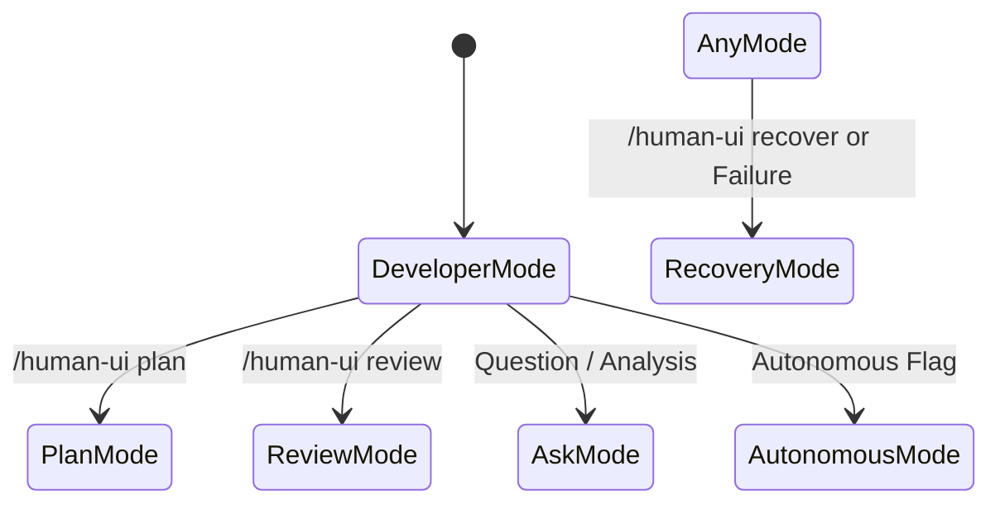

# Operating Modes

> **Configurable Operational Personas & Execution Constraints for AI Agents**

Human UI Engineering defines six distinct operating modes to ensure AI coding agents respect developer intent, security boundaries, and execution constraints.

---

## 1. Operating Modes Overview

| Mode | Trigger / Slash Command | Write Permissions | Execution Behavior |
|---|---|---|---|
| **Ask Mode** | Conversational question or explanation request | **READ-ONLY** | Analyzes code, explains architectural trade-offs, traces flows. Makes **zero file modifications**. |
| **Plan Mode** | `/human-ui plan [task]` | **READ-ONLY** (plans in scratch/artifacts) | Inspects project, drafts architecture plans, subtask orders, and risk registers. Does **not** write code. |
| **Developer Mode** | `/human-ui build`, `/human-ui [task]` (Default) | **READ-WRITE** | Implements requested features, follows design tokens, writes clean code, runs tests, and reports outcomes. |
| **Review Mode** | `/human-ui review [scope]`, `/human-ui audit` | **READ-ONLY** | Inspects pull requests, modified diffs, accessibility, and performance. Generates structured feedback. |
| **Autonomous Mode** | Batch tasks, unattended development | **SUPERVISED WRITE** | Executes safe, reversible tasks autonomously; stops and requests confirmation for breaking/costly actions. |
| **Recovery Mode** | `/human-ui recover` | **RESTORE & RESUME** | Reads [`AI_TASK_STATE.md`](../AI_TASK_STATE.md) and git telemetry, diagnoses errors, and resumes safely. |

---

## 2. Mode Transition & Guardrails

1. **Explicit Mode Switching**: If the user invokes `/human-ui plan`, the agent must never jump straight into modifying code. It must formulate and present the plan first, waiting for explicit user confirmation before switching to Developer Mode.
2. **Review Mode Safety**: When reviewing code, the agent must output findings, severity ratings, and specific line diff suggestions without modifying the files directly, unless the user explicitly follows up with "Apply these suggestions".
3. **Autonomous Mode Boundaries**: In Autonomous Mode, the agent is granted permission to run commands and edit files, but it must halt immediately when:
   - A command exits with unexpected fatal errors or unhandled exceptions.
   - Deleting non-temporary files or tables.
   - Modifying public interface contracts without explicit specification.
