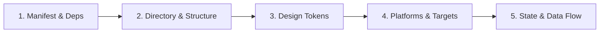

# Project Discovery Methodology

> A structured pre-flight discovery workflow that every AI coding agent must execute before proposing or implementing UI code.

---

## 1. Purpose

Writing UI code without understanding existing dependencies, token structures, state patterns, and conventions creates fragmented codebases, duplicate components, and architectural debt. 

This guide defines the 5-phase discovery methodology that grounds every subsequent engineering decision.

---

## 2. The 5-Phase Discovery Process

### Phase 1: Manifest & Dependency Inspection
Examine package declarations and build configurations to understand the runtime ecosystem:
- **Web / Node / Next.js**: `package.json`, `tsconfig.json`, `tailwind.config.*`, `vite.config.*`.
- **Flutter**: `pubspec.yaml`, `analysis_options.yaml`.
- **Android**: `settings.gradle.kts`, `app/build.gradle.kts`, `libs.versions.toml`.
- **iOS**: `Package.swift`, `Podfile`, `.xcodeproj/project.pbxproj`.

**Determine:**
- What UI libraries are already installed (e.g. Tailwind, Shadcn, Material, Cupertino, Compose, Tamagui)?
- What icon sets, font packages, and animation libraries are present?
- What are the minimum language versions (TypeScript, Dart, Kotlin, Swift)?

### Phase 2: Directory Layout & Architecture Recognition
Inspect directory names and existing file groupings:
- Are features split by domain (`features/auth/`, `features/checkout/`) or by layer (`components/`, `services/`, `views/`)?
- Where are shared reusable UI components located?
- What file naming convention is enforced (`kebab-case`, `PascalCase`, `snake_case`)?

### Phase 3: Design Token & Asset Inventory
Locate where visual primitives are declared:
- **Colors**: Where are primary, neutral, semantic (success/warning/error), and surface colors defined?
- **Typography**: What font families, font weights, and text scales are established?
- **Spacing**: Is there an existing spacing system (e.g., 4pt/8pt grid tokens, Tailwind utility scale)?
- **Assets**: Where are SVGs, images, and fonts stored?

### Phase 4: Platform & Target Form Factors
Identify where and how the software runs:
- Mobile-only (portrait/landscape), tablet, desktop, or responsive web?
- Does the application support light and dark modes?
- Are there specific accessibility or localization requirements indicated in the codebase?

### Phase 5: State & Data Flow Mapping
Identify how data reaches the UI layer:
- What state management solution is in active use (e.g. Redux Toolkit, Zustand, Riverpod, BLoC, Jetpack ViewModel, SwiftUI Observation)?
- How are async operations, caching, and server state managed (e.g. TanStack Query, RTK Query, Repository pattern)?
- How are navigation and routing handled (e.g. Next.js App Router, React Router, GoRouter, Android Navigation, SwiftUI NavigationStack)?

---

## 3. Discovery Checklist & Questions

Before writing a single line of code, the agent must be able to answer:

- [ ] What framework and version is this project running?
- [ ] What is the existing styling paradigm (CSS modules, utility classes, styled components, framework widgets)?
- [ ] Where do shared UI primitives live?
- [ ] Can existing buttons, inputs, and modals be reused for this task?
- [ ] What state management solution is idiomatic to this project?
- [ ] Are there existing test suites that should be updated or run?

---

## 4. Discovery Artifact

For medium-to-large initiatives, summarize discovery findings using the standardized [Project Brief Template](../templates/project-brief.md).

---

## 5. Related Documentation

- Master Instructions: [AGENTS.md](../AGENTS.md)
- Agent Behavior: [agent-behavior.md](agent-behavior.md)
- Architecture Guidelines: [architecture.md](architecture.md)
- Folder Structure Standards: [folder-structure.md](folder-structure.md)
- Project Brief Template: [../templates/project-brief.md](../templates/project-brief.md)
