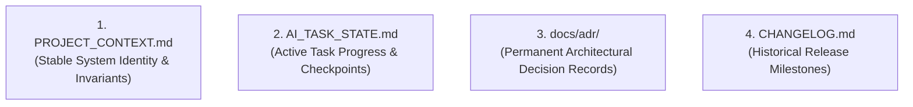

# Project Context & Knowledge Management

> **Persistent Knowledge Architecture: PROJECT_CONTEXT.md, AI_TASK_STATE.md & ADRs**

AI coding agents suffer from session amnesia unless project context is externalized cleanly. Human UI Engineering implements a structured, non-duplicated 4-tier knowledge management system.

---

## 1. The 4-Tier Knowledge Architecture

| Artifact | Location | Update Frequency | Purpose & Contents |
|---|---|---|---|
| **Project Context** | [`PROJECT_CONTEXT.md`](../PROJECT_CONTEXT.md) | Low (Quarterly / Major pivots) | Stable system identity: Domain, tech stack, core invariants, directory map, design token conventions. |
| **Task State** | [`AI_TASK_STATE.md`](../AI_TASK_STATE.md) | High (During active execution) | Transient working memory: Active phase, subtask checklist, last verified git checkpoint, blocker logs. |
| **Architecture Records** | [`docs/adr/`](../docs/adr/README.md) | Low-Medium (When making structural choices) | Permanent historical log of decisions: Context, problem, alternatives, decisions, consequences. |
| **Changelog** | [`CHANGELOG.md`](../CHANGELOG.md) | Medium (On version releases) | Semantic release notes: v1.0.0, v2.0.0, breaking changes, new capabilities, fixes. |

---

## 2. Rules for Knowledge Hygiene

1. **Zero Information Duplication**:
   - Do **NOT** duplicate design system color palettes or full file trees inside `AI_TASK_STATE.md`.
   - Do **NOT** copy active task progress into `PROJECT_CONTEXT.md`.
   - Keep each document scoped to its single responsibility.
2. **Pre-Flight Context Verification**:
   - When starting an agent session, read [`PROJECT_CONTEXT.md`](../PROJECT_CONTEXT.md) first to ground understanding in project invariants.
   - If resuming work or encountering a failure, check [`AI_TASK_STATE.md`](../AI_TASK_STATE.md) and run `git status`.
3. **Pragmatic Maintenance**:
   - Update `PROJECT_CONTEXT.md` only when new tech stacks, core directories, or invariants are added.
   - Reset or clean `AI_TASK_STATE.md` when a master task is successfully completed and committed.

