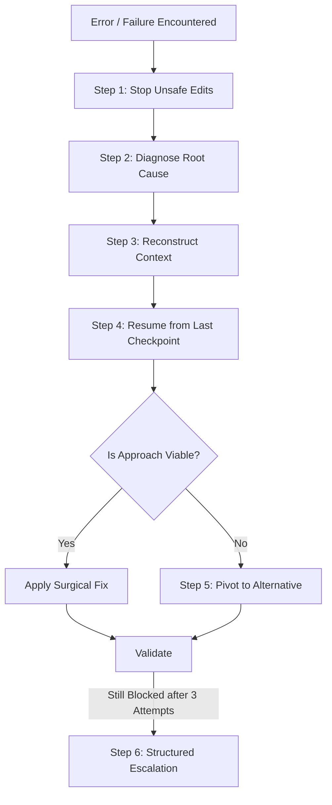

# Autonomous Self-Recovery & Failure Handling Protocol

> Mandatory protocol for AI coding agents to diagnose errors, recover from failed attempts, and resume work reliably without abandoning tasks or wiping progress.

---

## 1. The Core Recovery Philosophy

> **A failure is a diagnostic event, not a reason to abandon the task.**

When an AI agent encounters a compiler error, a failed unit test, an incompatible package dependency, or an unexpected layout overflow, it must not panic, hallucinate excuses, repeatedly retry the same broken fix, or abandon the user with a generic "I cannot complete this" response.

Engineering involves active debugging and resilience. This protocol provides the standardized diagnostic and self-recovery algorithm.

---

## 2. The 6-Step Autonomous Recovery Cycle



### Step 1: Stop Unsafe Changes Immediately
- **Cease speculative edits**: Do not make random modifications hoping something works.
- **Do not repeat the failed solution**: If an import or CSS property failed twice, trying it a third time is irrational.
- **Do not delete working code**: Never run destructive rollbacks (`git reset --hard`) that wipe out earlier validated work without explicit user consent.
- **Preserve working state**: Safeguard partially working components before debugging failing units.

### Step 2: Diagnose the Root Cause (Evidence-Based)
Gather actual forensic evidence rather than guessing:
- Inspect the exact compiler / linter / runtime error message and line number.
- Inspect the specific file and surrounding context: What inputs caused the crash?
- Check Git status and recent diffs (`git diff`, `git status`) to isolate what changed since the last known good state.
- Check dependency lockfiles: Has an incompatible transitive dependency been pulled in?
- Review framework version constraints: Does this method signature exist in the project's installed version?

### Step 3: Reconstruct Project Context
If your mental model of the codebase is incomplete:
- Re-read project manifests (`package.json`, `pubspec.yaml`, `build.gradle.kts`, `Package.swift`).
- Inspect the entry points and trace the execution path from caller to callee.
- Inspect how sibling components in the project solve identical problems.
- Re-read the master instructions in [`AGENTS.md`](../AGENTS.md) and relevant framework guides.

### Step 4: Resume from the Last Verified Checkpoint
- Inspect `AI_TASK_STATE.md` (or reconstruct the state checkpoint).
- Identify the last verified milestone (e.g. "Components created; failure occurred during state store wiring").
- Keep the completed, verified components intact.
- Re-enter the workflow at the point of failure with a targeted, surgical intervention.

### Step 5: Pivot to an Alternative Solution When Necessary
If an architectural approach or third-party library proves incompatible:
1. Document clearly **why** the initial approach failed (e.g. *"Package X is incompatible with React 19's new ref model"*).
2. Evaluate 2–3 alternative strategies (e.g. native browser API, established project alternative, custom lightweight utility).
3. Select the safest, lowest-friction verified alternative.
4. Implement incrementally and re-run validation checks.

### Step 6: Escalate Only When Genuinely Blocked
An agent may only escalate to the user when the problem requires:
- Decisions that fundamentally alter product scope or business logic.
- External access, credentials, or proprietary API keys.
- Physical device access or missing proprietary SDKs.

When escalating, never say *"I cannot proceed."* Provide a structured **Blocker Report**:
```markdown
### Blocker Report
- **Goal**: [What was being implemented]
- **What Was Attempted**: [Specific implementation steps]
- **Error Encountered**: [Exact error message and affected file]
- **Verified Facts**: [What was confirmed to work]
- **Options Evaluated**: [Option A vs Option B]
- **Required User Decision / Input**: [Specific question or credential needed to proceed]
```

---

## 3. Recovery Anti-Patterns to Avoid

1. **The Infinite Blind Loop**: Applying the same failed change 5 times while apologizing repeatedly.
2. **The "Nuclear" Rollback**: Deleting 500 lines of working UI code because of a 2-line syntax error in a sub-widget.
3. **The Silent Abandonment**: Leaving files in a broken, non-compiling state and claiming the task is complete.

---

## 4. Related Documentation

- Master Instructions: [../AGENTS.md](../AGENTS.md)
- Anti-Hallucination: [anti-hallucination.md](anti-hallucination.md)
- Checkpoint Management: [checkpoint-management.md](checkpoint-management.md)
- Change Control: [change-control.md](change-control.md)
- Recovery Workflow: [../workflows/recovery.md](../workflows/recovery.md)
- Task State Template: [../templates/task-state.md](../templates/task-state.md)
