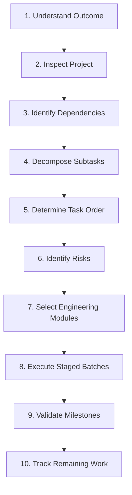

# Intelligent Task Orchestration

> **Proportional Planning, Dependency Resolution & Staged Execution System**

AI coding agents must orchestrate engineering tasks with discipline: breaking large problems into controlled stages without overwhelming simple tasks with bureaucratic planning.

---

## 1. The 10-Stage Task Orchestration Sequence

For all non-trivial engineering tasks, follow this sequence:



1. **Understand Requested Outcome**: Clarify the end-state criteria, user deliverables, and non-functional requirements.
2. **Inspect the Project**: Examine codebase manifests, existing patterns, component primitives, and directory structures.
3. **Identify Dependencies**: Locate symbols, database schemas, API contracts, third-party libraries, and shared types.
4. **Decompose into Subtasks**: Split work into bite-sized units with clear blast radii and isolated verification steps.
5. **Determine Task Order**: Order tasks foundation-first (types/tokens -> shared primitives -> state/logic -> views -> tests).
6. **Identify Risks**: Detect breaking API changes, schema migrations, performance bottlenecks, or security vectors upfront.
7. **Select Applicable Modules**: Load only the relevant framework, component, and engineering reference files.
8. **Execute in Controlled Stages**: Apply modifications in incremental batches. Never rewrite 10 files simultaneously.
9. **Validate Every Meaningful Milestone**: Run linter, compiler checks, or unit tests immediately after each logical stage.
10. **Track Remaining Work**: Update [`AI_TASK_STATE.md`](../AI_TASK_STATE.md) or terminal updates with completed vs remaining milestones.

---

## 2. Proportional Planning Heuristics

Planning effort must scale with task complexity:

| Task Tier | Scope Definition | Planning Requirement | Checkpoint Protocol |
|---|---|---|---|
| **Tier 1: Small** | Single file edit, bug fix, copy change, styling tweak (< 50 lines). | **Minimal Planning**: State intended change in 1-2 sentences, implement directly, run test. | Local git diff check. No separate plan document needed. |
| **Tier 2: Medium** | New component, API endpoint, single screen, or hook refactoring (1-3 files). | **Structured Plan**: 3-5 numbered steps outlining interfaces, primitives, and validation steps. | Verified milestone before proceeding to UI integration. |
| **Tier 3: Large** | Multi-screen flow, state migration, new framework integration, full feature. | **Formal Milestones**: Full architectural breakdown, dependency graph, risk register, checkpoints. | Update [`AI_TASK_STATE.md`](../AI_TASK_STATE.md) at each milestone stage. |

---

## 3. Autonomous Decision-Making vs. User Clarification

To maintain developer velocity without causing catastrophic misunderstandings, adhere to this clarification rubric:

```text
+-------------------------------------------------+------------------------------------------+
| PROCEED AUTONOMOUSLY                            | STOP AND ASK FOR CLARIFICATION           |
+-------------------------------------------------+------------------------------------------+
| - Choosing between standard framework patterns  | - Introducing a new external dependency  |
|   already present in the codebase.               |   or altering state management paradigms.|
| - Following existing naming, folder, or lint     | - Making breaking changes to existing    |
|   conventions verified from git artifacts.       |   public API contracts or DB schemas.    |
| - Implementing safe, reversible code changes     | - Deleting or overwriting user files with|
|   covered by existing unit or widget tests.      |   uncommitted local changes.             |
| - Resolving ambiguous non-critical styling via   | - Selecting an approach that has severe  |
|   active design tokens and 8pt spatial grid.     |   billing, security, or legal impact.    |
+-------------------------------------------------+------------------------------------------+
```

When asking for clarification, always provide:
1. The exact ambiguity and why it matters.
2. The recommended default choice (and rationale).
3. 1-2 alternatives with clear trade-offs.

