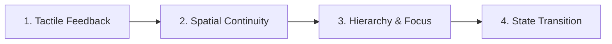

# Motion & Animation Engineering

> Engineering rules for purposeful, performant, and accessible motion in user interfaces.

---

## 1. Purpose

Animation in UI engineering is a functional tool, not cosmetic entertainment. Its purpose is to explain spatial relationships, provide tactile feedback, and direct attention. Gratuitous, slow, or bouncy animations increase cognitive fatigue and make applications feel sluggish.

This guide defines strict standards for UI motion.

---

## 2. The 4 Functional Roles of Motion



1. **Tactile Feedback**: Immediate acknowledgement of user input (button pressed state, checkbox checkmark drawing).
2. **Spatial Continuity**: Informing the user where an object originated and where it dismissed to (a bottom sheet rising from the bottom, a dropdown expanding from its trigger).
3. **Hierarchy & Focus**: Gently guiding the eye to an updated value, notification badge, or validation error.
4. **State Transition**: Smoothing the visual shift between loading skeletons and populated content.

---

## 3. Duration Tokens

Keep animations brief. If a user has to wait for an animation to finish before interacting, the animation is too slow:

| Token | Duration | Usage |
|---|---|---|
| `motion-instant` | **100ms – 150ms** | Micro-interactions: button press, hover color transitions, checkbox check |
| `motion-fast` | **200ms – 250ms** | Small transitions: dropdown menus, tooltips, toast pop-ins, badge reveals |
| `motion-moderate` | **300ms – 350ms** | Significant transitions: modal dialog open/close, bottom sheet slide, drawer |
| `motion-slow` | **400ms – 500ms** | Large layout shifts, complex shared-element screen transitions |

> [!WARNING]
> Any interaction animation exceeding **500ms** feels unresponsive and frustrates users during repeated workflows.

---

## 4. Easing Curves

Never use linear easing for physical UI elements. Physical objects accelerate and decelerate:

- **Decelerate / Ease-Out (`cubic-bezier(0, 0, 0.2, 1)`)**:
  - **Use for entering elements** (modals appearing, sheets sliding in).
  - Starts rapidly so the user gets instant visual confirmation, then eases to a stop.
- **Accelerate / Ease-In (`cubic-bezier(0.4, 0, 1, 1)`)**:
  - **Use for exiting elements** (toast dismissing, sheet sliding down).
  - Starts gently, accelerates off-screen to clear the view quickly.
- **Standard / Ease-In-Out (`cubic-bezier(0.4, 0, 0.2, 1)`)**:
  - **Use for moving elements within the screen** (reordering a list item, accordion expansion).
- **Linear**:
  - Strictly reserved for non-spatial, continuous loops (e.g. spinning loading indicators).

---

## 5. Performance: Animate Composite Properties Only

To maintain a steady 60fps/120fps frame budget, only animate properties that the GPU compositor can process without triggering layout recalculation or repainting:

| Animate These (GPU-Accelerated) | Avoid Animating (Triggers Layout / Reflow) |
|---|---|
| `transform: translate(x, y)` | `top`, `left`, `bottom`, `right`, `margin` |
| `transform: scale()` | `width`, `height` |
| `opacity` | `box-shadow`, `filter: blur()` |

---

## 6. Respecting Reduced Motion (`prefers-reduced-motion`)

Operating systems provide an accessibility setting to reduce motion for users prone to vestibular disorders, motion sickness, or cognitive overload. Respecting this setting is mandatory:

- **Web (CSS)**:
  ```css
  @media (prefers-reduced-motion: reduce) {
    *, *::before, *::after {
      animation-duration: 0.01ms !important;
      animation-iteration-count: 1 !important;
      transition-duration: 0.01ms !important;
      scroll-behavior: auto !important;
    }
  }
  ```
- **Flutter / Native**: Check `MediaQuery.of(context).disableAnimations` or system accessibility flags, and immediately cut or use simple cross-fades rather than sliding or bouncing.

---

## 7. Motion Anti-Patterns

1. **The Trampoline Effect**: Gratuitous elastic spring bounces on simple button clicks or modal reveals.
2. **Stagger Fatigue**: Staggering 50 items in a list with 50ms delays each, forcing the user to wait 2.5 seconds before seeing the bottom of the list.
3. **Flashing Transitions**: Blinking screens between page loads. Use seamless skeleton-to-content transitions.

---

## 8. Related Documentation

- Design Philosophy: [design-philosophy.md](design-philosophy.md)
- Accessibility: [accessibility.md](accessibility.md)
- Loading States: [../components/loading-states.md](../components/loading-states.md)
- Performance Guide: [../engineering/performance.md](../engineering/performance.md)
