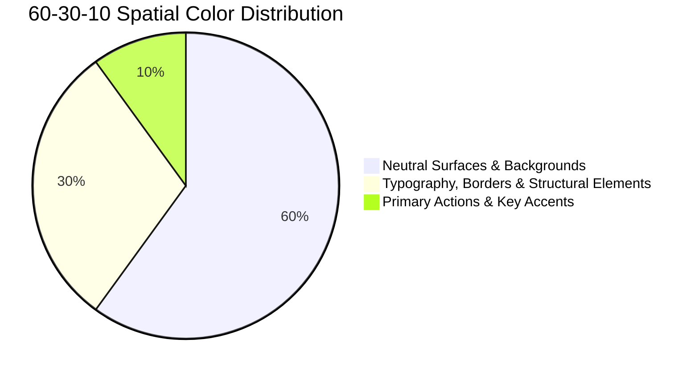

# Color System Architecture & Flutter ThemeData

> **Principles for defining, naming, previewing, and applying intentional, accessible Flutter color systems across light and dark modes.**

Color communicates hierarchy, status, and affordance. Random hex codes scattered across widgets create visual chaos, inconsistent branding, and severe accessibility failures. In the Human Flutter Engineering system, color follows a strict user-guided protocol, 60-30-10 distribution, and a mandatory visual placement preview.

---

## 1. Mandatory 3–4 Color Selection Protocol

The agent must **NEVER** silently invent or assume an application's primary brand colors. Before establishing a design system or authoring theme files, prompt the user in Bengali:

```text
আপনার অ্যাপ্লিকেশনের জন্য ৩টি অথবা ৪টি মূল রং (HEX কোডসহ) নির্বাচন করুন।

এই রংগুলোর ভিত্তিতে সম্পূর্ণ অ্যাপ্লিকেশনের Color System তৈরি করা হবে।

প্রতিটি রং কোথায় ব্যবহার হবে সেটিও আগে Visual Preview-তে দেখানো হবে।
```

### Derivation from 3–4 Base Colors
From the user's selected 3–4 HEX colors, derive:
- **Primary**: Main interactive actions, FAB, active nav highlights.
- **Secondary**: Supporting buttons, filter tags, secondary emphasis.
- **Tertiary**: Visual accents, success highlights, special callouts.
- **Neutrals**: Surface, surface container, canvas, borders, and text tiers for light and dark modes.

---

## 2. Mandatory 12-Component Visual Color Placement Preview

Before writing `lib/core/theme/app_colors.dart` or `app_theme.dart`, the agent **MUST** present a structured visual UI color placement board demonstrating exact placement across:

1. **App Background** — Base canvas luminance (`colorScheme.surface`)
2. **Primary App Bar** — Top navigation bar (`appBarTheme.backgroundColor`)
3. **Navigation Bar** — Bottom bar / navigation rail (`navigationBarTheme`)
4. **Primary Button** — Key action CTA (`elevatedButtonTheme`)
5. **Secondary Button** — Outlined or tonal button (`outlinedButtonTheme`)
6. **Cards & Containers** — Elevated content modules (`cardTheme.color`)
7. **Input Fields** — Form field fills and focus borders (`inputDecorationTheme`)
8. **Text & Headings** — Primary, secondary, and disabled text tiers
9. **Icons** — Primary action and neutral navigational icons
10. **Borders & Dividers** — 1px structural separation (`colorScheme.outlineVariant`)
11. **Selection States** — Selected vs unselected chips, tabs, radios
12. **Status Semantics** — Success, Warning, Error, and Info via `ThemeExtension`

👉 **Full Visual Preview Board Reference**: [../skills/human-flutter/references/color-preview.md](../skills/human-flutter/references/color-preview.md)

---

## 3. Spatial Color Hierarchy: The 60-30-10 Rule



1. **60% Neutrals & Surfaces**: Foundational canvas and card containers (`surface`, `surfaceContainer`).
2. **30% Structural Medium**: Text hierarchy, borders, outlines, dividers, and inactive icons.
3. **10% Intentional Accent**: Primary buttons, active tabs, toggle switches, and key focus rings.

---

## 4. Flutter Semantic Status Extension (`ThemeExtension`)

Material 3's `ColorScheme` does not include explicit success, warning, or info colors. Implement them via `ThemeExtension<AppCustomColors>` in `lib/core/theme/app_colors.dart`:

```dart
@immutable
class AppCustomColors extends ThemeExtension<AppCustomColors> {
  const AppCustomColors({
    required this.success,
    required this.onSuccess,
    required this.warning,
    required this.onWarning,
    required this.info,
    required this.onInfo,
  });

  final Color success;
  final Color onSuccess;
  final Color warning;
  final Color onWarning;
  final Color info;
  final Color onInfo;

  @override
  AppCustomColors copyWith({
    Color? success,
    Color? onSuccess,
    Color? warning,
    Color? onWarning,
    Color? info,
    Color? onInfo,
  }) {
    return AppCustomColors(
      success: success ?? this.success,
      onSuccess: onSuccess ?? this.onSuccess,
      warning: warning ?? this.warning,
      onWarning: onWarning ?? this.onWarning,
      info: info ?? this.info,
      onInfo: onInfo ?? this.onInfo,
    );
  }

  @override
  AppCustomColors lerp(ThemeExtension<AppCustomColors>? other, double t) {
    if (other is! AppCustomColors) return this;
    return AppCustomColors(
      success: Color.lerp(success, other.success, t)!,
      onSuccess: Color.lerp(onSuccess, other.onSuccess, t)!,
      warning: Color.lerp(warning, other.warning, t)!,
      onWarning: Color.lerp(onWarning, other.onWarning, t)!,
      info: Color.lerp(info, other.info, t)!,
      onInfo: Color.lerp(onInfo, other.onInfo, t)!,
    );
  }
}
```

---

## 5. Dark Mode Architecture

1. **Elevation via Surface Luminance**: In dark mode, drop shadows become invisible. Elevate surfaces by shifting backgrounds progressively lighter:
   - Base canvas: `#0F172A`
   - Card / Modal surface: `#1E293B`
   - Popover / Dropdown: `#334155`
2. **Avoid Pure Black Everywhere (`#000000`)**: Deep slate tones provide warmth and depth while preventing severe OLED smearing.
3. **Desaturate Saturated Accents**: Shift accent colors slightly lighter and less saturated in dark mode to prevent visual vibration.

---

## 6. Contrast Requirements (WCAG 2.1 AA)

- **Normal Body Text (< 18pt / 24px)**: Minimum **4.5:1** contrast ratio against background.
- **Large Text (≥ 18pt regular or ≥ 14pt bold)**: Minimum **3.0:1** contrast ratio.
- **UI Components & Graphical Objects**: Minimum **3.0:1** for active input borders and focus rings.

---

## 7. Related Documentation

- Master Instructions: [AGENTS.md](../AGENTS.md)
- Color Intelligence Reference: [../skills/human-flutter/references/color-intelligence.md](../skills/human-flutter/references/color-intelligence.md)
- Color Placement Preview: [../skills/human-flutter/references/color-preview.md](../skills/human-flutter/references/color-preview.md)
- Design Philosophy: [design-philosophy.md](design-philosophy.md)
- Typography: [typography.md](typography.md)
- Accessibility: [accessibility.md](accessibility.md)
