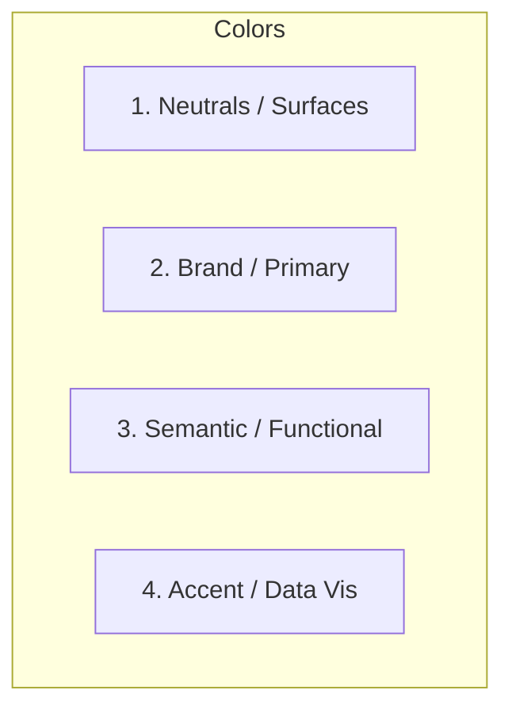

# Color System Architecture

> Principles for defining, naming, and applying intentional, accessible color palettes across light and dark modes.

---

## 1. Purpose

Color should communicate hierarchy, status, and affordance. Random hex codes scattered across stylesheets create visual chaos, inconsistent branding, and severe accessibility failures. 

This guide defines a functional, semantic color architecture.

---

## 2. Color Roles & Palette Architecture

A production UI requires four distinct color categories:

### 1. Neutrals & Surfaces (The 60% Layer)
The structural foundation of the interface. Must provide at least 5 levels of depth:
- `bg-base` / `canvas`: The main app background (e.g. `#F8FAFC` in light mode, `#0B0F19` in dark mode).
- `surface-card`: Cards, modals, sheets (`#FFFFFF` in light, `#1E293B` in dark).
- `surface-subtle`: Table row hovers, input backgrounds, secondary badges (`#F1F5F9` in light, `#151E2E` in dark).
- `border-default`: Subtle dividers and card outlines (`#E2E8F0` in light, `#334155` in dark).
- `border-strong`: Input borders, active outlines (`#CBD5E1` in light, `#475569` in dark).

### 2. Content & Text Tiers
Text must never be uniform:
- `text-primary`: Headings, labels, critical figures (Highest contrast: `#0F172A` in light, `#F8FAFC` in dark).
- `text-secondary`: Body copy, descriptions (`#475569` in light, `#94A3B8` in dark).
- `text-tertiary` / `muted`: Timestamps, helper text, breadcrumbs (`#64748B` in light, `#64748B` in dark).
- `text-disabled`: Inactive options, disabled button labels (`#94A3B8` in light, `#475569` in dark).

### 3. Brand / Primary Palette (The 10% Layer)
Used for key interactive elements:
- `primary`: Default button background, active tab indicators, checkboxes.
- `primary-hover`: Darker (or lighter in dark mode) interactive feedback state.
- `primary-subtle`: 10-15% opacity tint for selected list item backgrounds.
- `primary-foreground`: High-contrast text on top of the primary color (usually `#FFFFFF`).

### 4. Semantic / Status Colors
Each status color must provide three tokens: **Background**, **Border**, and **Foreground**:

| Status | Functional Intent | Light Mode Example | Dark Mode Example |
|---|---|---|---|
| **Success** | Successful submissions, active status, valid inputs | Green: `#16A34A` text / `#DCFCE7` bg | `#4ADE80` text / `#052E16` bg |
| **Warning** | Non-blocking alerts, expiring trials, pending tasks | Amber: `#D97706` text / `#FEF3C7` bg | `#FBBF24` text / `#451A03` bg |
| **Error / Destructive** | Form validation failures, account deletion, crashes | Red: `#DC2626` text / `#FEE2E2` bg | `#F87171` text / `#450A0A` bg |
| **Info** | Neutral tips, product updates, guidance | Blue: `#2563EB` text / `#DBEAFE` bg | `#60A5FA` text / `#172554` bg |

---

## 3. Dark Mode Architecture

1. **Elevation via Surface Luminance**: In dark mode, drop shadows become invisible against dark backgrounds. Elevate surfaces by making their background progressively lighter:
   - Base background: `#090D16` (Deepest)
   - Card / Modal surface: `#131B2E` (Higher)
   - Popover / Dropdown: `#1E293B` (Highest)
2. **Avoid Pure Black Backgrounds (`#000000`)**: Deep blue-grays or slate tones (`#0F172A`, `#111827`) provide more warmth and depth than pure void black.
3. **Desaturate Saturated Accents**: A vibrant `#3B82F6` that looks crisp in light mode will vibrate and strain eyes in dark mode. Shift accent colors slightly lighter and less saturated for dark backgrounds.

---

## 4. Contrast Requirements (WCAG 2.1 AA)

- **Normal Text (< 18pt / 24px)**: Minimum **4.5:1** contrast ratio.
- **Large Text (≥ 18pt regular or ≥ 14pt bold)**: Minimum **3.0:1** contrast ratio.
- **UI Components & Graphical Objects**: Minimum **3.0:1** against adjacent backgrounds for borders of active inputs and focus rings.

---

## 5. Token Naming Convention

Always use functional, semantic token names rather than physical color names:

- **Good**: `bg-surface`, `text-primary`, `border-error`, `brand-action`
- **Bad**: `blue-500`, `dark-gray-header`, `red-text`, `card-white`

Semantic naming ensures effortless theme switching (light/dark/custom branding) without modifying component code.

---

## 6. Related Documentation

- Design Philosophy: [design-philosophy.md](design-philosophy.md)
- Human Design Rules: [human-design-rules.md](human-design-rules.md)
- Typography: [typography.md](typography.md)
- Accessibility: [accessibility.md](accessibility.md)
- Design System Template: [../templates/design-system.md](../templates/design-system.md)

