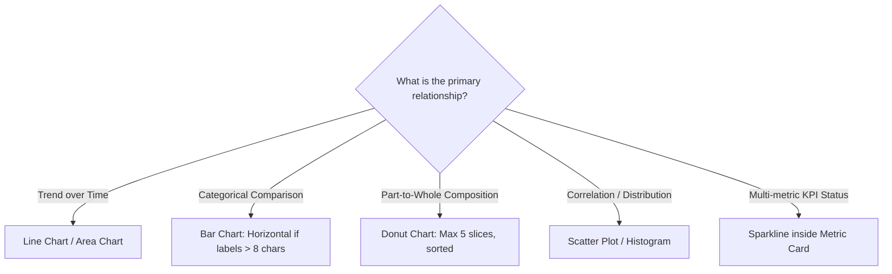

# Data Visualization Engineering & Design

> **Chart Selection, Data-Ink Ratio, Accessible Palettes & Responsive Telemetry**

Data visualization transforms raw numbers into actionable insight. Amateur AI interfaces generate illegible, cluttered charts with ungrounded neon palettes. Professional engineering enforces mathematical clarity, accessible contrast, and honest scale representations.

---

## 1. Core Principles of Data Presentation

1. **Maximize the Data-Ink Ratio** (Edward Tufte): Every pixel of ink should convey meaningful data. Eliminate decorative 3D effects, gratuitous background grids, and unnecessary border boxes.
2. **Honest Scaling & Baselines**:
   - Bar charts **MUST ALWAYS start at zero** ($Y=0$). Truncating the baseline exaggerates minor differences and misleads users.
   - For line charts displaying small fractional changes (e.g., stock volatility), a non-zero baseline is acceptable only if clearly annotated.
3. **Never Rely on Color Alone**:
   - Differentiate multiple series using distinct dash styles (`solid`, `dashed`), point markers (`circle`, `square`, `triangle`), or direct inline labels.
   - Design for color-vision deficiency (deuteranopia, protanopia) by testing palettes against WCAG 3:1 graphical contrast standards.

---

## 2. Chart Selection Matrix

| Relationship | Best Chart Type | Avoid | Design Rule |
|---|---|---|---|
| **Continuous Trend** | Line Chart / Spline | Pie charts, Radar charts | Limit to $\le 4$ simultaneous lines. If more exist, provide interactive series filtering. |
| **Ranked Comparison** | Bar Chart (Horizontal) | Vertical bars with 45-degree tilted labels | Horizontal bars accommodate long label text naturally without awkward rotations. |
| **Proportion** | Donut Chart ($\le 5$ slices) | Pie charts with 15 tiny slices | Group small categories (< 5%) into an "Other" category. Place total sum in center donut hole. |
| **Multi-Dimension Correlation** | Scatter Plot / Bubble | 3D surface charts | Use opacity ($0.6$) to reveal overlapping data density (overplotting defense). |

---

## 3. Interactive Tooltips & Scrubbing

1. **Tooltips Must Be Pinned & Formatted**:
   - Display formatted values with explicit units (e.g., `$1,240.50`, `42.8 ms`, `99.4%`), never raw floats (`1240.5000001`).
   - Include comparison deltas (`+12.4% vs last week`) with semantic color and iconography.
2. **Keyboard Accessibility**:
   - Ensure individual data points or chart intervals can be focused via Tab and inspected using arrow keys.
   - Provide an accessible table fallback (`<table class="sr-only">`) summarizing chart data for screen readers.

---

## 4. Responsive Adaptation for Mobile Viewports

- **Reduce Tick Density**: On screens $< 640\text{px}$, reduce X-axis date labels from daily to weekly or monthly to avoid overlapping text.
- **Convert Multi-Line Legends**: Stack legends below the chart canvas or collapse into a dropdown selector on narrow screens.
- **Touch Targets on Scrubbing**: Implement an invisible 32px touch overlay around scrub lines so mobile users can drag easily with thumbs.
