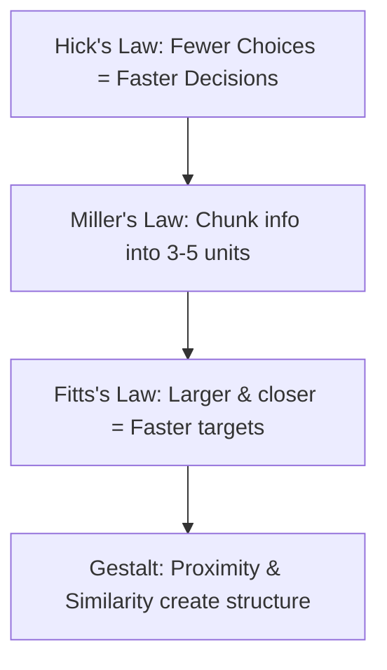

# Human Interface Design Principles

> Deep-dive principles for visual hierarchy, information architecture, visual rhythm, cognitive load reduction, and platform conventions.

---

## 1. Purpose

Human interface design is the discipline of structuring visual and interactive elements to match human cognitive, perceptual, and physical capabilities. A visually decorated screen that forces users to hunt for information, decipher ambiguous icons, or guess where to tap is an engineering failure.

This guide defines the cognitive and visual laws governing human-centered interfaces.

---

## 2. Information Architecture & Cognitive Load



### 1. Chunking & Miller's Law
- Humans can only process 4 to 7 items in short-term working memory at once.
- Break long complex forms into logical fieldsets, multi-step wizards, or collapsible accordions.
- Format structured data (phone numbers, credit cards, dates) with clear visual chunking (`(555) 123-4567` instead of `5551234567`).

### 2. Hick's Law (Minimizing Decision Friction)
- The time required to make a decision increases logarithmically with the number and complexity of choices.
- Highlight the **single recommended option** in pricing tiers, checkout flows, and modal actions.
- Hide secondary or rare configuration settings behind a progressive disclosure toggle ("Advanced Settings").

### 3. Fitts's Law (Motor Efficiency)
- The time to acquire a target is a function of the distance to and size of the target.
- Place primary actions in the thumb zone on mobile (bottom app bar, bottom sheet).
- Expand small visual icons with invisible padding so that the effective clickable hit target is at least 44x44pt / 48x48dp.

---

## 3. Visual Rhythm & Cadence

Layouts should establish a harmonious vertical cadence:

```text
Section Header (24px semibold)
    ↓ (space-2: 8px)
Subhead / Description (14px muted)
    ↓ (space-6: 24px)
[ Form Field / Content Card ]
    ↓ (space-4: 16px)
[ Form Field / Content Card ]
    ↓ (space-10: 40px - Generous breathing room before next major section)
Next Section Header
```

- **Avoid Monotonous Spacing**: If every single margin is 16px, the eye cannot perceive where one section ends and another begins.
- Use tight spacing (4px–8px) for tightly coupled items (label to input).
- Use generous spacing (32px–48px) to establish macroscopic section boundaries.

---

## 4. Contrast Engineering Beyond Color

Contrast is created through multiple orthogonal dimensions:

| Dimension | Low Contrast (Secondary) | High Contrast (Primary) |
|---|---|---|
| **Luminance** | `#64748B` (Muted Slate) | `#0F172A` (Deep Navy / Charcoal) |
| **Scale** | 13px–14px body | 24px–32px heading |
| **Weight** | 400 Regular | 700 Bold |
| **Surface** | Flat outlined container | Elevated container with subtle ambient shadow |
| **Density** | Dense compact metadata | Spacious hero callout |

---

## 5. Interaction Feedback Loops

Every user interaction must initiate an immediate visual or tactile acknowledgement:

1. **Press / Tap**: Visual depression, background tint, or haptic tick within **50ms**.
2. **Transition**: Smooth ease-out animation within **200ms–300ms**.
3. **Completion**: Clear state change (checkmark, badge update, redirect) or non-blocking toast.
4. **Never Leave the User in Suspense**: If an operation takes longer than 200ms, display a progress indicator immediately.

---

## 6. Related Documentation

- Master Instructions: [../AGENTS.md](../AGENTS.md)
- Design Philosophy: [design-philosophy.md](design-philosophy.md)
- Human Design Rules (Do's & Don'ts): [human-design-rules.md](human-design-rules.md)
- Color System: [color-system.md](color-system.md)
- Typography: [typography.md](typography.md)
- Spacing: [spacing.md](spacing.md)
- Accessibility: [accessibility.md](accessibility.md)
