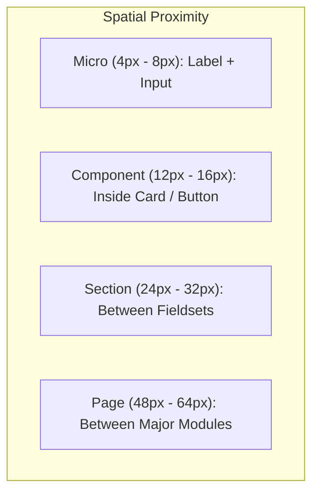

# Spacing & Spatial Grid System

> Mathematical rules for layout cadence, whitespace distribution, and spatial consistency.

---

## 1. Purpose

Random margin and padding values (e.g. 13px, 19px, 27px) create jagged layouts and visual restlessness. 

This guide establishes a strict **8pt / 4pt grid system** that guarantees harmonious spatial relationships across all devices.

---

## 2. The 8pt / 4pt Mathematical Scale

All margins, paddings, gap dimensions, and component heights must derive from multiples of 8px, with a 4px sub-grid for micro-adjustments:

| Token | Size | Primary Usage |
|---|---|---|
| `space-1` | 4px | Micro-spacing: Icon-to-text gap, badge internal padding |
| `space-2` | 8px | Tight: Distance between label and input, avatar stack overlap |
| `space-3` | 12px | Compact: Internal padding of small buttons, dropdown menu items |
| `space-4` | 16px | Base: Standard card internal padding, list item gaps, form field gaps |
| `space-5` | 20px | Medium: Mobile page edge gutters, card header padding |
| `space-6` | 24px | Generous: Desktop card padding, gaps between distinct form sections |
| `space-8` | 32px | Sectional: Spacing between independent content modules |
| `space-10` | 40px | Wide: Desktop column gutters |
| `space-12` | 48px | Structural: Spacing between major page bands or hero headers |
| `space-16` | 64px | Page Layout: Top/bottom margins of hero sections |

---

## 3. Spatial Hierarchy & Rules

### The Proximity Heuristic (Law of Proximity)
1. **Related elements sit close together**: An input label should be 6px–8px above its field.
2. **Unrelated elements sit farther apart**: The gap between the bottom of that field and the next label must be at least 16px–24px.
3. If the space between two distinct items is smaller than the space inside the item, the eye groups them incorrectly.

---

## 4. Layout Margins & Gutters Across Viewports

- **Mobile Viewports (< 640px)**:
  - Screen edge horizontal padding: `16px` (or `20px`).
  - Column gap / content gap: `12px` to `16px`.
- **Tablet Viewports (640px – 1024px)**:
  - Screen edge horizontal padding: `24px` to `32px`.
  - Column gap: `16px` to `24px`.
- **Desktop Viewports (≥ 1024px)**:
  - Max container width: Typically `1140px` to `1280px` centered with auto margins.
  - Column gap: `24px` to `32px`.

---

## 5. Spacing Anti-Patterns

- **Arbitrary Odd Values**: Using `padding: 13px` or `margin-bottom: 21px`. Always snap to the scale.
- **Inconsistent Card Padding**: Applying 16px horizontal padding and 32px vertical padding without an intentional visual reason. Keep card padding balanced (e.g. 16px all-around, or 20px all-around).
- **Ignoring Scroll Overlap**: Failing to add bottom padding to scrollable lists, causing the final item to hide behind floating bottom navigation or action bars.

---

## 6. Related Documentation

- Design Philosophy: [design-philosophy.md](design-philosophy.md)
- Typography: [typography.md](typography.md)
- Responsive Design: [responsive-design.md](responsive-design.md)
- Cards Component: [../components/cards.md](../components/cards.md)

