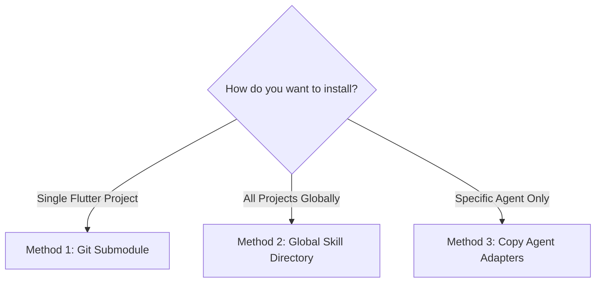

# Human Flutter Installation & Setup Guide

> Step-by-step instructions for installing, configuring, and updating Human Flutter Engineering across your development environments.

---

## 1. Quick Installation Overview

Choose the installation method that fits your workflow:



---

## 2. Method 1: Git Submodule (Recommended for Teams)

Embed Human Flutter Engineering directly inside your Flutter repository so that all developers and AI agents share the exact same version:

```bash
# Add as a submodule in your project root (e.g. at .human-ui or .human-flutter)
git submodule add https://github.com/juwelzan/human-ui-engineering.git .human-ui

# Setup adapters (creates canonical directories and links/copies adapters)
mkdir -p .agents/skills .agents/rules .agent/skills .cursor/rules .claude/commands .github/prompts .windsurf/workflows

# Antigravity & Gemini discovery (.agents is canonical for slash command autocomplete)
ln -s ../../.human-ui/skills/human-flutter .agents/skills/human-flutter
cp .human-ui/.agent/rules/human-flutter.md .agents/rules/human-flutter.md
cp -r .human-ui/.agent/skills/human-flutter .agent/skills/

# Other agent adapters
cp .human-ui/.cursor/rules/human-flutter.mdc .cursor/rules/
cp .human-ui/.claude/commands/human-flutter.md .claude/commands/
cp .human-ui/.github/prompts/human-flutter.prompt.md .github/prompts/
cp .human-ui/.windsurf/workflows/human-flutter.md .windsurf/workflows/
```

To update to the latest version:
```bash
git submodule update --remote .human-ui
```

---

## 3. Method 2: Global Installation (Single Developer, All Projects)

Install Human Flutter Engineering in your user home directory so it activates across every Flutter project on your machine:

### For Google Antigravity & Gemini CLI
```bash
# Create canonical global skill directory
mkdir -p ~/.gemini/config/skills/human-flutter

# Clone or link the canonical skill into global config
git clone https://github.com/juwelzan/human-ui-engineering.git /tmp/human-ui-engineering
cp -r /tmp/human-ui-engineering/skills/human-flutter/* ~/.gemini/config/skills/human-flutter/
rm -rf /tmp/human-ui-engineering
```
*Antigravity and Gemini CLI will automatically discover `/human-flutter` across all Flutter projects and workspaces.*

### For Claude Code
```bash
mkdir -p ~/.claude/commands
cat << 'EOF' > ~/.claude/commands/human-flutter.md
---
description: Execute a production-grade Flutter engineering task using Human Flutter Engineering.
argument-hint: "[subcommand] [task or instruction]"
---
Follow the instructions at: https://github.com/juwelzan/human-ui-engineering/blob/main/skills/human-flutter/SKILL.md
EOF
```

---

## 4. Method 3: Agent-Specific Manual Setup

If you only use one specific IDE or tool, follow its dedicated configuration:

### Cursor Setup
1. Copy `.cursor/rules/human-flutter.mdc` into your project's `.cursor/rules/` directory.
2. In Cursor Composer or Chat, type `/human-flutter` or mention `@human-flutter`.

### VS Code GitHub Copilot Setup
1. Copy `.github/prompts/human-flutter.prompt.md` into your project's `.github/prompts/` folder.
2. In GitHub Copilot Chat, type `/human-flutter [task]`.

### Windsurf Cascade Setup
1. Copy `.windsurf/workflows/human-flutter.md` into `.windsurf/workflows/`.
2. Copy `.windsurf/rules/human-flutter.md` into `.windsurf/rules/`.
3. In Cascade, select `/human-flutter` from the slash menu.

---

## 5. How to Verify Your Installation

Open your agent's chat window and type:
```text
/human-flutter status
```
If properly installed, the agent will acknowledge the Human Flutter Engineering framework and report the current project status and active checkpoints.

---

## 6. Related Documentation

- Main Skill: [../skills/human-flutter/SKILL.md](../skills/human-flutter/SKILL.md)
- Compatibility Matrix: [compatibility-matrix.md](compatibility-matrix.md)
- Chat Slash Command Guide: [slash-command-guide.md](slash-command-guide.md)
- Master Instructions: [../AGENTS.md](../AGENTS.md)
