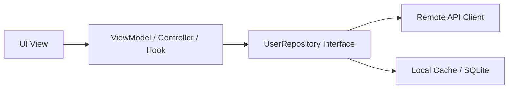

# UI Architecture Patterns & Paradigms

> Comparative overview and implementation rules for Flutter UI architecture patterns: BLoC / Cubit, Riverpod, Provider, and Feature-First Clean Architecture.

---

## 1. Purpose

No single UI architecture fits every framework and application scale. However, every robust pattern shares the same goal: separating UI rendering from business logic, ensuring unidirectional data flow, and enabling modular testing. 

This guide outlines the standard UI architecture patterns and explains how to align with existing conventions.

---

## 2. Flutter UI Architecture Patterns

### 1. BLoC / Cubit (Business Logic Component)
- **Primary Environments**: Flutter enterprise and medium-to-large applications.
- **Data Flow**:
  - UI dispatches an **Event** into the BLoC sink.
  - The BLoC processes asynchronous logic and emits a new immutable **State** via a reactive Dart Stream.
  - UI listens via `BlocBuilder` / `BlocConsumer` and rebuilds selectively using `buildWhen`.
- **Key Advantage**: Strict event-driven auditability, predictable state transitions, and clear separation of business logic from UI widgets.

### 2. Riverpod (Notifier & AsyncNotifier Architecture)
- **Primary Environments**: Modern Flutter applications requiring compile-time type safety.
- **Data Flow**:
  - State is encapsulated in `Notifier<T>` or `AsyncNotifier<T>` providers.
  - Views read state with `ref.watch()` and select specific sub-properties with `ref.watch(provider.select(...))`.
  - Side effects are triggered through `ref.read(provider.notifier).method()`.
- **Key Advantage**: Compile-time safety (no `ProviderNotFoundException`), automatic dependency cleanup (`.autoDispose`), and robust family parameterization.

### 3. Provider & ChangeNotifier
- **Primary Environments**: Lightweight Flutter applications and simple dependency injection.
- **Data Flow**:
  - State holder extends `ChangeNotifier` and calls `notifyListeners()` on state mutation.
  - Views observe changes using `context.watch<T>()` or `context.select<T, R>()`.
- **Key Advantage**: Minimal boilerplate, gentle learning curve, native to Flutter core patterns.

### 4. Feature-First Clean Architecture
- **Primary Environments**: Scalable, modular Flutter codebases.
- **Data Flow**:
  - Features isolate `presentation/`, `domain/`, and `data/` layers.
  - `domain/` contains pure Dart entities and repository contracts.
  - `data/` implements repositories and communicates with `Dio` or `Drift`.
- **Key Advantage**: High testability; UI can be refactored without breaking business rules.

---

## 3. The Repository Pattern

Regardless of the UI pattern chosen, the Presentation layer should never invoke raw HTTP endpoints or SQL databases directly. Use **Repositories**:

- Repositories abstract the source of data (network vs disk cache).
- Repositories map raw DTOs / JSON into clean domain models.
- Makes the presentation layer trivial to test using mock repositories.

---

## 4. Adapting to Existing Projects

> [!IMPORTANT]
> **Golden Rule**: Never force a new architectural pattern or state-management library on an existing Flutter codebase without explicit user instruction.
> - If an existing Flutter project uses BLoC / Cubit, write BLoC events and states.
> - If an existing Flutter project uses Riverpod, write Riverpod Notifiers.
> - If an existing Flutter project uses Provider, follow its established patterns.

---

## 5. Related Documentation

- Master Instructions: [../AGENTS.md](../AGENTS.md)
- UI Architecture: [../core/architecture.md](../core/architecture.md)
- State Management: [state-management.md](state-management.md)
- Clean Code: [clean-code.md](clean-code.md)
- Architecture Plan Template: [../templates/architecture-plan.md](../templates/architecture-plan.md)

