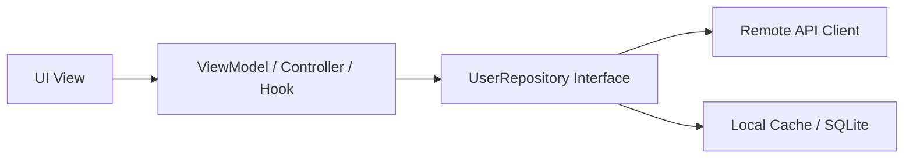

# UI Architecture Patterns & Paradigms

> Comparative overview and implementation rules for UI architecture patterns: MVVM, MVI/Redux, BLoC, and Custom Hook architectures.

---

## 1. Purpose

No single UI architecture fits every framework and application scale. However, every robust pattern shares the same goal: separating UI rendering from business logic, ensuring unidirectional data flow, and enabling modular testing. 

This guide outlines the standard UI architecture patterns and explains how to align with existing conventions.

---

## 2. Common UI Architecture Patterns

### 1. MVVM (Model - View - ViewModel)
- **Primary Environments**: Android (Jetpack Compose + ViewModel), iOS (SwiftUI + Observation/ObservableObject), Web.
- **Data Flow**:
  - **View**: Observes state exposed by the ViewModel and emits user events.
  - **ViewModel**: Encapsulates UI state and business logic; communicates with repositories.
  - **Model**: Pure data entities and business rules.
- **Key Advantage**: ViewModel survives configuration changes (e.g. screen rotation on mobile).

### 2. MVI / Redux / Flux (Model - View - Intent)
- **Primary Environments**: React (Redux Toolkit, Zustand), Web, complex state workflows.
- **Data Flow**:
  - User interaction dispatches an **Intent / Action**.
  - A pure **Reducer** processes current state + action to compute the new state.
  - The UI subscribes to the store and renders the new immutable state snapshot.
- **Key Advantage**: 100% deterministic, time-travel debugging, highly auditable state transitions.

### 3. BLoC / Cubit (Business Logic Component)
- **Primary Environments**: Flutter.
- **Data Flow**:
  - UI emits **Events** into the BLoC sink.
  - The BLoC processes asynchronous tasks and emits new **States** via a reactive Dart Stream.
  - UI listens via `BlocBuilder` / `BlocConsumer` and rebuilds granularly.
- **Key Advantage**: Strict separation of concerns, reactive stream-based data handling.

### 4. Custom Hook / Composition Architecture
- **Primary Environments**: React, Next.js, Vue 3 Composition API.
- **Data Flow**:
  - Encapsulate reactive state, caching, and handlers in custom hooks (e.g. `useCheckoutFlow()`).
  - Views remain purely presentational, consuming hook returns.
- **Key Advantage**: Lightweight, highly reusable logic without heavy boilerplate.

---

## 3. The Repository Pattern

Regardless of the UI pattern chosen, the Presentation layer should never invoke raw HTTP endpoints or SQL databases directly. Use **Repositories**:

- Repositories abstract the source of data (network vs disk cache).
- Repositories map raw DTOs / JSON into clean domain models.
- Makes the presentation layer trivial to test using mock repositories.

---

## 4. Adapting to Existing Projects

> [!IMPORTANT]
> **Golden Rule**: Never force a new architectural pattern or state-management library on an existing codebase without explicit user instruction.
> - If an existing React project uses Redux Toolkit, write RTK slices.
> - If an existing Flutter project uses Provider, use Provider.
> - If an Android app uses Jetpack Compose with MVI, follow MVI.

---

## 5. Related Documentation

- Master Instructions: [../AGENTS.md](../AGENTS.md)
- UI Architecture: [../core/architecture.md](../core/architecture.md)
- State Management: [state-management.md](state-management.md)
- Clean Code: [clean-code.md](clean-code.md)
- Architecture Plan Template: [../templates/architecture-plan.md](../templates/architecture-plan.md)
