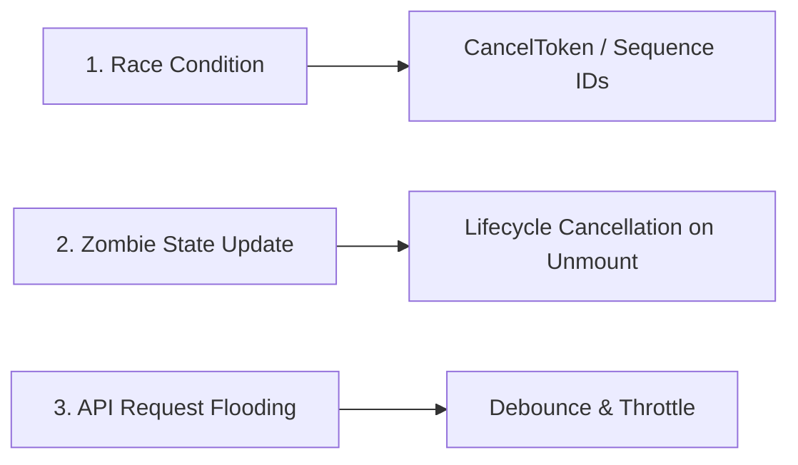

# Async Operations & Lifecycle Safety

> Engineering rules for request cancellation, race condition prevention, debouncing, throttling, and optimistic UI updates.

---

## 1. Purpose

User interfaces are inherently asynchronous: network latency, user typing, animations, and hardware sensor streams all execute concurrently. Failing to manage asynchronous lifecycles leads to race conditions, out-of-order state updates, zombie memory leaks, and duplicate submissions.

This guide defines the universal standards for asynchronous UI engineering.

---

## 2. The 3 Classic Async UI Hazards



### 1. Race Conditions (Out-of-Order Responses)
- **Scenario**: User types "Flutter" (Request 1), then rapidly types "Flutter 3.27" (Request 2). If Request 1 is delayed by network latency and arrives *after* Request 2, the UI will display the outdated "Flutter" results instead of "Flutter 3.27".
- **Solution**: Cancel obsolete in-flight requests using Dio's `CancelToken` or stream transformers (`switchMap`).

### 2. Zombie Updates on Unmounted Views
- **Scenario**: A user taps "Load Analytics", then immediately clicks "Back". 3 seconds later, the asynchronous `Future` resolves and calls `setState()`, throwing Flutter framework warnings or leaking memory.
- **Solution**: Check `if (!context.mounted) return;` or `if (!mounted) return;` before calling `setState()`, and cancel listeners in `dispose()`.

### 3. API Request Flooding
- **Scenario**: An input fires an HTTP request on every single keystroke, overwhelming backend servers.
- **Solution**: Debounce user input by 250ms–350ms using a `Timer` or reactive stream operator.

---

## 3. Asynchronous Cancellation Patterns in Flutter & Dart

Always wire asynchronous operations to widget and controller lifecycles:

### A. HTTP Request Cancellation via Dio `CancelToken`
```dart
class _SearchScreenState extends State<SearchScreen> {
  CancelToken? _cancelToken;
  List<SearchResult> _results = [];
  bool _isLoading = false;

  Future<void> _performSearch(String query) async {
    // 1. Cancel previous in-flight request
    _cancelToken?.cancel('Cancelled by newer search query');
    _cancelToken = CancelToken();

    setState(() => _isLoading = true);

    try {
      final response = await dio.get(
        '/api/search',
        queryParameters: {'q': query},
        cancelToken: _cancelToken,
      );

      if (!mounted) return; // Prevent zombie state update
      setState(() {
        _results = (response.data as List)
            .map((e) => SearchResult.fromJson(e))
            .toList();
        _isLoading = false;
      });
    } on DioException catch (e) {
      if (CancelToken.isCancel(e)) return; // Ignored deliberate cancellation
      if (!mounted) return;
      setState(() => _isLoading = false);
    }
  }

  @override
  void dispose() {
    _cancelToken?.cancel('Widget disposed'); // Prevent leaks on unmount
    super.dispose();
  }
}
```

### B. Reactive Debouncing with StreamController & `switchMap`
In BLoC or reactive controllers, use stream transformers to automatically cancel obsolete requests:

```dart
EventTransformer<SearchEvent> debounceRestartable<SearchEvent>(Duration duration) {
  return (events, mapper) => events
      .debounceTime(duration)
      .switchMap(mapper); // switchMap automatically drops prior unresolved futures
}
```

---

## 4. Debounce vs. Throttle

| Pattern | Behavior | Ideal UI Scenario |
|---|---|---|
| **Debounce** | Delays execution until a specified quiet period has elapsed with no new events. | Search autocomplete typing, window resize layout recalculations, auto-saving drafts. |
| **Throttle** | Enforces a maximum execution rate (at most once every N milliseconds). | Infinite scroll trigger checks, drag-and-drop pointer tracking, audio/video playback scrubbing. |

---

## 5. Optimistic UI Updates & Rollback

For low-risk, immediate actions (e.g. toggling a favorite star or upvoting):

1. **Optimistic Mutation**: Immediately update the local UI state and render the active appearance.
2. **Background Dispatch**: Send the asynchronous request with a cancellation token.
3. **Rollback on Error**: If the server rejects the request:
   - Revert the state snapshot back to its pre-mutation value.
   - Display a non-blocking toast alert explaining the failure with an explicit "Retry" action.

---

## 6. Related Documentation

- Master Instructions: [../AGENTS.md](../AGENTS.md)
- Error Handling: [error-handling.md](error-handling.md)
- Performance Engineering: [performance.md](performance.md)
- Memory Management: [memory-management.md](memory-management.md)

