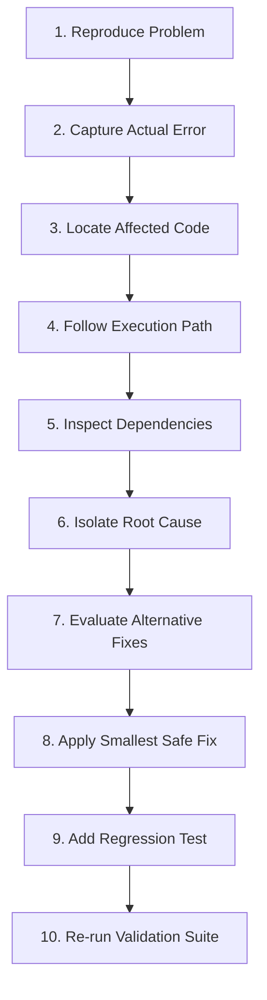

# Scientific Debugging & Root-Cause Engine

> **10-Stage Defect Isolation, Execution Tracing & Smallest-Safe-Fix Protocol**

Amateur AI debugging consists of guessing, randomly editing multiple files, and suppressing warnings. Professional engineering demands a scientific, reproducible, and minimal-delta approach.

---

## 1. The 10-Stage Scientific Debugging Sequence



1. **Reproduce the Problem**: Execute the failing test command, run the script, or trigger the route. If unreproducible, document the limitation honestly.
2. **Capture the Actual Error**: Extract exact terminal stack traces, HTTP status codes, console error payloads, or compiler diagnostic codes.
3. **Locate the Affected Code**: Trace the topmost stack frame originating in user/project code (skipping third-party library internals).
4. **Follow the Execution Path**: Step backward from the crash site to inspect how input parameters and state mutated prior to the failure.
5. **Inspect Related Dependencies**: Check recent package updates, schema migrations, environment variables, or breaking upstream changes.
6. **Isolate the Root Cause**: Differentiate the surface symptom (e.g., `TypeError: Cannot read properties of undefined`) from the architectural root cause (e.g., asynchronous network race condition failing to await a promise).
7. **Evaluate Alternative Fixes**: Weigh trade-offs:
   - Solution A: Quick patch at caller site.
   - Solution B: Defensive default in the shared primitive.
   - Solution C: Upstream schema validation fix.
8. **Apply the Smallest Safe Fix**: Modify only the necessary lines. Avoid refactoring adjacent unrelated code.
9. **Add Regression Protection**: Write an automated test reproducing the exact input that triggered the bug.
10. **Re-run Validation Suite**: Confirm the bug is fixed AND no secondary tests broke.

---

## 2. Forbidden Debugging Practices

> [!CAUTION]
> **Prohibited Anti-Patterns in AI Debugging**:
> - **Suppressing Warnings**: Disabling ESLint rules (`// eslint-disable-next-line`), adding `@ts-ignore`, or compiler flags (`--no-strict`) to hide errors.
> - **Swallowing Exceptions**: Wrapping failing code in `try { ... } catch (e) {}` with no logging or fallback.
> - **Shotgun Debugging**: Modifying 5 different files simultaneously in hopes that one will resolve the issue.
> - **Dynamic Casting**: Casting broken types to `any` or Dart `dynamic`.

---

## 3. Standard Debugging Report Format

When reporting a resolved bug, present findings using this schema:

```markdown
### Bug Diagnostic Summary
- **Symptom**: Checkout button remained disabled after filling all required billing fields.
- **Root Cause**: `validateForm()` checked `phone` validity even when `isPhoneRequired` was false, resulting in an unpromoted validation error in the form state.
- **Applied Fix**: Updated validation guard in `src/features/checkout/hooks/useBillingForm.ts` line 42 to skip phone checks when `!isPhoneRequired`.
- **Regression Protection**: Added unit test `should permit checkout submission when optional phone is omitted` in `useBillingForm.test.ts`.
- **Validation Outcome**: All 14 checkout unit tests **PASSED** (0 failures).
```

