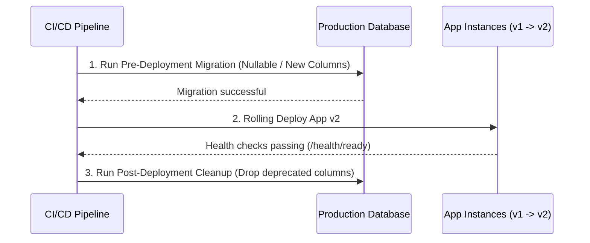

# Build, Release & DevOps Engineering

> **CI/CD Pipelines, Environment Hygiene, Semantic Releases & Safe Deployments**

Shipping production software requires predictable build tooling, automated validation gates, disciplined environment management, and zero-downtime release procedures.

---

## 1. Environment Segregation & Configuration

1. **Environment Tiers**:
   - `development`: Local developer workstation, hot reload, mocked external APIs or sandbox credentials.
   - `staging / preview`: Ephemeral or persistent replica of production; real database migrations and integration targets.
   - `production`: Real customer data, high-availability clusters, strict security and monitoring.
2. **Environment Variable Hygiene**:
   - Maintain `.env.example` committed to git with dummy placeholders for all required keys.
   - Never commit `.env`, `.env.local`, or `.env.production` files.
   - Fail hard on application boot if a required variable is missing or malformed.

---

## 2. Semantic Versioning & Release Preparation

Adhere to Semantic Versioning (`MAJOR.MINOR.PATCH`):
- **MAJOR (`v3.0.0`)**: Incompatible API changes, breaking database migrations, or major architectural pivots.
- **MINOR (`v2.1.0`)**: Backward-compatible new features, new endpoints, or newly supported frameworks.
- **PATCH (`v2.0.1`)**: Backward-compatible bug fixes and internal performance repairs.

### Release Pre-Flight Checklist
- [ ] Working tree is clean on `main` / release branch (`git status`).
- [ ] All automated tests pass (`npm test`, `pytest`, `flutter test`, `cargo test`).
- [ ] Type check and static analysis pass with 0 errors.
- [ ] Production build succeeds (`npm run build`, `flutter build`).
- [ ] [`CHANGELOG.md`](../CHANGELOG.md) updated with release notes and migration guides.
- [ ] Required database migrations are backward-compatible.

---

## 3. Database Migration Deployment Order

When releasing code that includes database migrations:



**Golden Rule**: The database must always be able to serve both the *currently running* version (v1) and the *newly deploying* version (v2) simultaneously.

---

## 4. Monitoring, Structured Logging & Rollback Protocols

1. **Structured JSON Logging**:
   - Log at appropriate levels (`DEBUG`, `INFO`, `WARN`, `ERROR`).
   - Include correlation / trace IDs across microservice calls:
     ```json
     {"timestamp":"2026-11-07T00:00:00Z","level":"error","message":"Payment capture failed","traceId":"tr_8f9a2b","userId":"u_123","errorCode":"ERR_CARD_DECLINED"}
     ```
2. **Telemetry & Alerting**:
   - Monitor Error Budgets, P95/P99 latency, and crash-free session rates.
3. **Automated Rollback Triggers**:
   - If HTTP 5xx error rate exceeds 1% during a canary rollout, automatically abort and restore the previous stable image.
   - Keep deployment rollback instructions explicitly documented in the release plan.

