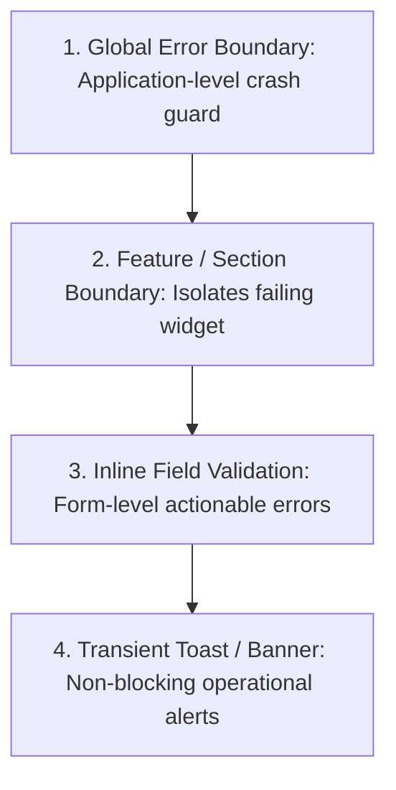

# UI Error Handling & Resilience

> Architectural standards for graceful degradation, error boundaries, user-facing error messaging, and failure recovery.

---

## 1. Purpose

In network-connected user interfaces, errors are inevitable: connections drop, APIs change, validation fails, and edge-case exceptions occur. A fragile application crashes to a blank screen; a resilient application isolates the defect, preserves user input, and offers clear recovery paths. 

This guide defines the engineering standard for UI error handling.

---

## 2. The 4 Tiers of Error Containment



### 1. Global Error Boundary
- **Role**: Last line of defense against catastrophic rendering exceptions.
- **Behavior**: Catches unhandled runtime exceptions. Instead of crashing to a blank white screen, displays a friendly, branded error screen with a "Reload Application" or "Return Home" action.

### 2. Feature / Section Boundary
- **Role**: Isolates component-level failures.
- **Behavior**: If an analytics chart widget fails due to malformed data, only that specific chart card renders an error fallback with a "Retry" button. The rest of the dashboard remains interactive.

### 3. Inline Field Validation
- **Role**: User input corrections in forms.
- **Behavior**: Renders directly below the affected input field in high-contrast semantic red, accompanied by an icon and programmatic screen-reader association (`aria-describedby`).

### 4. Transient Toast Notifications
- **Role**: Non-blocking background operation alerts (e.g. "Failed to auto-save draft", "Network connection lost").
- **Behavior**: Appears at screen edge for 4–6 seconds with an explicit "Retry" action. Never used for critical errors requiring permanent acknowledgment.

---

## 3. Anatomy of a User-Empowering Error Message

Never display raw technical jargon, HTTP status codes, or stack traces to end users.

| Bad Error Message (Technical & Blaming) | Good Error Message (Human & Actionable) |
|---|---|
| `Error 500: Internal Server Error` | *"Unable to load your transactions. Our servers are temporarily busy. Please try again in a few moments."* |
| `TypeError: Cannot read property 'map' of undefined` | *"We couldn't display your team members right now. [Retry button]"* |
| `Invalid input: Regex mismatch` | *"Please enter a valid email address (e.g. name@example.com)."* |

---

## 4. Async Execution Safety

Always wrap asynchronous network and database operations in safe execution blocks:

```typescript
// Mandatory async structure
async function handleSubmit() {
  setIsLoading(true);
  setError(null);
  
  try {
    const result = await api.submitData(payload);
    onSuccess(result);
  } catch (err) {
    const humanMessage = mapErrorToUserMessage(err);
    setError(humanMessage);
    logTelemetryError(err); // Sanitize PII
  } finally {
    // ALWAYS reset loading flag to prevent infinite zombie spinners
    setIsLoading(false);
  }
}
```

---

## 5. Error Handling Anti-Patterns

1. **The Silent Failure**: Catching an exception in an empty catch block (`catch (e) {}`), leaving the user staring at an unresponsive screen with zero feedback.
2. **The Full-Page Crash for a Minor Widget**: Allowing a small secondary sidebar widget to blow up the entire root layout tree.
3. **Leaking Sensitive Telemetry**: Displaying database connection strings, API secrets, or private user emails in visible error banners.

---

## 6. Related Documentation

- Master Instructions: [../AGENTS.md](../AGENTS.md)
- Clean Code: [clean-code.md](clean-code.md)
- State Management: [state-management.md](state-management.md)
- Loading States: [../components/loading-states.md](../components/loading-states.md)
- Bug Prevention: [../quality/bug-prevention.md](../quality/bug-prevention.md)

