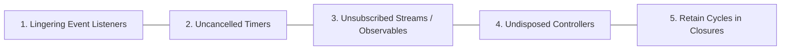

# Memory Management & Resource Disposal

> Engineering practices for eliminating memory leaks, managing component lifecycles, and releasing resources.

---

## 1. Purpose

Memory leaks in UI applications cause progressive performance degradation, frame drops, battery exhaustion, and eventual out-of-memory (OOM) application crashes. In long-running Single Page Applications (SPAs) or mobile apps, failing to dispose of listeners and controllers is disastrous. 

This guide defines the engineering standard for resource disposal.

---

## 2. The 5 Major Culprits of UI Memory Leaks



### 1. Lingering Event Listeners
Attaching listeners to global targets (`window`, `document`, hardware sensors) without removing them when the component unmounts. The component remains trapped in memory forever.

### 2. Uncancelled Timers & Intervals
Setting `setInterval` or `Timer.periodic` and failing to call `clearInterval` or `timer.cancel()`. The timer continues firing in the background and holding a reference to the detached view.

### 3. Unsubscribed Streams & Observables
Subscribing to reactive streams (Dart Streams, RxJS Observables, WebSocket connections) without cancelling the subscription when the view disappears.

### 4. Undisposed Native Controllers
In mobile frameworks (Flutter, Android, iOS), controllers (e.g. `AnimationController`, `TextEditingController`, `ScrollController`, `MediaPlayer`) allocate underlying OS or GPU memory and must be explicitly destroyed.

### 5. Retain Cycles & Closures
Closures capturing `self` or large outer view state strongly, preventing the garbage collector or ARC from releasing the instance.

---

## 3. Idiomatic Cleanup Patterns by Framework

### A. React / Next.js
Always return a cleanup function from `useEffect`:
```tsx
useEffect(() => {
  const handleResize = () => setDimensions(window.innerWidth);
  window.addEventListener('resize', handleResize);
  
  const timer = setInterval(pollStatus, 5000);

  // MANDATORY: Cleanup on unmount
  return () => {
    window.removeEventListener('resize', handleResize);
    clearInterval(timer);
  };
}, []);
```

### B. Flutter
Always override `dispose()` in `StatefulWidget`:
```dart
class _CustomWidgetState extends State<CustomWidget> {
  late final TextEditingController _controller;
  late final AnimationController _animController;
  StreamSubscription? _sub;

  @override
  void initState() {
    super.initState();
    _controller = TextEditingController();
    _animController = AnimationController(vsync: this);
    _sub = eventBus.stream.listen(_handleEvent);
  }

  @override
  void dispose() {
    // MANDATORY: Dispose controllers and cancel subscriptions
    _controller.dispose();
    _animController.dispose();
    _sub?.cancel();
    super.dispose();
  }
}
```

### C. Android (Kotlin / Compose)
Use `DisposableEffect` for cleanup:
```kotlin
DisposableEffect(key1) {
    val listener = SensorEventListener { /* ... */ }
    sensorManager.registerListener(listener, sensor, SensorManager.SENSOR_DELAY_UI)
    
    onDispose {
        sensorManager.unregisterListener(listener)
    }
}
```

### D. iOS (Swift / SwiftUI)
Use `[weak self]` in closures and clean up on dismiss:
```swift
.onDisappear {
    timer?.invalidate()
    timer = nil
    cancellables.removeAll()
}
```

---

## 4. Unbounded Cache Safeguards

- Never store unbounded lists of images, search queries, or API payloads in a plain global `Map` or `List`.
- Always use a **Least Recently Used (LRU)** cache with an explicit maximum entry limit or size threshold.

---

## 5. Related Documentation

- Master Instructions: [../AGENTS.md](../AGENTS.md)
- Clean Code: [clean-code.md](clean-code.md)
- Performance: [performance.md](performance.md)
- Performance Audit Checklist: [../quality/performance-audit.md](../quality/performance-audit.md)

