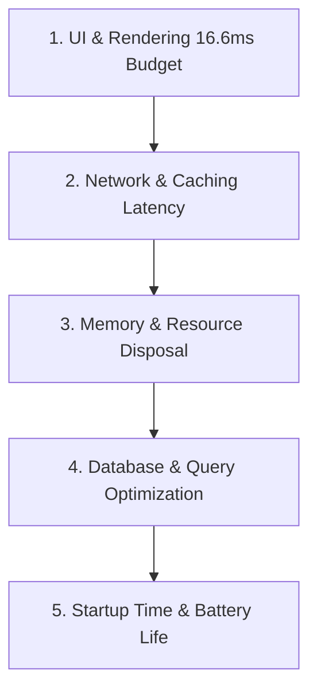

# Full-Stack Performance & Resource Engineering

> **Rendering Efficiency, Memory Management, Network Caching, DB Query Performance & Battery Life**

High performance is an architectural invariant that spans frontend rendering, network latency, database efficiency, and resource utilization. AI coding agents must measure with telemetry before claiming performance improvements and never sacrifice accessibility or correctness for superficial benchmarks.

---

## 1. The Core Performance Pillars



---

## 2. UI & Rendering Efficiency (The Frame Budget)

To maintain 60fps (16.6ms/frame) or 120fps (8.3ms/frame) smooth interactions:
1. **Rebuild Containment**:
   - Isolate volatile state (e.g. search text inputs) into leaf widgets to avoid re-rendering entire parent views.
   - Use compile-time `const` constructors on all immutable widgets.
   - Use scoped rebuilds (`buildWhen` in BLoC, `.select()` in Riverpod, `ValueListenableBuilder`).
2. **List Virtualization (Mandatory for Large Data)**:
   - Always virtualize dynamic lists and collections exceeding 20 items using `ListView.builder`, `GridView.builder`, or `CustomScrollView` with `SliverList`.
   - Virtualization keeps memory flat regardless of whether 100 or 100,000 items exist in the collection.
3. **Cumulative Layout Shift (CLS)**:
   - Explicitly declare aspect ratios or width/height on images and dynamic placeholders to eliminate visual jumps during load.

---

## 3. Network Performance & Cache Management

1. **HTTP Caching Strategies**:
   - Static assets: `Cache-Control: public, max-age=31536000, immutable` with content-hashed filenames.
   - Dynamic API endpoints: Leverage `ETag` and `Stale-While-Revalidate` (SWR) headers to return cached responses while refreshing in the background.
2. **Payload Minification & Compression**:
   - Enable Brotli / Gzip compression on all text and JSON responses.
   - Implement field filtering / GraphQL / sparse fieldsets to avoid transmitting unnecessary columns over mobile networks.
3. **Connection Multiplexing**:
   - Enforce HTTP/2 or HTTP/3 to eliminate head-of-line blocking and enable concurrent stream multiplexing over a single connection.

---

## 4. Memory Lifecycle & Resource Disposal

1. **Dispose Subscriptions, Timers & Listeners**:
   - Every active stream subscription, event listener, `setInterval`, animation controller, and socket connection MUST be cancelled in unmount/dispose lifecycles.
   - Memory leaks degrade device performance over time, causing mobile operating systems to kill apps in the background.
2. **Avoid Global Accumulation**:
   - Never append telemetry or unbounded event logs to in-memory global arrays without a strict circular buffer (LRU) limit.

---

## 5. Startup Time, Code Splitting & Binary Size

1. **Deferred Loading in Flutter Web & Desktop**:
   - Lazy-load secondary features and heavy charts using deferred imports:
     ```dart
     import 'features/admin_dashboard.dart' deferred as admin;
     
     Future<void> loadAdmin() async {
       await admin.loadLibrary();
     }
     ```
2. **Tree Shaking & Binary Size Optimization**:
   - Build production releases with symbol stripping and obfuscation:
     ```bash
     flutter build appbundle --release --obfuscate --split-debug-info=build/symbols
     ```
   - Analyze APK/AAB size distributions via `flutter build appbundle --analyze-size`.

---

## 6. Battery Consumption & Background Execution

- **Mobile & Battery Optimization**:
  - Stop polling APIs when the application is backgrounded or hidden (`visibilitychange` on web, `AppLifecycleState.paused` in Flutter).
  - Batch network analytics and telemetry requests rather than firing individual requests on every click.
  - Avoid high-frequency location tracking or GPS updates when coarse location is sufficient.

---

## 7. Evidence-Based Measurement Protocol

> [!IMPORTANT]
> **No Optimizations Without Baseline Telemetry**:
> Never claim "optimized component rendering" or "reduced network lag" without objective measurements:
> - Measure before/after metrics: Frame render times (ms), bundle size (KB), Lighthouse scores, or database query execution times (`EXPLAIN ANALYZE`).
