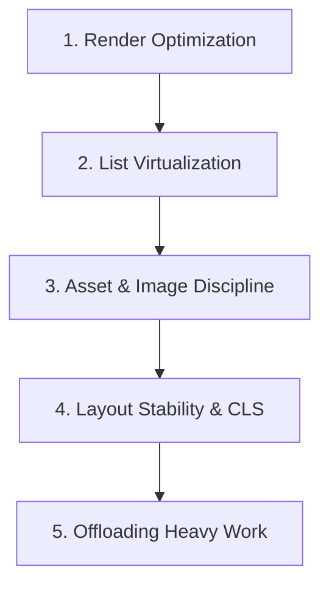

# UI Performance & Rendering Optimization

> Engineering rules for maintaining 60fps/120fps frame budgets, zero layout shifts, and rapid interaction response.

---

## 1. Purpose

Sluggish interactions, janky scrolling, and delayed renders alienate users. Performance is not a post-launch polish phase; it is an architectural discipline maintained throughout component design and state management. 

This guide defines strict performance standards for user interfaces.

---

## 2. The Frame Budget (16.6ms / 8.3ms)

To deliver smooth 60fps (standard displays) or 120fps (ProMotion / high refresh rate displays), the application must compute and paint each frame within a strict time window:
- **60fps Target**: Total work per frame must stay under **16.6 milliseconds**.
- **120fps Target**: Total work per frame must stay under **8.3 milliseconds**.

Any long-running computation on the main UI thread freezes animations, drops frames, and causes jank.

---

## 3. The 5 Pillars of UI Performance

### 1. Render Optimization & Rebuild Containment
- **Isolate Volatile State**: If a search input updates on every keystroke, do not store that string in a parent component that wraps an expensive 500-item table. Keep the volatile state inside the input or a lightweight search container.
- **Const / Memoization**:
  - **Flutter**: Use `const` constructors aggressively. Const widgets are canonicalized at compile-time and skipped entirely during rebuild passes.
  - **React**: Use `React.memo`, `useMemo`, and `useCallback` strategically on components that re-render frequently with heavy subtrees. Avoid blanket memoization on trivial 5-line primitives.
  - **Android Compose**: Ensure data models are `@Immutable` or `@Stable` so Compose skips recompositions.

### 2. List Virtualization (Mandatory for Large Data)
- **NEVER** render hundreds of unconstrained items in a standard scroll container. 
- Always use virtualized windowing:
  - **Web / React**: `@tanstack/react-virtual` or `react-window`.
  - **Flutter**: `ListView.builder()` or `CustomScrollView` with slivers.
  - **Android Compose**: `LazyColumn` / `LazyRow`.
  - **iOS SwiftUI**: `LazyVStack` / `LazyHStack` inside `ScrollView`.
- Virtualization ensures only the visible ~10 items are instantiated in memory, keeping memory flat whether rendering 10 items or 100,000.

### 3. Image & Media Optimization
- Always serve modern compressed formats (WebP, AVIF) instead of raw 4MB PNGs.
- Explicitly declare `width` and `height` (or aspect-ratio) on all image tags and placeholders to eliminate layout shifts when images finish loading.
- Use native lazy loading (`loading="lazy"` on web, cached network image providers on mobile).

### 4. Layout Stability (Cumulative Layout Shift - CLS)
- Dynamic content (banners, ads, fetched widgets) must never push existing content down abruptly.
- Reserve container space upfront using min-height or skeleton placeholders.

### 5. Offloading Main Thread Computations
- Never execute heavy CPU tasks (crypto, image resizing, large JSON parsing, complex regex filtering) on the main UI thread.
- Offload to background workers:
  - **Web**: Web Workers.
  - **Flutter**: `compute()` or Dart Isolates.
  - **Android**: `Dispatchers.Default` with Kotlin Coroutines.
  - **iOS**: `Task.detached(priority: .userInitiated)` with Swift Concurrency.

---

## 4. Input Throttling & Debouncing

When responding to continuous high-frequency user events (search typing, window resizing, scroll offsets):
- **Search Inputs**: Debounce API queries by 250ms–350ms.
- **Scroll & Resize**: Throttle handler execution to 16ms (requestAnimationFrame) or use passive listeners.

---

## 5. Related Documentation

- Master Instructions: [../AGENTS.md](../AGENTS.md)
- Memory Management: [memory-management.md](memory-management.md)
- Animation Performance: [../design/animation.md](../design/animation.md)
- Loading States: [../components/loading-states.md](../components/loading-states.md)
- Performance Audit: [../quality/performance-audit.md](../quality/performance-audit.md)
