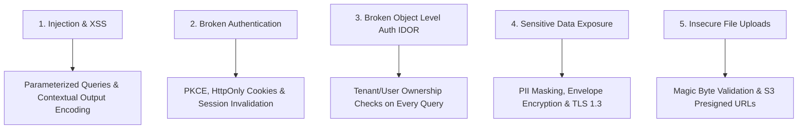

# Comprehensive Security Engineering

> **Full-Stack Security: Authentication, Authorization, Input Validation, Secrets, Network & Data Privacy**

Security is an architectural invariant, not an afterthought. AI coding agents must proactively identify vulnerabilities, prevent data leaks, enforce defensive defaults, and flag security-sensitive changes for human review.

---

## 1. The Core Security Tenets

1. **Zero Trust & Defense in Depth**: Never trust client input, third-party webhooks, or unverified network calls. Validate at every layer.
2. **Principle of Least Privilege**: Grant users, services, database roles, and cloud credentials only the minimum permissions necessary.
3. **No Insecure Defaults**: Disable debugging endpoints in production, mandate HTTPS/TLS, enforce strong password policies, and enable CORS whitelists.
4. **Zero Secrets in Source Code**: Never hardcode API keys, private keys, tokens, or credentials in any file committed to version control.
5. **Flag Security-Sensitive Modifications**: Explicitly highlight any changes affecting authentication, authorization rules, encryption, or permissions during code review.

---

## 2. Threat Vector & Defense Matrix



---

## 3. Authentication & Authorization (AuthN & AuthZ)

1. **Authentication Best Practices**:
   - Modern mobile & SPA apps: Use OAuth 2.0 with Proof Key for Code Exchange (PKCE).
   - Session tokens: Store in `HttpOnly`, `Secure`, `SameSite=Strict` cookies. Rotate session IDs upon privilege elevation or login.
   - Multi-Factor Authentication (MFA): Support TOTP (Time-based One-Time Password) or WebAuthn/Passkeys.
2. **Broken Object Level Authorization (BOLA / IDOR) Defense**:
   - **Never trust client-supplied entity IDs without verifying ownership**:
   ```typescript
   // VULNERABLE TO IDOR:
   app.get('/api/documents/:id', async (req, res) => {
     const doc = await db.documents.findUnique({ where: { id: req.params.id } });
     res.json(doc);
   });

   // SAFE: Enforce tenant / user ownership boundary
   app.get('/api/documents/:id', async (req, res) => {
     const doc = await db.documents.findFirst({
       where: {
         id: req.params.id,
         tenantId: req.user.tenantId, // Ownership bound to auth session
       },
     });
     if (!doc) throw new NotFoundException('Document not found');
     res.json(doc);
   });
   ```

---

## 4. Input Validation & Output Encoding

1. **Input Validation (Perimeter Defense)**:
   - Validate every inbound payload against strict type schemas (Zod, Pydantic, Joi).
   - Reject unrecognised fields (`strip` or `strict` mode) to prevent mass-assignment vulnerabilities.
2. **Output Encoding (XSS Defense)**:
   - Rely on automatic template escaping (React JSX, Flutter Text, Angular templates).
   - Sanitize rich markdown/HTML with `DOMPurify` before rendering.
   - Whitelist protocols on hyperlinks (`https:`, `http:`, `mailto:`); reject `javascript:` pseudo-protocols.

---

## 5. Secrets Management & Storage

| Layer | Recommended Storage | Prohibited Storage |
|---|---|---|
| **Web Browser** | `HttpOnly` Cookies | `localStorage` / `sessionStorage` (Accessible via XSS) |
| **Mobile (Android)** | Android Keystore / `EncryptedSharedPreferences` | Unencrypted `SharedPreferences` |
| **Mobile (iOS)** | Apple Keychain (`kSecClassGenericPassword`) | `UserDefaults` or bundle plist |
| **Backend Service** | AWS Secrets Manager, GCP Secret Manager, Vault | Hardcoded strings, unencrypted `.env` in git |

---

## 6. Network & API Security

1. **Transport Security**: Mandate TLS 1.3. Enforce HTTP Strict Transport Security (`HSTS`) with `max-age=31536000; includeSubDomains; preload`.
2. **Cross-Origin Resource Sharing (CORS)**: Never set `Access-Control-Allow-Origin: *` on authenticated endpoints. Explicitly whitelist trusted origin domains.
3. **Rate Limiting & Abuse Prevention**: Enforce rate limits by IP and authenticated user account to mitigate brute force attacks and denial of service.

---

## 7. Logging Safety & Data Privacy (PII)

> [!CAUTION]
> **Never Log Sensitive Information**:
> Sanitize logs to ensure the following are NEVER written to disk or third-party log providers:
> - Passwords, PINs, or recovery codes.
> - Full credit card numbers (PAN) or CVVs.
> - Authentication tokens (Bearer tokens, session cookies, API secrets).
> - Personally Identifiable Information (PII) such as Social Security numbers or national ID cards.

---

## 8. File Upload & Permission Safety

1. **Never store user uploads on local server filesystems**: Upload directly to object storage (S3, GCS) via time-limited presigned URLs.
2. **Validate File Magic Bytes**: Do not rely on client-supplied `Content-Type` headers or file extensions. Validate file signatures (magic bytes) on the server.
3. **Restrict File Execution**: Ensure storage buckets are configured with private ACLs and serve user content with `Content-Disposition: attachment` or strict `Content-Security-Policy`.
