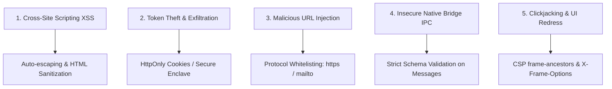

# UI Security Fundamentals

> Engineering standards for client-side security, XSS prevention, token hygiene, Content Security Policy (CSP), and secure native bridge communication.

---

## 1. Purpose

Client-side user interfaces run in untrusted, user-controlled environments (web browsers, mobile operating systems, desktop runtimes). Insecure handling of user input, authentication tokens, external URLs, or native bridge communication exposes users to Cross-Site Scripting (XSS), token theft, clickjacking, and data exfiltration.

This guide defines the universal security standards required across all UI codebases.

---

## 2. Core UI Security Threats & Defenses



---

## 3. Cross-Site Scripting (XSS) Prevention

### 1. Escape by Default
- Modern UI frameworks (React JSX, Flutter Text, Angular templates, Vue templates, Android Compose) escape strings by default.
- **NEVER** bypass built-in escaping without strict sanitization:
  - **React**: Avoid `dangerouslySetInnerHTML`. If markdown or rich HTML is mandatory, sanitize using `DOMPurify`.
  - **Vue**: Avoid `v-html` on untrusted user strings.
  - **Flutter**: Never inject unescaped HTML strings into WebViews.
  - **Android**: Disable JavaScript in `WebView` unless explicitly required (`settings.javaScriptEnabled = false`).

### 2. URL Protocol Validation
When rendering user-supplied links (`<a href={userLink}>` or `url_launcher`):
```typescript
// Anti-Pattern: Vulnerable to javascript: pseudo-protocol XSS
<a href={profile.websiteUrl}>Website</a>

// Best Practice: Protocol Whitelisting
function isSafeUrl(url: string): boolean {
  try {
    const parsed = new URL(url);
    return ['https:', 'http:', 'mailto:', 'tel:'].includes(parsed.protocol);
  } catch {
    return false;
  }
}
```

---

## 4. Authentication Token & Session Hygiene

| Environment | Recommended Storage | Discouraged Storage |
|---|---|---|
| **Web Browser** | `HttpOnly`, `Secure`, `SameSite=Strict` cookies | `localStorage` / `sessionStorage` (vulnerable to XSS theft) |
| **Mobile (Android)** | Android Keystore / `EncryptedSharedPreferences` | Unencrypted `SharedPreferences` |
| **Mobile (iOS)** | Apple Keychain (`kSecClassGenericPassword`) | `UserDefaults` |
| **Desktop (Electron)** | OS Keychain (`safeStorage` API) | Plaintext JSON files |

> [!CAUTION]
> Never store sensitive API secrets, OAuth client secrets, or database master keys inside client-side UI codebases. Anything in client code can be decompiled or inspected via browser DevTools.

---

## 5. Secure Native Bridge & IPC Communication

In hybrid, cross-platform, or desktop applications (React Native, Flutter Platform Channels, Electron IPC, Tauri):
1. **Validate All IPC Messages**: Treat every message coming from a WebView or UI renderer as untrusted. Validate payload schemas using Zod, TypeBox, or protobuf.
2. **Context Isolation**:
   - In Electron: Always set `contextIsolation: true` and `nodeIntegration: false`.
   - In Tauri: Restrict allowlist capabilities in `tauri.conf.json`.

---

## 6. Dependency Supply Chain Hygiene

- Regularly scan for known vulnerabilities: `npm audit`, `dart pub audit`.
- Pin dependency versions or commit lockfiles (`package-lock.json`, `pubspec.lock`, `yarn.lock`).
- Never introduce obscure third-party libraries for trivial tasks that native APIs solve.

---

## 7. Related Documentation

- Master Instructions: [../AGENTS.md](../AGENTS.md)
- Clean Code Standards: [clean-code.md](clean-code.md)
- Error Handling: [error-handling.md](error-handling.md)
- Release Checklist: [../quality/release-checklist.md](../quality/release-checklist.md)

