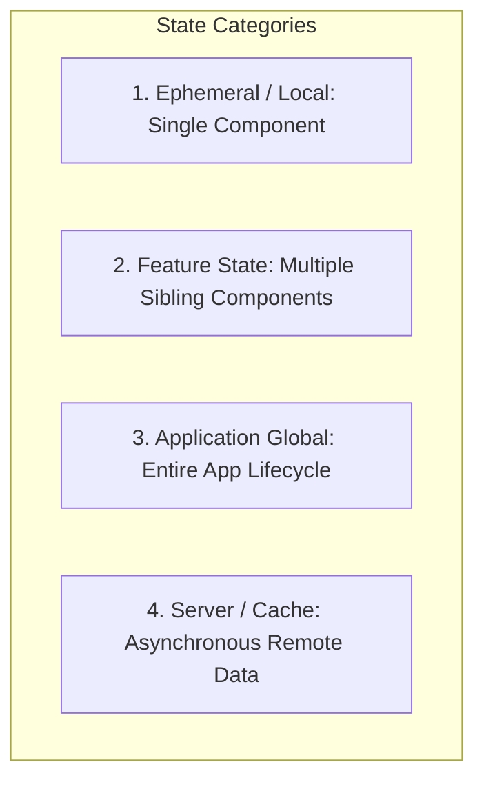

# State Management Strategies & Ergonomics

> Rules for categorizing, placing, and managing state across local, feature, global, and server layers.

---

## 1. Purpose

Mismanaged state is the single most common cause of UI bugs, race conditions, memory leaks, and sluggish re-renders. Storing ephemeral component state in global stores or manually synchronizing server caches creates chaotic codebases. 

This guide defines strict state boundaries and placement rules.

---

## 2. The 4 Categories of UI State



| Category | Typical Scope | Examples | Recommended Tooling |
|---|---|---|---|
| **1. Local / Ephemeral** | Single component | `isOpen`, `hoveredIndex`, input text string, tab active index | `useState`, `StatefulWidget`, Compose `rememberSaveable`, `@State` |
| **2. Feature State** | Multiple components within a single page/flow | Multi-step checkout wizard, active filter selections, pagination cursor | React Context, ViewModel, Riverpod family, Zustand slice, BLoC |
| **3. Global State** | Entire application lifecycle | Current user auth session, active theme (light/dark), shopping cart, permissions | Zustand, Redux Toolkit, Riverpod, App-level ViewModel, `@Environment` |
| **4. Server / Cache** | Remote asynchronous data | User list, product catalog, search query results | TanStack Query, RTK Query, SWR, Repository cache |

---

## 3. The State Placement Heuristic

Before declaring state, follow this decision sequence:

1. **Can it be derived?** If a value can be computed on the fly from existing props or state (e.g. `fullName = firstName + ' ' + lastName` or `itemsCount = items.length`), **NEVER store it in state**. Redundant state creates out-of-sync bugs.
2. **Does any sibling component need this?**
   - **No**: Keep it strictly local to the component (`useState`, local variable).
   - **Yes**: Lift the state up to the closest common ancestor.
3. **Does another screen or background service need this?**
   - **No**: Keep it inside the feature module.
   - **Yes**: Move it to the global application state.

---

## 4. Server State vs. Client State

Do not treat server data like local UI state:
- Server data is **remote**, **asynchronously owned**, and **potentially stale**.
- **Do not manually dispatch Redux actions** just to set `data`, `isLoading`, and `error` for every standard GET request if modern data-fetching tooling (TanStack Query, RTK Query) is available.
- Use query keys, automatic cache invalidation, and background refetching to keep server state fresh.

---

## 5. Granular Subscriptions & Render Optimization

Avoid subscribing components to entire global state objects:

```tsx
// Anti-Pattern: Subscribing to entire store triggers re-renders on ANY store update
const store = useAppStore();

// Best Practice: Fine-grained selector pattern
const userTheme = useAppStore((state) => state.theme);
```

By selecting only the specific primitive or slice needed, components re-render only when their specific dependent slice actually changes.

---

## 6. State Anti-Patterns

1. **Global Store Pollution**: Storing temporary text field typing strings or modal visibility booleans inside a global Redux/Zustand store.
2. **Prop Drilling Hell**: Passing a `userId` down through 7 levels of intermediate layout components that have no interest in the user.
3. **State Mutation In-Place**: Directly mutating arrays or objects (e.g. `items.push(newItem)`) instead of producing immutable copies (`[...items, newItem]`), which breaks reactive change-detection algorithms.

---

## 7. Related Documentation

- Master Instructions: [../AGENTS.md](../AGENTS.md)
- UI Architecture: [../core/architecture.md](../core/architecture.md)
- Architecture Patterns: [architecture-patterns.md](architecture-patterns.md)
- Error Handling: [error-handling.md](error-handling.md)
- Performance: [performance.md](performance.md)
