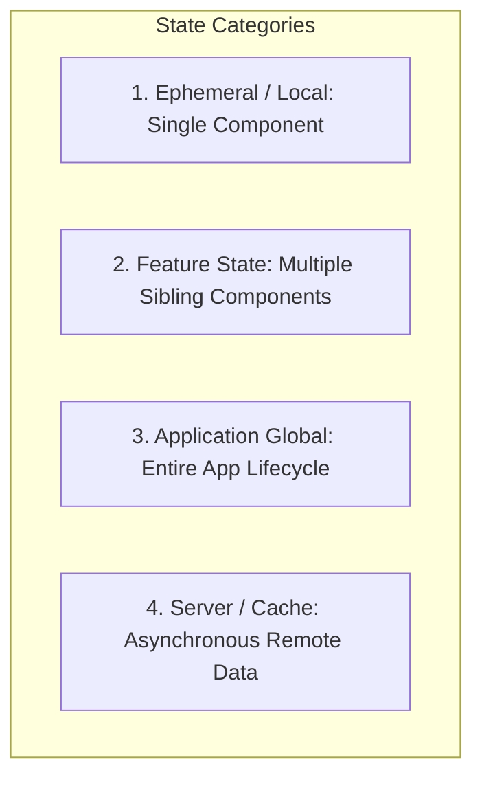

# State Management Strategies & Ergonomics

> Rules for categorizing, placing, and managing state across local, feature, global, and server layers.

---

## 1. Purpose

Mismanaged state is the single most common cause of UI bugs, race conditions, memory leaks, and sluggish re-renders. Storing ephemeral component state in global stores or manually synchronizing server caches creates chaotic codebases. 

This guide defines strict state boundaries and placement rules.

---

## 2. The 4 Categories of UI State



| Category | Typical Scope | Examples | Recommended Flutter Tooling |
|---|---|---|---|
| **1. Local / Ephemeral** | Single widget | `isOpen`, `hoveredIndex`, input text string, tab active index | `StatefulWidget`, `ValueNotifier`, `AnimationController` |
| **2. Feature State** | Multiple widgets within a single feature/screen | Multi-step checkout wizard, active filter selections, pagination cursor | `Bloc` / `Cubit`, Riverpod `NotifierProvider` |
| **3. Global State** | Entire application lifecycle | Current user auth session, active theme mode, shopping cart, permissions | Global `BlocProvider`, Riverpod, `InheritedWidget` |
| **4. Server / Cache** | Remote asynchronous data | User profile, product catalog, search results | Repository pattern with Dio, Drift, or Hive cache |

---

## 3. The State Placement Heuristic

Before declaring state, follow this decision sequence:

1. **Can it be derived?** If a value can be computed on the fly from existing properties or state (e.g. `fullName = '$firstName $lastName'` or `itemsCount = items.length`), **NEVER store it in state**. Redundant state creates out-of-sync bugs.
2. **Does any sibling widget need this?**
   - **No**: Keep it strictly local to the widget (`StatefulWidget`, `ValueNotifier`).
   - **Yes**: Lift the state up to the closest common ancestor or scoped feature controller.
3. **Does another screen or background service need this?**
   - **No**: Keep it inside the feature module.
   - **Yes**: Move it to the global application state.

---

## 4. Server State vs. Client State

Do not treat remote server data like local ephemeral UI state:
- Server data is **remote**, **asynchronously owned**, and **potentially stale**.
- Leverage typed Repository caching or stream-based data sources to manage network fetching, caching, and cache invalidation.
- Model loading, success, empty, and failure states explicitly using Dart sealed classes.

---

## 5. Granular Subscriptions & Rebuild Optimization

Avoid subscribing widgets to entire global state objects:

```dart
// ❌ Anti-Pattern: Subscribing to entire BLoC rebuilds on ANY state change
final state = context.watch<UserBloc>().state;

// ✅ Best Practice: Fine-grained selector pattern via context.select
final username = context.select<UserBloc, String>((bloc) => bloc.state.user.name);

// ✅ Best Practice: Scoped rebuilds with buildWhen
BlocBuilder<OrderBloc, OrderState>(
  buildWhen: (previous, current) => previous.status != current.status,
  builder: (context, state) {
    return OrderStatusBadge(status: state.status);
  },
);
```

By selecting only the specific primitive or slice needed, widgets rebuild only when their specific dependent property actually changes.

---

## 6. State Anti-Patterns

1. **Global Store Pollution**: Storing temporary text field typing strings or modal visibility booleans inside a global application BLoC.
2. **Parameter Drilling**: Passing parameters down through 7 levels of intermediate layout widgets that have no interest in the data.
3. **In-Place Mutation**: Directly mutating lists in-place (e.g. `state.items.add(newItem)`) instead of emitting new immutable copies (`[...state.items, newItem]`), which breaks Flutter's equality checks.

---

## 7. Related Documentation

- Master Instructions: [../AGENTS.md](../AGENTS.md)
- UI Architecture: [../core/architecture.md](../core/architecture.md)
- Architecture Patterns: [architecture-patterns.md](architecture-patterns.md)
- Error Handling: [error-handling.md](error-handling.md)
- Performance: [performance.md](performance.md)

