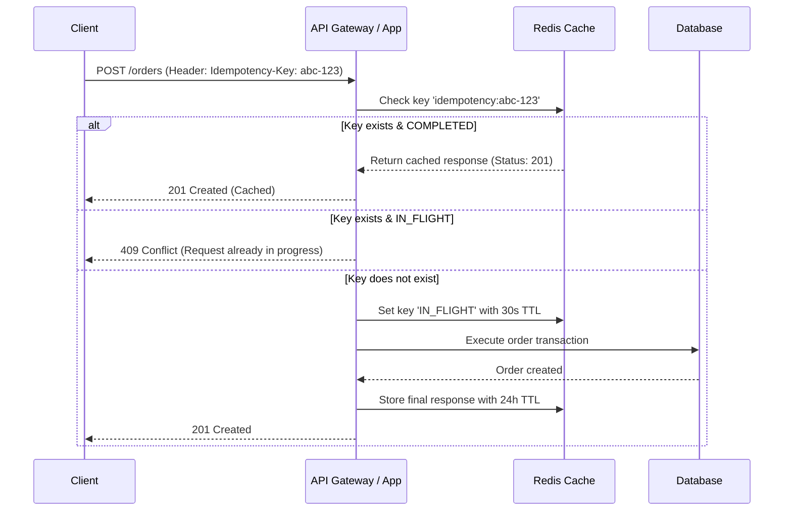

# API Development Engineering Guide

> **Protocols, Contracts, Versioning, Pagination, Idempotency & Rate Limiting**

This module provides engineering standards for architecting, building, and maintaining production APIs across REST, GraphQL, gRPC, and WebSockets.

---

## 1. Protocol Selection Matrix

| Protocol | Primary Use Case | Transport | Strengths | Trade-Offs |
|---|---|---|---|---|
| **REST (JSON/HTTP)** | Public APIs, CRUD web/mobile backends | HTTP/1.1 or HTTP/2 | Universal tooling, human-readable, excellent CDN caching. | Over/under-fetching, verbose contracts. |
| **GraphQL** | Multi-client apps with complex relational UI requirements | HTTP POST | Client-specified queries, single roundtrip, typed schema. | Difficult caching, query complexity attacks (N+1 queries). |
| **gRPC** | Internal microservices, high-throughput inter-service RPC | HTTP/2 (Protobuf) | Compact binary format, multiplexing, strict proto contracts. | Poor browser direct support, binary payloads. |
| **WebSockets / SSE** | Real-time dashboards, live chat, streaming notifications | TCP / HTTP/1.1+ | Full-duplex persistent connection (WS), low-latency events. | Stateful connection management, load balancing complexity. |

---

## 2. API Design & Versioning

1. **Contract-First Design**: Define contracts using OpenAPI 3.1 (`openapi.yaml`), GraphQL Schema (`schema.graphql`), or Protocol Buffers (`service.proto`) before writing endpoint handlers.
2. **Versioning Heuristics**:
   - Prefer URL path versioning for public APIs: `/api/v1/customers`.
   - Never break existing clients: adding optional fields is non-breaking; renaming, removing, or changing types is a breaking change requiring a new API version.
   - Deprecation notices: Announce sunset dates via `Sunset` and `Deprecation` HTTP headers (RFC 8594).

---

## 3. High-Performance Pagination

Always default to **Cursor-Based (Keyset) Pagination** for lists over 1,000 records:

```text
GET /api/v1/orders?limit=20&cursor=eyJpZCI6MTQyLCJjcmVhdGVkQXQiOiIyMDI2LTExLTA3In0=
```

### Why Cursor Beats Offset:
- **Performance**: Offset (`OFFSET 50000`) forces databases to scan and discard 50,000 rows. Cursor pagination uses index seeks (`WHERE (created_at, id) < ($1, $2) ORDER BY created_at DESC, id DESC LIMIT 20`), executing in sub-millisecond time.
- **Consistency**: Prevents missing or duplicate items when records are inserted or deleted while the user is paging.

---

## 4. Idempotency on Mutating Requests

All non-idempotent operations (POST / payments / orders / state mutations) must support an `Idempotency-Key` header:



---

## 5. Standardized Error Handling (RFC 7807)

Return consistent, machine-parseable error payloads adhering to RFC 7807:

```json
{
  "type": "https://api.example.com/errors/insufficient-funds",
  "title": "Insufficient Funds",
  "status": 422,
  "detail": "Your wallet balance of $12.50 is insufficient for transaction amount $50.00.",
  "instance": "/api/v1/wallets/w_987/debit",
  "invalidParams": [
    {
      "name": "amount",
      "reason": "Exceeds available balance"
    }
  ],
  "traceId": "trace-9a8b7c6d5e"
}
```

---

## 6. Rate Limiting & Protection

- **Algorithms**: Implement Token Bucket or Sliding Window rate limiting via Redis.
- **Standard Headers**:
  - `RateLimit-Limit`: Maximum requests permitted in window.
  - `RateLimit-Remaining`: Remaining request count in active window.
  - `RateLimit-Reset`: Seconds remaining until quota reset.
- When quota is exceeded, return `429 Too Many Requests` with a `Retry-After: <seconds>` header.
