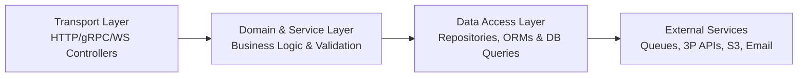

# Backend Development Engineering Guide

> **Server Runtimes, Layered Architecture, Concurrency & Resilient Systems**

This module provides framework-specific engineering intelligence for server-side software engineering across Node.js/TypeScript, Python, Go, Java, and Rust.

---

## 1. Core Architecture Patterns

Every professional backend system must enforce a strict 3-tier boundary:



1. **Transport / Controller Layer**:
   - Parses incoming requests and validates input schemas (e.g., Zod, Pydantic, Marshmallow).
   - Authenticates and authorizes caller context (JWT, sessions, API keys).
   - Maps domain entities and results to standard HTTP/gRPC status codes and response bodies.
   - **Rule**: Never execute raw database queries or core business logic inside controllers.
2. **Domain / Service Layer**:
   - Encapsulates business rules, transactions, workflows, and state transitions.
   - Pure, testable logic decoupled from HTTP request objects (`req`, `res`).
3. **Data Access / Repository Layer**:
   - Abstracts data persistence (SQL, NoSQL, ORM, raw query builders).
   - Implements query pagination, filtering, and connection management.

---

## 2. Server Runtimes & Idioms

| Runtime / Language | Recommended Frameworks | Concurrency Model | Key Idioms & Best Practices |
|---|---|---|---|
| **Node.js / TypeScript** | Fastify, NestJS, Express | Single-threaded Event Loop | Never block event loop with CPU-heavy loops; use worker threads for crypto/compression; enforce strict TypeScript. |
| **Python** | FastAPI, Django, Litestar | Asyncio / WSGI / ASGI | Use FastAPI + Pydantic v2; leverage async DB drivers (asyncpg); offload synchronous I/O to thread pools. |
| **Go** | net/http, Gin, Fiber, Chi | Goroutines + Channels | Always pass `context.Context` through handlers; avoid goroutine leaks; handle errors explicitly; prefer standard library. |
| **Java / Kotlin** | Spring Boot 3, Ktor, Quarkus | Thread-per-request / Virtual Threads | Leverage Java 21 Project Loom virtual threads for high throughput; enforce constructor dependency injection. |
| **Rust** | Axum, Actix-web | Multi-threaded Async (Tokio) | Leverage type-safe state extractors; use RAII connection guards; manage cancellation tokens safely. |

---

## 3. Configuration & Twelve-Factor Hygiene

1. **Environment Variable Validation at Startup**: Never access `process.env` or `os.environ` throughout the codebase. Validate all environment variables during boot:
   ```typescript
   // TypeScript with Zod
   import { z } from 'zod';

   const envSchema = z.object({
     NODE_ENV: z.enum(['development', 'staging', 'production']),
     PORT: z.coerce.number().default(3000),
     DATABASE_URL: z.string().url(),
     JWT_SECRET: z.string().min(32),
   });

   export const env = envSchema.parse(process.env);
   ```
2. **Secrets Handling**: Store secrets in external key managers (AWS Secrets Manager, GCP Secret Manager, Vault) or encrypted `.env` injected by orchestrators. **Never check secrets into git.**

---

## 4. Background Jobs & Worker Queues

1. **Decouple Heavy Tasks**: Email delivery, image processing, PDF generation, and webhook delivery must never run inside the HTTP request cycle. Offload to queues (BullMQ, Celery, River, Temporal).
2. **Idempotent Job Processing**: Ensure every background job can be safely retried without side effects:
   - Pass an `idempotencyKey` with every job payload.
   - Check job execution state in the database before mutating records.
3. **Dead Letter Queues (DLQ)**: Configure exponential backoff with jitter and route permanently failing jobs to a DLQ for operator inspection.

---

## 5. Graceful Shutdown & Health Checks

1. **Health Probes**:
   - `/health/live` (Liveness): Returns `200 OK` if the process is responsive.
   - `/health/ready` (Readiness): Verifies active connectivity to database, Redis, and queues before accepting traffic.
2. **Graceful Teardown**: Intercept `SIGTERM` and `SIGINT`:
   - Stop accepting new inbound connections.
   - Complete active in-flight HTTP requests within a timeout (e.g., 15s).
   - Flush logger buffers and close database connection pools cleanly.
