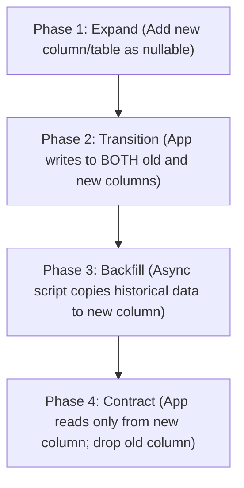

# Database Engineering Guide

> **Relational SQL, NoSQL, Migrations, Indexing, Connection Pooling & Query Performance**

This module provides engineering standards for architecting schemas, writing efficient queries, managing migrations, and securing data stores across PostgreSQL, MySQL, SQLite, MongoDB, and Redis.

---

## 1. Engine Selection Matrix

| Engine | Storage Model | Best For | Consistency Model | Critical Considerations |
|---|---|---|---|---|
| **PostgreSQL** | Relational / ACID / JSONB | Primary OLTP database, complex joins, financial data | Strong ACID | Default choice for web backends; excellent JSONB and indexing support. |
| **MySQL / MariaDB** | Relational / InnoDB | High-throughput web applications, read-heavy workloads | Strong ACID | Strict SQL mode recommended; ensure utf8mb4 encoding. |
| **SQLite** | Embedded Serverless File | Mobile apps, CLI tools, local desktop (Tauri/Electron), edge | Serialized / WAL mode | Enable WAL (Write-Ahead Logging) mode for concurrent readers. |
| **MongoDB** | Document / BSON | Unstructured catalogs, polymorphic content models | Configurable (Replica Sets) | Avoid deep document nesting (> 3 levels); define compound indexes. |
| **Redis** | In-Memory Key-Value | Caching, session store, rate limiting, pub/sub queues | Eventual / In-Memory persistence | Configure eviction policies (`allkeys-lru`); set TTL on all transient keys. |

---

## 2. Zero-Downtime Migration Patterns (Expand & Contract)

When modifying database schemas in production, **never execute breaking DDL in a single step**. Follow the Expand and Contract pattern across three deploy stages:



### PostgreSQL Safe DDL Rules
- **Adding Columns**: `ALTER TABLE users ADD COLUMN phone VARCHAR(20);` is instant in modern Postgres. Avoid adding non-null columns without defaults.
- **Concurrent Indexing**: Never run `CREATE INDEX` on production tables without `CONCURRENTLY`. A standard `CREATE INDEX` locks the table for writes until complete.
  ```sql
  -- Safe production index creation
  CREATE INDEX CONCURRENTLY idx_orders_customer_created
  ON orders (customer_id, created_at DESC);
  ```

---

## 3. Query Optimization & Eliminating N+1 Scans

### The N+1 Problem
Occurs when an ORM queries a parent record and then executes N subsequent queries for each child record in a loop:

```text
-- DANGEROUS: 1 query for posts + 100 queries for authors
SELECT * FROM posts LIMIT 100;
SELECT * FROM authors WHERE id = 1;
SELECT * FROM authors WHERE id = 2;
...
```

### The Solution: Eager Loading or Batch Fetching
```sql
-- OPTIMAL: Single JOIN or 2 batched queries
SELECT p.*, a.name, a.email
FROM posts p
INNER JOIN authors a ON p.author_id = a.id
ORDER BY p.created_at DESC
LIMIT 100;
```
In GraphQL or Node.js services, use `DataLoader` to memoize and batch identifier lookups into a single `WHERE id IN (...)` query.

---

## 4. Connection Pooling & Resource Sizing

1. **Avoid Connection Starvation**: Databases have a hard limit on concurrent connections (e.g., PostgreSQL `max_connections = 100`). Each connection consumes 5-10MB of RAM.
2. **Connection Sizing Formula**:
   $$\text{Pool Size} = (2 \times \text{CPU cores}) + \text{Effective Spindle Count}$$
3. **Serverless Architectures**: If deploying on serverless runtimes (AWS Lambda, Vercel Functions), use a connection pooling proxy (PgBouncer, Prisma Accelerate, Supabase Pooler) to prevent opening thousands of ephemeral direct connections.

---

## 5. Security & Parameterized Queries

> [!CAUTION]
> **Zero Tolerance for Dynamic SQL String Concatenation**:
> Never interpolate raw user input into SQL queries. Always use parameterized queries or trusted ORM interfaces:
> ```typescript
> // VULNERABLE TO SQL INJECTION:
> db.query(`SELECT * FROM users WHERE email = '${email}'`);
>
> // SAFE PARAMETERIZED QUERY:
> db.query('SELECT * FROM users WHERE email = $1', [email]);
> ```
