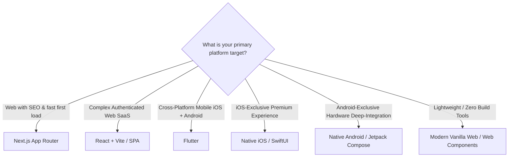

# UI Framework Selection Matrix

> Objective criteria for selecting the appropriate UI technology stack based on platform targets, performance needs, and product constraints.

---

## 1. Purpose

Choosing the wrong UI framework leads to expensive rewrites, poor user experience, performance bottlenecks, and developer friction. 

This guide provides an objective decision matrix to evaluate UI frameworks for new projects.

---

## 2. Comparative Framework Matrix

| Framework | Primary Target | Strengths | Trade-offs | Ideal Use Case |
|---|---|---|---|---|
| **Next.js** | Web (Desktop & Mobile) | Server-Side Rendering (SSR), perfect SEO, automatic image optimization, route-level code splitting | Node.js server runtime required for dynamic SSR; heavier mental model than pure SPA | Content-heavy web apps, e-commerce, SaaS landing + app, SEO-critical portals |
| **React (SPA / Vite)** | Web, Desktop (Electron/Tauri) | Huge ecosystem, flexible tooling, instant HMR, ubiquitous component libraries | Zero native SEO without SSR; initial JS bundle download cost | Internal dashboards, authenticated SaaS portals, offline web applications |
| **Flutter** | iOS, Android, Desktop, Web | Single codebase with 100% pixel-perfect control, 60/120fps Skia/Impeller engine, rich widget library | Heavier binary size; non-DOM web rendering limits text selection & SEO | Cross-platform consumer mobile apps, brand-driven high-fidelity custom UI |
| **Native Android (Compose)** | Android, Wear OS, Auto | Deep OS integration, instant access to newest Android APIs, optimal memory/battery efficiency | Android only; requires Kotlin expertise | Android-first applications, hardware-intensive apps (Bluetooth, camera, sensors) |
| **Native iOS (SwiftUI)** | iOS, iPadOS, macOS, watchOS, visionOS | Perfect Apple platform feel, native gestures, highest battery efficiency, SF Symbols integration | Apple ecosystem only; iOS version fragmentation | Apple ecosystem apps, premium consumer iOS apps, hardware/Apple Silicon features |
| **Modern General Web** | Standard Web Browsers | Zero dependencies, instant loading, maximum longevity, standard Web Components & CSS | Requires manual architecture for complex enterprise state management | Lightweight tools, documentation sites, embedded widgets, landing pages |

---

## 3. Decision Tree

---

## 4. Selection Heuristics

1. **If SEO & First Page Load Matter Above All**: Choose **Next.js**. Client-side SPAs or Flutter Web should not be chosen for public search-indexed content.
2. **If You Need 1 Codebase for iOS & Android with Custom Branding**: Choose **Flutter**. Its custom 2D rendering engine ensures complete visual consistency across devices.
3. **If You Need Deep Hardware Integration**: Choose **Native Android (Kotlin/Compose)** or **Native iOS (Swift/SwiftUI)** for battery efficiency, background processing, and instant access to OS beta features.
4. **If You Have an Existing Team**: Prioritize team fluency over marginal architectural hype. A clean React codebase built by an experienced team outperforms a messy Flutter codebase built by beginners, and vice versa.

---

## 5. Framework Guide Index

- [Flutter Guide](flutter.md)
- [React Guide](react.md)
- [Next.js Guide](nextjs.md)
- [Native Android Guide](native-android.md)
- [Native iOS Guide](native-ios.md)
- [General Web Guide](web.md)
