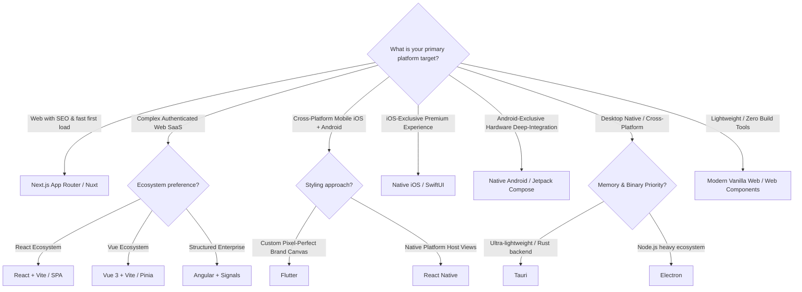

# UI Framework Selection Matrix

> Objective criteria for selecting the appropriate UI technology stack based on platform targets, performance needs, team capabilities, and product constraints.

---

## 1. Purpose

Choosing the wrong UI framework leads to expensive rewrites, poor user experience, performance bottlenecks, and developer friction. 

This guide provides an objective decision matrix to evaluate UI frameworks for new software projects.

---

## 2. Comparative Framework Matrix

| Framework | Primary Target | Strengths | Trade-offs | Ideal Use Case |
|---|---|---|---|---|
| **Next.js** | Web (Desktop & Mobile) | Server-Side Rendering (SSR), perfect SEO, automatic image/font optimization, route streaming | Node.js runtime required for dynamic SSR; heavier mental model | Content-heavy web apps, e-commerce, SaaS landing + app, SEO-critical portals |
| **React (SPA / Vite)** | Web, Desktop | Huge ecosystem, flexible tooling, instant HMR, ubiquitous component libraries | Zero native SEO without SSR; initial JS bundle download cost | Internal dashboards, authenticated SaaS portals, offline web applications |
| **Vue.js / Nuxt** | Web SPAs, SSR | Gentle learning curve, elegant Single File Components, fine-grained reactivity, Pinia | Smaller enterprise ecosystem than React | Modern web applications, rapid prototyping, content sites via Nuxt |
| **Angular** | Enterprise Web | Complete batteries-included framework, strict TypeScript, Signals, robust CLI, built-in forms/router | Steeper initial learning curve; heavier structure | Large enterprise portals, complex multi-team web applications |
| **Flutter** | iOS, Android, Desktop, Web | Single codebase with 100% pixel-perfect control, 60/120fps Impeller engine, rich widget library | Heavier initial binary size; non-DOM web rendering | Cross-platform consumer mobile apps, brand-driven high-fidelity custom UI |
| **React Native** | iOS & Android Mobile | Direct mapping to native platform views via Fabric, code sharing with React web teams | Bridge/Native module versioning; OS-specific quirks | Mobile apps built by teams with strong existing React / JS expertise |
| **Native Android** | Android OS, Wear, Auto | Deep OS integration, instant access to newest Android APIs, optimal memory/battery efficiency | Android only; requires Kotlin expertise | Android-first applications, hardware-intensive apps (Bluetooth, camera, sensors) |
| **Native iOS** | iOS, iPadOS, macOS, watchOS | Perfect Apple platform feel, native gestures, highest battery efficiency, SF Symbols integration | Apple ecosystem only; iOS version fragmentation | Apple ecosystem apps, premium consumer iOS apps, hardware/Apple Silicon features |
| **Modern General Web** | Standard Web Browsers | Zero dependencies, instant loading, maximum longevity, standard Web Components & CSS | Requires manual architecture for complex enterprise state management | Lightweight tools, documentation sites, embedded widgets, landing pages |
| **Desktop (Tauri/Electron)** | macOS, Windows, Linux | Full desktop OS integration, multi-windowing, file system access, offline operation | Multi-platform build tooling; Electron memory footprint | Professional desktop tools, offline utilities, developer workstations |

---

## 3. Decision Tree

---

## 4. Selection Heuristics

1. **If SEO & First Page Load Matter Above All**: Choose **Next.js** or **Nuxt**. Client-side SPAs or Flutter Web should not be chosen for public search-indexed content.
2. **If You Need 1 Codebase for iOS & Android with Custom Branding**: Choose **Flutter**. Its custom 2D rendering engine ensures complete visual consistency across devices.
3. **If You Need 1 Codebase for iOS & Android with Native Host Controls**: Choose **React Native**.
4. **If You Need Deep Hardware Integration**: Choose **Native Android (Kotlin/Compose)** or **Native iOS (Swift/SwiftUI)** for battery efficiency, background processing, and instant access to OS beta features.
5. **If You Need Enterprise-Scale Web with High Governance**: Choose **Angular**.
6. **If You Have an Existing Team**: Prioritize team fluency over marginal architectural hype. A clean React codebase built by an experienced team outperforms a messy Flutter codebase built by beginners, and vice versa.

---

## 5. Framework Guide Index

- [Framework Isolation Architecture](README.md)
- [Flutter Guide](flutter.md)
- [React Guide](react.md)
- [Next.js Guide](nextjs.md)
- [Vue.js Guide](vue.md)
- [Angular Guide](angular.md)
- [React Native Guide](react-native.md)
- [Native Android Guide](native-android.md)
- [Native iOS Guide](native-ios.md)
- [General Web Guide](web.md)
- [Desktop Development Guide](desktop.md)
- [Backend Development Guide](backend.md)
- [API Development Guide](api.md)
- [Database Engineering Guide](database.md)
