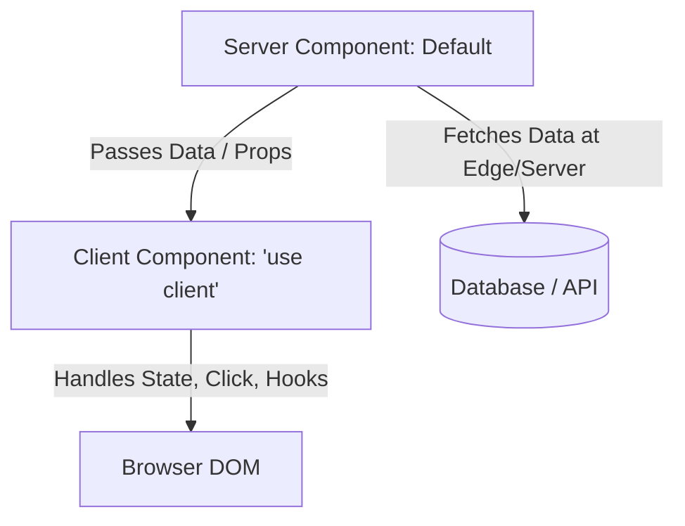

# Next.js UI Engineering Guide

> Practical engineering guide for building production Next.js applications using App Router, React Server Components (RSC), Streaming, and modern Web Vitals optimization.

---

## 1. Recommended Project Structure (App Router)

Follow an organized App Router layout with clear separation between routes and feature logic:

```text
src/
├── app/                        # App Router routes & layouts
│   ├── layout.tsx              # Root HTML layout, font setup, theme provider
│   ├── page.tsx                # Home / landing page
│   ├── (auth)/                 # Route group for authentication
│   │   ├── login/page.tsx
│   │   └── register/page.tsx
│   ├── dashboard/
│   │   ├── layout.tsx          # Dashboard sidebar & header shell
│   │   ├── page.tsx
│   │   └── loading.tsx         # Streaming skeleton fallback
│   ├── api/                    # Route handlers
│   └── error.tsx               # Root error boundary
├── components/                 # Global UI primitives (design system)
│   ├── ui/                     # Button, Input, Modal, Dropdown (Shadcn/Radix)
│   └── feedback/               # Skeletons, ErrorBoundary
├── features/                   # Domain features
│   ├── billing/
│   │   ├── components/
│   │   ├── actions/            # Server actions
│   │   └── types.ts
│   └── analytics/
└── lib/                        # Server & client utilities (db, utils)
```

---

## 2. Server Components (RSC) vs. Client Components

Master the mental boundary between Server and Client components:



### Server Components (Default)
- **Use For**: Data fetching directly from databases/microservices, accessing server-only secrets, rendering heavy markdown/static content.
- **Rules**: Zero client JavaScript bundle cost. Cannot use hooks (`useState`, `useEffect`) or browser event listeners (`onClick`).

### Client Components (`'use client'`)
- **Use For**: Interactive buttons, form inputs, modal dialogs, animations, browser APIs (local storage, window resize).
- **Rule**: Push `'use client'` as far down the component tree as possible (leaf components) to keep parent layouts server-rendered.

---

## 3. Streaming & Loading States

- Use `loading.tsx` files inside route directories for automatic React `Suspense` streaming.
- While the server component fetches data, Next.js streams the skeleton fallback immediately, delivering an ultra-fast First Contentful Paint (FCP).
- Use granular `<Suspense fallback={<CardSkeleton />}>` around individual slow server widgets to avoid blocking the entire page.

---

## 4. Image & Font Optimization

1. **`next/image`**:
   - Always use `next/image` instead of raw `` tags.
   - Automatically optimizes images to WebP/AVIF and resizes per device.
   - For above-the-fold hero images, add `priority={true}` to improve Largest Contentful Paint (LCP).
   - For dynamic images, always provide explicit `width` and `height`, or use `fill` with a positioned parent container.
2. **`next/font`**:
   - Load Google or local fonts using `next/font` (e.g. `Inter({ subsets: ['latin'] })`).
   - Automatically self-hosts font files with zero Cumulative Layout Shift (CLS) and zero external network requests to Google servers.

---

## 5. Performance & Web Vitals

- **Server Actions**: Use Server Actions (`'use server'`) for lightweight mutations rather than authoring custom REST API routes for simple forms.
- **Dynamic Imports**: Use `next/dynamic` for heavy client-side components that are not needed on initial page load (e.g. rich text editors, map visualizers):
  ```tsx
  const RichEditor = dynamic(() => import('@/components/RichEditor'), {
    ssr: false,
    loading: () => <EditorSkeleton />,
  });
  ```

---

## 6. Testing

- Test Server Actions and utility functions with Vitest/Jest.
- Test Client Components using React Testing Library.
- Test end-to-end user flows and SSR behavior using Playwright.

---

## 7. Common Mistakes to Avoid

1. **Marking the Entire Layout as `'use client'`**: Putting `'use client'` at the top of `layout.tsx` or `page.tsx`, converting the entire subtree into client-side rendering and losing all SSR/SEO benefits.
2. **Waterfalls in Server Components**: Sequential `await` calls that block rendering:
   ```typescript
   // Anti-Pattern: Waterfall
   const user = await getUser();
   const posts = await getPosts();
   
   // Best Practice: Parallel fetching
   const [user, posts] = await Promise.all([getUser(), getPosts()]);
   ```
3. **Missing `error.tsx` Client Directive**: Forgetting that Next.js route error boundaries (`error.tsx`) must always be Client Components (`'use client'`).

---

## 8. Related Documentation

- Framework Selection: [framework-selection.md](framework-selection.md)
- React Guide: [react.md](react.md)
- Web Guide: [web.md](web.md)
- Master Instructions: [../AGENTS.md](../AGENTS.md)
